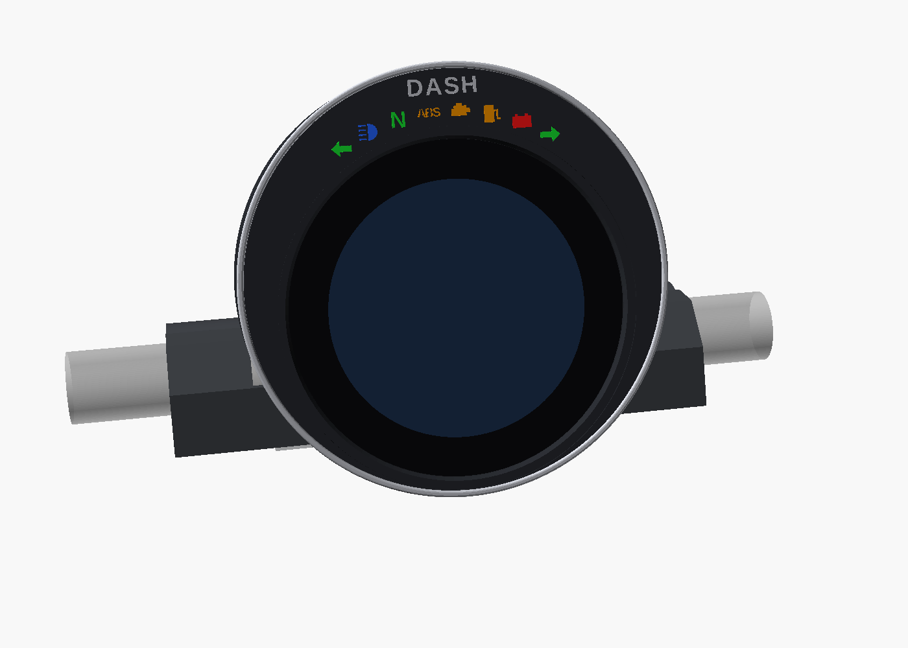
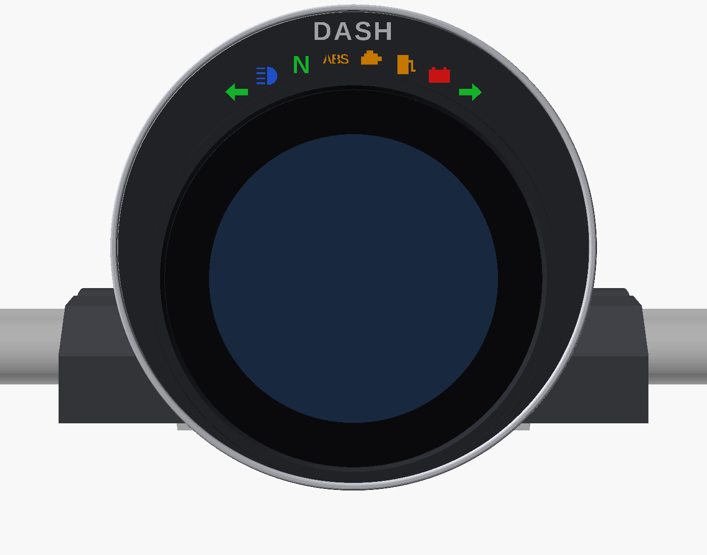
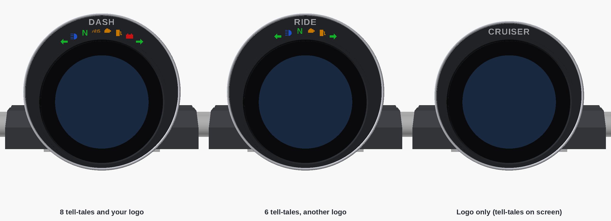

# Handlebar Dash (v1): a round digital dash that replaces the stock instruments

**Status: phase 1 ready to build; the display head is modelled (v1).** Phase 1 (a CAN logger and measurements on the bike) is in [`PHASE1_LOGGER.md`](PHASE1_LOGGER.md); its firmware compiles. The display head's CAD is [`handlebar_dash.scad`](handlebar_dash.scad), its STLs in [`parts/`](parts/) (checked in CAD, not printed yet). The interface box comes next. This file is the design brief: what we know about the bike, the plan, the display head, and the open questions.

A round colour display on its own handlebar clamp that **replaces the stock instrument cluster**. It reads the bike's own signals (speed, fuel, gear, indicators, warning lights) and adds its own sensors: GPS (speed, trip, clock), battery voltage, air temperature, and lean angle and g-force.

- **Reference bike:** a 2021-on single-cylinder 350 on the "J" platform, harness **J1D3** (the Meteor 350). Every bike-specific value (handlebar size, clamp position, harness adapter, signal map, fuel and gear sensor calibration) will be a setting, so the other bikes on the same platform can be added with the least work (see [Other bikes](#other-bikes)).
- **Owner's choices (2026-11-23):** replace the stock instruments; a large round display; its own handlebar clamp; show GPS speed and trip, clock, battery voltage, air temperature, lean angle and g-force, and the bike's own signals (gear, fuel, indicators); read the bike's documentation.
- **Then:** the **2.8" round display** ("bigger is better"); an **OBD+ port and expansion slots** so it can grow; **the Meteor 350 first** (all its variants), other bikes later.

## What we know about the bike

**Source:** Royal Enfield's own wiring schematic, *"J1D3 Meteor overall schematics (Applicable for Euro V regulations)"*, edition 22-11-2024. The owner's manual links it with a QR code on its wiring-diagram page (p. 121). The schematic and the manual are kept locally in `reference/`, which is never published (they are Royal Enfield's documents). The table below states the facts from them in our own words. Check them against your bike: markets and model years differ.

### The stock instrument cluster's connector (18 pins)

| Pin | Signal | Wire | Comes from / goes to |
|---|---|---|---|
| 1 | Ignition (switched +12 V) | WH | ignition switch |
| 2 | Fuel level sensor | LG | fuel pump module (float sender) |
| 3 | CAN L | WH/BU | CAN bus |
| 4 | CAN H | WH | CAN bus |
| 5 | Ground | BK | |
| 6 | Left indicator (lamp signal) | WH/BK | flasher / indicator switch |
| 7 | not used | | |
| 8 | Battery (+12 V, always on) | RD | |
| 9 | High beam (lamp signal) | YE/BU | headlamp switch |
| 10 | not used | | |
| 11 | Engine warning light (EMS MIL) | BU/YE | engine ECU, pin 15 |
| 12 | Right indicator (lamp signal) | WH/GN | flasher / indicator switch |
| 13 | INFO button | GY | left switch module |
| 14 | ABS warning light (ABS MIL) | GN/YE | ABS unit, pin 7 |
| 15 | Sensor supply +5 V (out) | YE | gear position sensor |
| 16 | Gear position signal (in) | BR/BK | gear position sensor |
| 17 | not used | | |
| 18 | Sensor ground | BK/YE | gear position sensor |

Fuse **F4, 10 A** ("signalling") feeds the cluster, the indicators, the wheel speed sensors and the stop lamp.

### The CAN bus

- On the bus: the **engine ECU** (pins 12 CAN H, 25 CAN L), the **ABS unit** (pins 3 CAN H, 4 CAN L), the **instrument cluster**, and two service sockets: **"OBD-2"** (pin 2 CAN H, pin 5 CAN L, pin 3 ground) and **"Diagnostic"** (pin 2 CAN H, pin 5 CAN L, pin 4 ground, pin 1 red, likely +12 V).
- The **wheel speed sensors** (front and rear) are wired only to the ABS unit. So **road speed reaches the cluster as a CAN message**; there is no speed wire.
- The clutch switch and the side-stand switch go to the engine ECU, not to the cluster.
- The Tripper navigation pod ("display device") only takes power (battery, switched +12 V, ground): its data comes from the phone over Bluetooth.
- **Not published:** which CAN messages carry speed, engine speed, temperature and the rest. They have to be logged and worked out on the bike (phase 1).

### What the stock cluster shows (owner's manual, pp. 31-37)

Speed (needle), odometer, trips A, B and F (distance since low fuel), 12-hour clock, fuel gauge (7 bars), service reminder, ECO indicator, gear position, and warning lights: ABS, low battery, low fuel, left and right indicators, high beam, engine malfunction, neutral. The INFO button cycles the trips and sets the clock.

**Note:** bikes built from late 2024 were reported to leave the factory without the gear position sensor (a parts shortage), with only the neutral light working. The dash must work with or without it.

## What this means for the design

1. **Speed needs the CAN bus.** Until the messages are worked out, the dash can show **GPS speed**. After phase 1 it shows the bike's own wheel speed, and probably engine speed, engine temperature and neutral too.
2. **Unplugging the stock cluster may upset the bus.** The cluster may carry one of the bus's two 120 Ω terminating resistors, and the ECU or ABS unit may report it missing. Phase 1 checks both. The dash will have a switchable 120 Ω terminator, and will only listen to the bus (it never sends) unless a missing-cluster fault forces otherwise.
3. **The dash takes over the cluster's sensor jobs:** a 5 V supply and an input for the gear position sensor, and the bias current for the fuel level sender. Both need calibrating on the bike.
4. **The lamp signals are 12 V wires** (indicators, high beam, the two warning lights): each input needs a divider and clamping before it reaches the microcontroller.
5. **The odometer is a legal requirement.** The dash keeps its own odometer, starting from the stock cluster's reading, saved so it survives power cuts.
6. **Lean angle needs a sensor fixed to the frame,** not on the handlebar, which turns with the steering. So the motion sensor goes in the interface box, not in the display.

## Plan

**Layout: two boxes, three buses.**
- **Interface box**, where the stock cluster's connector is (behind the headlamp). It plugs into the bike's 18-pin cluster connector through an adapter harness, so no wires are cut, and it holds:
  - the CAN transceiver;
  - the gear sensor's 5 V supply and the fuel sender bias;
  - the 12 V inputs, with protection;
  - the motion sensor;
  - an automotive 12 V to 5 V supply.
  
  It sends ready-made readings to the display.
- **Display head** on the handlebar clamp: the **Waveshare ESP32-S3 2.8" round touch display** (480 × 480, ST7701 panel, GT911 touch; about ₹3,700–4,700 in India), in a round gauge with 8 LED tell-tales lit in its own face, with GPS and a light sensor for automatic brightness. It sits on the handlebar, Harley-style, in a cradle. It connects to the interface box by one thin 4-wire cable (+5 V from the box's supply, ground, dash bus H and L).
- **Why two boxes:** round ESP32-S3 displays use most of their pins for the screen, leaving too few for the bike's signals. Lean angle also needs the motion sensor on the frame.

**The buses:**
- **The bike's bus (listen only).** The interface box reads the bike's CAN bus but never transmits on it, so nothing the dash does can upset the ECU or the ABS.
- **The dash bus (ours).** A second, private CAN bus (500 kbit/s) links the interface box, the display head and the expansion slots. Anything added later talks only to this bus, never to the bike's. The interface box's microcontroller is an **ESP32-C6**, which has two CAN controllers: one for each bus, with no extra chip.
- **The OBD+ port.** A standard **16-pin OBD-II socket** on the interface box: the bike's CAN bus (pins 6 and 14), ground (4 and 5) and fused +12 V (16), as in cars. Any scan tool or ELM327 dongle plugs straight in, and the bike's own 6-pin service socket stays free.

**Expansion slots (3).** Sealed 6-pin sockets on the interface box, all the same:

| Pin | Signal |
|---|---|
| 1 | +12 V, switched with the ignition, fused at 1 A per slot (self-resetting fuse) |
| 2 | +5 V, 500 mA |
| 3 | Ground |
| 4 | Dash bus CAN H |
| 5 | Dash bus CAN L |
| 6 | One spare input or output, protected (for a simple switch or sensor) |

A module plugged in gets power and joins the dash bus. Examples for later: a tyre-pressure receiver, a heated-grip controller, an auxiliary light switch, a second display, a data logger. The dash bus's message list will be published with the firmware, so others can make modules.

**Phases:**
1. **Logger and measurements (needs the bike), see [`PHASE1_LOGGER.md`](PHASE1_LOGGER.md).** A small ESP32 and CAN transceiver plugged into the OBD-2 socket, listening only, logging to a microSD card. Ride, rev, change gear, use the indicators and so on, then work out the messages. Also measure:
   - the bus's termination, with the cluster in and out;
   - the fuel sender's resistance from full to empty;
   - the gear sensor's voltage in each gear;
   - whether the bike reports anything with the cluster unplugged.
   
   The logger's parts are reused in the interface box.
2. **Electronics on the bench:** interface box and display working together, with a recorded log played back as if it were the bike.
3. **Enclosures (OpenSCAD):** the display head, a round gauge with its tell-tales in the face, and its cradle (done, v1), and the interface box. Like the other projects: parametric, printable, with asserts and fit checks.
4. **Firmware:** the screens (speed, gear, fuel, trips, clock, tell-tales, lean angle), the odometer, brightness, the INFO button.
5. **On the bike,** keeping the stock cluster so it can be refitted (for servicing or inspection).

## The display head (v1 CAD)

`handlebar_dash.scad` (OpenSCAD 2021.01, with asserts); `PART=` picks an export. Modelled around the **Waveshare ESP32-S3 2.8" round display board**, from Waveshare's published outline drawing and its official 3D model (STEP, 2024-12-26):
- the cover glass is 95.86 mm across and 1.26 mm thick;
- the visible screen is 70.13 mm across;
- the board is 9.73 mm deep in all;
- it has four M2 brass standoffs whose ends are 9.71 mm behind the glass, at (±18.0, −25.56) and (±29.5, +15.14) mm from the glass centre.

**The gauge is 117.5 mm across and 39.6 mm deep.** Round the display's own black glass border, the housing adds only a 3 mm rim at the bottom, about 10 mm at the sides, and 18 mm above the screen for the tell-tales and the logo.

**Owner's direction:**
- the handlebar sizes from the Meteor 350;
- the tell-tales "look like they are part of the model too, not an extra addon";
- they can be customised;
- "look are a great deal important ... it will be the main thing";
- then: "reduce icon sizes and try to reduce bezels too, and place the display a bit below so the logo can be placed above it on the display's bezel";
- then: "how about showing them on the sides". The side bezels of the low-set display were only 7.5 mm, too narrow for the icons, so the owner first chose a centred screen with the icons down the sides; then asked for both together ("what about the part where the display sits below and the logo sits on its bezel"): the display was set low again with the icons on the upper sides; then: "the display should be below with the logos stacked above it ... previously it is display bezel + 3d model bezel, instead this could be display bezel and above it, so overall bezel is reduced". So now the housing hugs the glass, and everything sits stacked above the screen.

**The look, and what it's based on:** the best round motorcycle gauges carry their warning lamps **in their own face**, not on a separate panel:
- the Indian Scout's round cluster has its lamps inside the dial;
- the KOSO DL-04 (made for Harley-Davidsons) has six indicators around its round screen;
- the Daytona Velona has its turn, neutral and high-beam lamps in the face under its display;
- Royal Enfield's own Tripper Dash is a round TFT, "suited to the retro appeal" of these bikes.

So the display head is a classic **gauge cup**:
- **The face:** the display sits **low**, with only a 3 mm rim under its glass, flush with the back. Above the screen, **the tell-tales** sit in an arc and **the logo** above them. The face stays round: its centre sits as far above the display (`disp_drop`, about 7.5 mm) as the icons, the logo's box (`logo_w` × `logo_size`) and the GPS antenna need, so bigger icons or a wider logo make the gauge grow, and fewer make it shrink.
- **The body:** the face, then a shoulder back to the cover, deepest at the top. The outer edge is rounded.
- **Details:** a fine accent groove around the screen, and a separate **trim ring** in the face's edge. Print the trim ring in silver (or any contrast colour) for a chrome-bezel look.
- **On the bike:** it sits low on the bar, Harley-style.

**The tell-tales:**
- **What they are:** 8 icons, 5.5 mm tall, in an arc above the screen. Left side, top to bottom: **turn left, high beam, neutral, ABS**. Right side, top to bottom: **turn right, battery, low fuel, engine.**
- **How they're built:**
  - each icon is cut through the face's 0.8 mm front skin and sits in its own light chamber, so no colour bleeds into the next;
  - a 5 mm addressable RGB LED (WS2812B family) at the back of each chamber means one data wire drives all 8, and the firmware sets each icon's colour;
  - **fill each icon flush with translucent white UV resin:** the resin diffuses the light, seals the face, and makes each lamp flush with it;
  - the face prints face down, so the icons come out crisp, and the "A" and "B" in ABS have stencil bridges, so no pieces fall out;
  - the LEDs go in from inside, through windows in the bore's wall, before the display.
- **Customise them** (settings, and in the website's customizer):

| Setting | Choices |
|---|---|
| `logo_text` | the logo above the screen, engraved (`"DASH"` by default; any short word). Fill it with paint |
| `logo_file` | or your own logo as an SVG or DXF file, scaled to `logo_size` (4.5 mm) high |
| `back_logo_text`, `back_logo_file` | a logo engraved on the **back cover**, seen from in front of the bike (none by default). `back_logo_size` [width, height] (0 = in proportion), `back_logo_y`; an assert keeps it between the GX12 socket and the mount (up to about 76 mm wide, 43 mm tall) |
| `icons` | which icons and their order (the first half down the left side, the rest up the right side), from `left`, `right`, `beam`, `neutral`, `abs`, `engine`, `fuel`, `battery`, `oil`. Fewer icons is fine, for example 6 |
| `icon_size` | icon size, 5.5 mm by default (bigger needs a bigger bezel) |
| `logo_w` | the room for the logo's width, 30 mm (the logo is `logo_size` 4.5 mm high; the gauge grows to fit) |
| `telltales` | `"none"` for a face with the logo only (the tell-tales then show on the screen only) |
| `trim` | the trim ring on or off |

**Your own logo files:** put them in `handlebar_dash_v1/private/`, which git ignores, so they're never committed or published on the website. Then set, for example, `logo_file = "private/front.svg"` and `back_logo_file = "private/back.svg"`. Use this for artwork you have the right to use, such as your own design. A maker's badge on your own bike is your own business, but it must never go into the repository. The SVG must be filled shapes in one colour: convert any text and strokes to paths first (in Inkscape: Path → Object to Path, then Path → Stroke to Path). Check the size in OpenSCAD's preview: the front logo should stay within about 40 mm wide.

Asserts refuse settings that don't fit: icons running off the face or into the carrier's key (lower right), and a hollow whose flat roof would be too long a bridge to print (over 16 mm).

The firmware shows the tell-tales on the screen too. The LEDs stay readable when the screen is washed out by the sun.

**How it goes together:**
1. **Shell:** the gauge cup with its face and a thin lip that overlaps the glass's black border by 2.2 mm. The glass sits on a 0.8 mm foam ring (`lip_gasket`). The upper half of the face is hollow: the tell-tales' chambers are above the screen, and the **GPS antenna** (an 18 mm active patch, see COMPONENTS.md) lies at the top behind the logo, beyond the LEDs, facing the sky (plastic doesn't block GPS). Fit the antenna first, through the window in the bore, then the LEDs. The hollow has a flat roof (a 12.7 mm bridge at the top, fine for a print service), so the shoulder outside can be steep and the antenna still fits; the bottom of the face is solid.
2. **Carrier:** the display screws to it with 4 × M2 × 6 into its own standoffs. The GPS module and the CAN board stick to its back with foam tape. It slides in from the back; a key on its side stops it going in rotated.
3. **Back cover:** a plug that presses the carrier forward, squeezing the foam ring by 0.2 mm. Four M3 × 10 pan-head screws go through the shoulder into heat-set inserts in the cover. There are no screws on the front. It also carries:
   - the GX12 4-pin socket, at the top;
   - the mount's fixings.
4. **On the bar (cradle):** two bar clamps either side of the bike's own handlebar clamp, joined by a bridge that bolts to the back cover with 2 × M4 bolts into heat-set inserts.
   - Each clamp is a half of the cradle plus a separate cap (`cradle_cap`), with a 1 mm rubber strip and 2 × M4 bolts and nuts.
   - The head sits behind the bar, its centre 20 mm above it, so its lower part drops below the bar line.
   - **Turning the cradle on the bar sets the tilt.**
5. **On a stalk (option):** the GoPro-style joint, or any GoPro handlebar mount.

**The Meteor 350's handlebar:**
- **The bar is 22.2 mm (7/8").** Every riser maker for the Meteor gives this (Hepco & Becker, Voigt MT, xparts), and it's the default `bar_d`.
- **The clamp:** the Meteor's top clamp is a one-piece die-cast part with the RE logo (the same part as the Interceptor 650's), sitting on two risers.
- **No published clamp size:** so `bike_clamp` is a **generous estimate, 100 × 45 mm with its top 28 mm above the bar**. The cradle's clamps are 135 mm apart (`cradle_span`), and the head's back is 34 mm behind the bar (`head_back`).
- **Measure on your bike:**
  - the clamp's width, depth and height;
  - the straight bar either side of it (the cradle's clamps need about 80 mm of straight bar each side of the centre);
  - then set them.
- **If they don't fit:** asserts refuse sizes where the cradle would hit the clamp.

**Checks done (CAD):**
- every part exports as one watertight body;
- the parts only touch where they should, with 8 icons and with 6;
- the foam ring is squeezed;
- the GPS antenna fits its hollow;
- **on the bar:** the head and the cradle clear the bar, the clamp caps and the bike's clamp (the estimate) **from 0 to 30° of tilt** (at 33° the head's lower edge reaches the estimated clamp; with your bike's real clamp size this limit moves);
- **on a stalk:** the head clears from 0 to 45°;
- **Waveshare's own 3D model** of the board, placed in the housing: every point is inside the 48.23 mm bore (its largest radius is 47.94 mm), in front of the carrier (only the 4 standoff ends touch it), and behind the foam ring.

**Not in v1 yet:**
- the light sensor's window;
- a USB-C access hole (firmware updates can go over Wi-Fi);
- mounts for the GPS and CAN boards (foam tape).

**Provisional:**
- the GoPro joint's dimensions;
- the display board's free pins (the dash bus on GPIO19/20, the LED data on GPIO0): check them against the board's schematic.

## Other bikes

The other 350s on the same platform (the Classic, Hunter, Bullet and Goan Classic 350s) share the engine, ECU and ABS. They probably share the CAN messages, but their cluster connector, wiring and handlebars may differ. For each one:
- get its schematic;
- check the cluster connector;
- log its bus once;
- set its handlebar size.

Only the Meteor's schematic has been read so far; the Hunter 350's owner's manual (dual-channel ABS) has no wiring QR code.

## Legal and warranty

- A working speedometer (and odometer) is required on the road. The dash must always show speed, and must fall back to GPS speed if the bus goes quiet.
- Royal Enfield's manuals say electrical changes not done by an authorised centre can void the warranty. The adapter harness avoids cutting wires, and the stock cluster can be plugged back in.
- The display must be readable in direct sun (the stock LCD also looks dull in overhead sun, as its manual says). Pick a bright IPS panel; the LED tell-tales stay readable even when the screen washes out.

## Parts and cost

**The exact parts, with Amazon.in / Flipkart links and prices: [`COMPONENTS.md`](COMPONENTS.md).** The housings will be modelled around the parts marked "Model fits this" there: the Waveshare 2.8" round display board, the ESP32-C6-DevKitC-1, the SN65HVD230 boards, the NEO-M8N GPS with its 25 mm patch antenna, the GY-521 motion sensor, the Envistia 12 V → 5 V supply, the STAR055 OBD-II socket and the GX12 sockets.

Rough total: about **₹20,000–23,000 buying everything on Amazon.in / Flipkart**, or about **₹13,000–16,000** buying the display and the ESP32-C6 from Indian electronics stores (Robu, Hubtronics, Evelta), which list them for a fraction of the Amazon price. Plus printing, about ₹600–1,500 (est.). All from listings on 2026-11-23, or estimates.

## Open questions

- **Your bike's service socket:** black or red? Some 6-pin to 16-pin adapters are sold for the black (Euro 4) socket only. The schematic shows two 6-pin sockets ("OBD-2" and "Diagnostic"); check which is fitted and its colour before buying the adapter.
- **The display head's free pins:** the 2.8" board's spare header pins must carry the dash bus (2 pins to a CAN transceiver). Check on the board.
- **The connector:** the mating part for the bike's 18-pin cluster plug, so the adapter harness doesn't need any cutting. Find its part number, or take one from a used cluster.
- **Room for the interface box** behind the headlamp, once the stock cluster is gone.
- **Other bikes:** which ones to support first.
