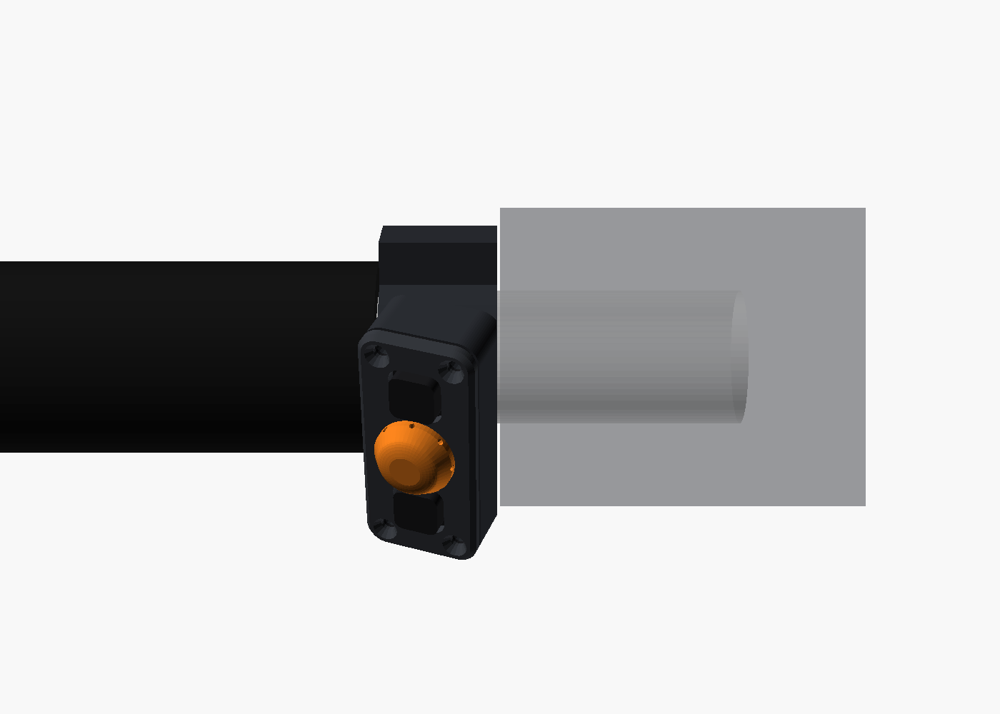
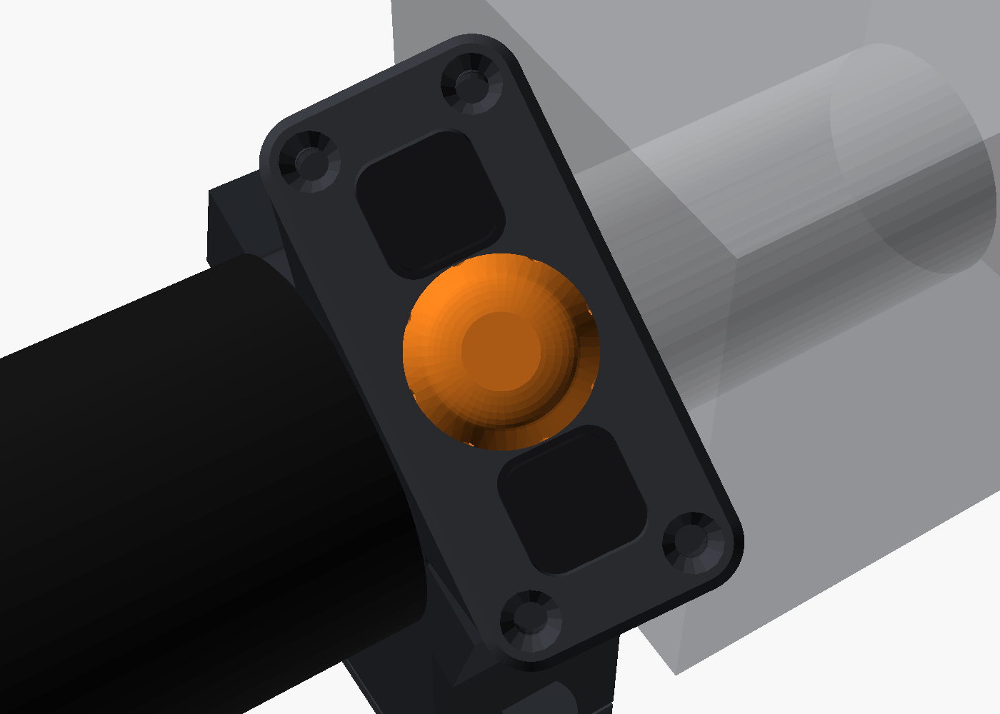

# Handlebar Remote (v1): a slim thumb controller between the grip and the switch cube

**Status: designed and modelled (v1, checked in CAD, not printed or built yet).** The firmware comes next.

One slim collar on the **left handlebar, between the grip and the bike's switch cube**: the controls on top, tilted toward the grip under your thumb, and the electronics in a slim bay underneath. It works **digital displays without letting go of the bar**: the [Handlebar Dash](../handlebar_dash_v1/) over its own wiring, and a **phone** (or anything else that takes a Bluetooth keyboard or remote) over Bluetooth. It's general purpose: the bar size, the gap and the controls' angles are settings, so it fits any bike.

**Owner's choices:**
- 2026-11-24: a 5-way joystick (up, down, left, right, press) and 2 buttons, glove-friendly and used without looking; wired to the dash (one of its expansion slots: power and the dash bus) **and** Bluetooth for a phone.
- 2026-11-25: "between the grips and the control panel, a slim control unit".
- 2026-11-25: "the electronic box is too big, make it more compact and attached to the buttons; make the buttons more ergonomic, tilt it to the grip side". So the separate box became a bay in the collar itself, and the controls tilt 20° toward the grip. (The earlier versions are in git history.)

## What it does

| Control | On the dash | On a phone (Bluetooth) |
|---|---|---|
| Joystick up / down | move through the menu or the screens | arrow keys up / down |
| Joystick left / right | previous / next screen | arrow keys left / right |
| Joystick press | select | Enter |
| Button 1 (upper, toward the front) | back | Escape (back) |
| Button 2 (lower, toward you) | the trip / INFO screen | play / pause (media) |
| Button 2, held 1 s | switch between controlling the dash and the phone | the same |

- **On a phone**, the remote is a standard Bluetooth keyboard with media keys, so it needs no app. Navigation apps that take a keyboard or a "remote" (for example OsmAnd, Locus Map and DMD2) can be driven with the arrows; media keys work with any music app. Google Maps reacts to few keys, so it's mostly music and volume there.
- **On the dash**, the remote sends its keys as messages on the dash bus (below), and the dash's firmware decides what each one does.
- **Without the dash:** it also works alone, as a Bluetooth remote, powered from any 5 V USB socket on the bike.

## How it's built: one collar

**Where it goes:** a **19 mm** collar in a 20 mm gap on the bar (`gap_w`). On most bikes the switch cube sits against the grip: slide it about 20 mm inboard (if it has a locating pin, the bar needs a new 4–5 mm hole for it, or file the pin off).

**On top: the controls.** A low pod on the collar's upper rear side, facing up and back toward your thumb (`pod_a` 125° round the bar) and **tilted 20° toward the grip** (`pod_tilt`), so your thumb reaches it straight from the grip. Its face, 19 × 41 mm, has **the joystick in the middle and a button either side of it round the bar**, so your thumb rolls from one to the next. The pod sits a little toward the grip (its top edge overhangs the grip's end by about 2 mm, well clear above the grip), so that its inside stays within the collar on the switch cube's side.
- **Inside:** a small perfboard (14 × 30 mm) with a 10 mm 5-way switch and 2 low tactile switches, resting on steps at the pod's 4 corners.
- **The keypad (TPU)** lies on the pod's rim under the face plate: it's the seal, its 2 hollow domes are the buttons (a nub under each presses its switch), and it hugs the joystick cap's sleeve. The **face plate** screws down on it with 4 M2 screws, squeezing it 0.2 mm.
- **The joystick cap** (13 mm) pushes onto the switch's stem through the plate and the keypad.

**Underneath: the electronics.** A slim **bay** hangs straight under the bar (`bay_a`), **as wide as the collar** (19 mm), 30 mm front to back (40 at its cap's screw lobes), hanging about 29 mm below the bar. The **ESP32-C3 Super Mini** and the **CAN transceiver** stand on edge side by side, the ESP32's USB-C at the bottom (reachable with the cap off). A **cap** with a TPU gasket closes it from below (2 M2 screws), and the 4-core cable to the dash comes in through the cap (sealed with silicone).

**The collar's two halves** split at an angle so the controls are all in the top half and the bay all in the bottom half; 2 M3 screws join them through ears at the split, with a 1 mm rubber strip inside the ring. **The switches' 8 wires** (thin 30 AWG wire-wrap wire) go down from the pod's floor into a groove inside the ring, round the back of the bar, and up into the bay. Seal the two holes where they pass with a dab of silicone.

## Electronics

| Part | Job |
|---|---|
| **5-way navigation switch**, 10 × 10 mm, about 7 mm tall | the joystick. It's the switch on the common "5-way navigation button module": buy the module and take the switch off (or buy the switch on its own) |
| **2 low tactile switches**, 6 × 6 × 3.5 mm | the 2 buttons |
| **ESP32-C3 Super Mini** (22.5 × 18 mm) | reads the switches; Bluetooth LE (keyboard + media keys); its own CAN controller for the dash bus |
| **SN65HVD230 CAN transceiver module** | the dash bus (remove its 120 Ω resistor: see below) |

**The 8 wires, pod to bay:** UP, DOWN, LEFT, RIGHT, PRESS, BUTTON 1, BUTTON 2 and COMMON (every switch connects its wire to COMMON when pressed).

**In the bay (ESP32-C3 Super Mini):**

| GPIO | To |
|---|---|
| 0, 1, 3, 4, 5 | UP, DOWN, LEFT, RIGHT, PRESS (the ESP32's own pull-ups; COMMON to ground) |
| 6, 7 | BUTTON 1, BUTTON 2 |
| 21 | CAN TX → transceiver D |
| 20 | CAN RX ← transceiver R |
| 5V, GND | from the dash's cable |
| 3V3 | the transceiver's supply |

GPIO 2, 8 and 9 are left free (start-up pins, the board's LED and BOOT button).

**The cable to the dash:**
- **To the dash:** a 4-core cable and a **GX12 6-pin plug** into one of the dash's expansion slots. Slot pin 2 is +5 V, 3 ground, 4 CAN H and 5 CAN L; pins 1 (12 V) and 6 (spare) aren't used.
- **Without the dash:** a USB-A plug into the bike's USB socket for 5 V (Bluetooth only).
- **Termination:** the dash bus already has its two 120 Ω terminators, at the dash's interface box and its display. The remote is a short branch, so **remove the 120 Ω resistor** from its SN65HVD230 module.

## Messages on the dash bus

The remote's messages, so the dash (or anything else on the dash bus) can use them. 500 kbit/s, standard 11-bit IDs:

| ID | Sent | Bytes |
|---|---|---|
| **0x340** keys | on every change, every 100 ms while a key is held, and every second as a heartbeat | 0: the keys held, one bit each (0 up, 1 down, 2 left, 3 right, 4 press, 5 button 1, 6 button 2). 1: the event (0 none, 1 pressed, 2 released, 3 held 1 s, 4 repeat). 2: which key (its bit number). 3: a counter |
| **0x341** status | every second | 0: what it's controlling (0 the dash, 1 the phone). 1: Bluetooth (0 off, 1 waiting to pair, 2 connected) |

## Settings to measure

None of these parts has a published drawing, so the sizes in `handlebar_remote.scad` are placeholders (marked MEASURE):
- **Your bike:** the bar's diameter (`bar_d`, 22.2 mm); the gap you can make between the grip and the switch cube (`gap_w`, 20 mm); the switch cube's size and the grip's diameter (only for the fit check). And, to suit your thumb: `pod_a` (where the controls face round the bar, 125°: up and back) and `pod_tilt` (how far they tilt toward the grip, 20°, up to 30°). Check the bay (straight down, about 29 mm below the bar) clears your clutch lever's travel and cables.
- **The switches:** the 5-way switch's body (10 × 10 × 4 mm) and its stem (7 mm above the board, 3.5 mm across); the tactile switches' height (3.5 mm).
- **The boards in the bay:** the ESP32-C3 Super Mini's thickness with its parts (4.5 mm); the SN65HVD230 module's size (26 × 16 × 6 mm).

The model adapts and refuses what doesn't fit: a gap under 19 mm, tactile switches too tall for the joystick, a stem too short for its cap to grip, boards too thick to stand side by side in the bay, a tilt over 30°.

## Checks done (CAD)

- every part exports as one watertight body;
- the switches fit the pod (the board only touches its steps); the boards fit the bay;
- the joystick's stem grips the cap, the keypad hugs the cap's sleeve and is squeezed by the face plate, the bay's gasket is squeezed by its cap (all deliberate);
- the collar's halves, the face plate, the keypad, the cap and the bay's cap only touch where they should;
- the collar clears the grip and the switch cube, also with no tilt or 30° of tilt, a 19 mm gap, a 32 mm bar, and the controls facing from 95° to 150°.

**Not yet:** printed and tried on a bike; the firmware; the real parts measured.

## Printing

| Part | Material | How |
|---|---|---|
| `collar_top`, `collar_bottom` | ASA (PETG for a first try), 100 % infill round the ring | on their flat switch-cube side (the rings print round) |
| `face_plate` | ASA / PETG | its top down |
| `joy_cap` | ASA / PETG (or TPU for grip) | flat top down |
| `keypad`, `bay_gasket` | TPU 85A–95A | domes down; flat |
| `bay_cap` | ASA / PETG | its outside down |

Parts and where to buy them: [`COMPONENTS.md`](COMPONENTS.md), and the project's page on the website.
