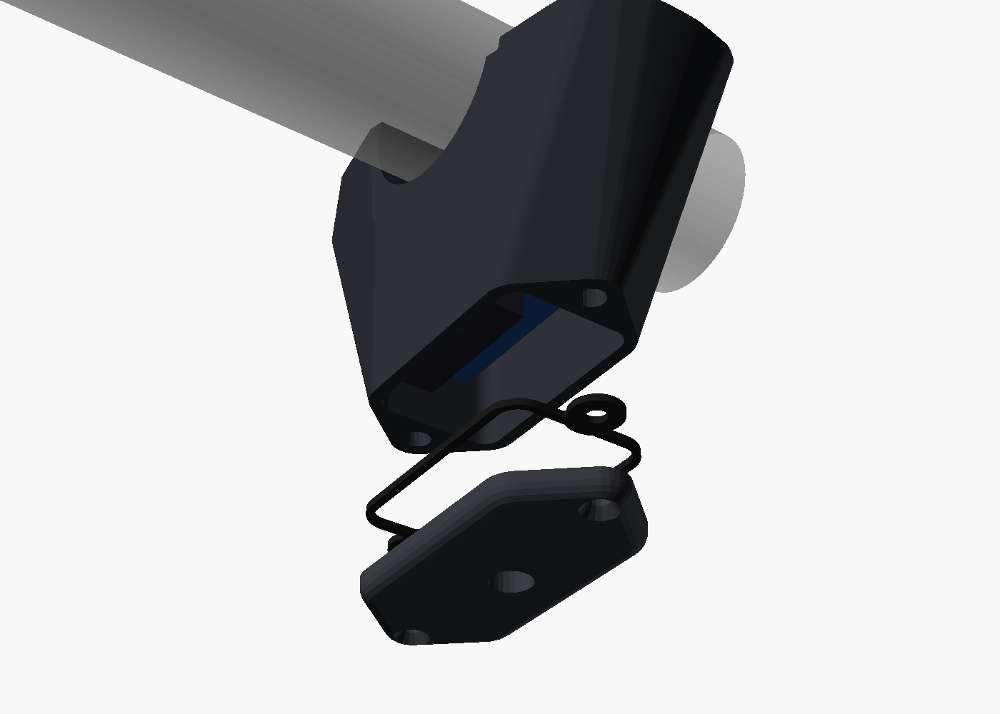

# Handlebar Remote (v1): a slim thumb controller between the grip and the switch cube

**Status: designed and modelled (v1, checked in CAD, not printed or built yet).** The firmware comes next.

One slim collar on the **left handlebar, between the grip and the bike's switch cube**: the controls on top, tilted toward the grip under your thumb, and the electronics in a slim bay underneath. It works **digital displays without letting go of the bar**: the [Handlebar Dash](../handlebar_dash_v1/) over its own wiring, and a **phone** (or anything else that takes a Bluetooth keyboard or remote) over Bluetooth. It's general purpose: the bar size, the gap and the controls' angles are settings, so it fits any bike.

**Owner's choices:**
- 2026-11-24: a 5-way joystick (up, down, left, right, press) and 2 buttons, glove-friendly and used without looking; wired to the dash (one of its expansion slots: power and the dash bus) **and** Bluetooth for a phone.
- 2026-11-25: "between the grips and the control panel, a slim control unit".
- 2026-11-25: "the electronic box is too big, make it more compact and attached to the buttons; make the buttons more ergonomic, tilt it to the grip side". So the separate box became a bay in the collar itself, and the controls tilt 20° toward the grip.
- 2026-11-25: "why is it square, make it an organic shape". So the collar is now one smooth pebble: a single rounded body flowing from the controls on top round the bar into the bay underneath, with no flat-sided boxes or square ears.
- 2026-11-25: "make the button faceplate more rounded and organic rather than a box, and have the door on the back side, on the handle side: it will help it be more airtight". So the face plate and its 4 screws are gone: the controls' whole top is **one smooth domed cover** with the buttons in it, its only seam low down round the pod's sides, sealed by the keypad, and its screws hidden underneath and at the back.
- 2026-11-25: "could we add more buttons", choosing 2 more on top, in line. So there are **4 buttons**, all in one row round the bar with the joystick in the middle: the collar is too narrow (19 mm) for two rows. The pod is longer (66 mm instead of 45). `buttons` = 2 gives the shorter 2-button pod back.
- 2026-11-25: "it still not ergonomic ... the buttons are just like a box, not a control unit", choosing a **sculpted thumb pad**. So the flat face became a **thumb cradle**: curved along your thumb's sweep, every button in its own cup tilted toward your thumb, ridges between the buttons, round inner buttons and pill-shaped outer ones, and the joystick standing up out of the middle. (The earlier versions are in git history.)

## What it does

| Control | On the dash | On a phone (Bluetooth) |
|---|---|---|
| Joystick up / down | move through the menu or the screens | arrow keys up / down |
| Joystick left / right | previous / next screen | arrow keys left / right |
| Joystick press | select | Enter |
| Button 3 (the outer one at the front end) | home (the main screen) | volume up |
| Button 1 (next to the joystick, toward the front) | back | Escape (back) |
| Button 2 (next to the joystick, toward you) | the trip / INFO screen | play / pause (media) |
| Button 4 (the outer one at the end toward you) | day / night brightness | volume down |
| Button 2, held 1 s | switch between controlling the dash and the phone | the same |

The functions are only the firmware's defaults (it isn't written yet), so they can change.

- **On a phone**, the remote is a standard Bluetooth keyboard with media keys, so it needs no app. Navigation apps that take a keyboard or a "remote" (for example OsmAnd, Locus Map and DMD2) can be driven with the arrows; media keys work with any music app. Google Maps reacts to few keys, so it's mostly music and volume there.
- **On the dash**, the remote sends its keys as messages on the dash bus (below), and the dash's firmware decides what each one does.
- **Without the dash:** it also works alone, as a Bluetooth remote, powered from any 5 V USB socket on the bike.

## How it's built: one smooth collar

The whole collar is **one smooth, rounded body** (a "pebble"): the ring's edges are rounded, the body flows from the face down round the bar into the bay, the controls' top is a thumb cradle with well-rounded edges, and the bay's cap is a rounded dish. The halves, the insides and the holes are all cut from it.

**Where it goes:** a **19 mm** collar in a 20 mm gap on the bar (`gap_w`). On most bikes the switch cube sits against the grip: slide it about 20 mm inboard (if it has a locating pin, the bar needs a new 4–5 mm hole for it, or file the pin off).

**On top: the controls.** A low pod on the collar's upper rear side, facing up and back toward your thumb (`pod_a` 125° round the bar) and **tilted 20° toward the grip** (`pod_tilt`), so your thumb reaches it straight from the grip. Its face, 19 × 67 mm, has **the joystick in the middle and 2 buttons either side of it, all in one row round the bar** (`buttons` = 2 gives a 47 mm pod with one button either side). The pod sits a little toward the grip (its top edge overhangs the grip's end by about 2 mm, well clear above the grip), so that its inside stays within the collar on the switch cube's side.
- **The face is a thumb cradle**, shaped for your thumb rather than flat:
  - **curved along the thumb's sweep** (`sweep_r`, 110 mm): it dips in the middle and rises about 4 mm toward the ends, so every button is about the same reach as your thumb swings, and the curve tilts each one toward it;
  - **each button sits in its own shallow cup**, standing 0.7 mm proud of the face round it, and its top follows the curve;
  - **ridges** between the inner and outer buttons, so you can count them with gloves on;
  - **different shapes:** the inner 2 buttons are round, the outer 2 are wider pills;
  - **the joystick stands up out of the middle** (its cap floats 2.4 mm over the cradle's bottom), the easiest control to find. The model checks that the cap, tilted 14° each way, clears the face and the buttons.

  
- **Inside:** a small perfboard (14 × 53 mm; 14 × 32 with 2 buttons) with a 10 mm 5-way switch and 4 tactile switches, resting on steps at the pod's 4 corners. The tactile switches are two heights, because the face curves: **6 × 6 × 7 mm for the inner 2 and 6 × 6 × 8 mm for the outer 2** (the model picks them and prints them).
- **The cover:** the face and the pod's upper sides are **one smooth part**, with no plate and no screws on the face. Its only seam runs low round the pod's sides, at the switch board's level, about 7 mm below the face.
- **The keypad (TPU)** is a liner inside the cover, in one piece:
  - a sheet under the face: its hollow domes stand through the cover as the buttons (each switch's round actuator rises into its dome), and it hugs the joystick cap's sleeve;
  - a skirt down the cover's inside, whose foot holds the switch board down;
  - a flange that is the seam's gasket, squeezed 0.2 mm by the cover.

  So water on the face meets one continuous rubber sheet, and the only joint is low down on the sides.
- **The cover's screws** are out of sight:
  - **at the front, an M2.5 from underneath** (its head hidden in the bottom half's front boss), up through both halves of the collar into an insert in the cover's front end;
  - **at the back end, one small M2.5 countersunk**, sunk in the face's raised end, into an insert in the top half.
- **The joystick cap** (13 mm) pushes onto the switch's stem through the cover and the keypad.

**Underneath: the electronics.** A slim **bay** hangs straight under the bar (`bay_a`), **as wide as the collar** (19 mm), 30 mm front to back (40 at its cap's screw lobes), hanging about 29 mm below the bar. The **ESP32-C3 Super Mini** and the **CAN transceiver** stand on edge side by side, the ESP32's USB-C at the bottom (reachable with the cap off). A **cap** with a TPU gasket closes it from below (2 M2 screws), and the 4-core cable to the dash comes in through the cap (sealed with silicone).

**The collar's two halves** split at an angle so the controls are all in the top half and the bay all in the bottom half, with a 1 mm rubber strip inside the ring. (With the long 4-button pod facing far back, the model turns the split further down behind the bar so the pod's back end stays above it.) Two screws join them, hidden in the body:
- **at the front**, the cover's front screw: it comes up from underneath through both halves;
- **at the back, an M2.5 from inside the pod**: its head is sunk in the pod's floor at its rear end, under the switch board, and it goes down into an insert in the bottom half behind the bay. Behind the bar the split runs between the pod and the bay, so a screw there from outside would cross one of them.

**Screw lengths:** the model picks each length for your settings and prints it when you open the file (at the defaults: front M2.5 × 40 socket cap, back M2.5 × 14 countersunk, inside M2.5 × 12; with 2 buttons the front one is × 35 and the back one × 12).

**Order on the bike:**
1. Both halves round the bar.
2. The inside screw.
3. The switch board.
4. The keypad, then the cover; hold it on with the back screw.
5. The front screw from underneath, which also clamps the collar's front. **The switches' 10 wires** (8 with 2 buttons; thin 30 AWG wire-wrap wire) go down from the pod's floor into a groove inside the ring, round the back of the bar, and up into the bay. Seal the two holes where they pass with a dab of silicone.

## Electronics

| Part | Job |
|---|---|
| **5-way navigation switch**, 10 × 10 mm, about 7 mm tall | the joystick. It's the switch on the common "5-way navigation button module": buy the module and take the switch off (or buy the switch on its own) |
| **4 tactile switches**, 6 × 6 mm: 2 × 7 mm tall (inner), 2 × 8 mm tall (outer) | the 4 buttons (2 with `buttons` = 2, both 7 mm) |
| **ESP32-C3 Super Mini** (22.5 × 18 mm) | reads the switches; Bluetooth LE (keyboard + media keys); its own CAN controller for the dash bus |
| **SN65HVD230 CAN transceiver module** | the dash bus (remove its 120 Ω resistor: see below) |

**The 10 wires, pod to bay:** UP, DOWN, LEFT, RIGHT, PRESS, BUTTON 1 to 4 and COMMON (every switch connects its wire to COMMON when pressed).

**In the bay (ESP32-C3 Super Mini):**

| GPIO | To |
|---|---|
| 0, 1, 3, 4, 5 | UP, DOWN, LEFT, RIGHT, PRESS (the ESP32's own pull-ups; COMMON to ground) |
| 6, 7 | BUTTON 1, BUTTON 2 |
| 10, 9 | BUTTON 3, BUTTON 4 (GPIO 9 is also the board's BOOT button: don't hold button 4 while powering up, or the board starts in programming mode) |
| 21 | CAN TX → transceiver D |
| 20 | CAN RX ← transceiver R |
| 5V, GND | from the dash's cable |
| 3V3 | the transceiver's supply |

GPIO 2 and 8 are left free (a start-up pin and the board's LED).

**The cable to the dash:**
- **To the dash:** a 4-core cable and a **GX12 6-pin plug** into one of the dash's expansion slots. Slot pin 2 is +5 V, 3 ground, 4 CAN H and 5 CAN L; pins 1 (12 V) and 6 (spare) aren't used.
- **Without the dash:** a USB-A plug into the bike's USB socket for 5 V (Bluetooth only).
- **Termination:** the dash bus already has its two 120 Ω terminators, at the dash's interface box and its display. The remote is a short branch, so **remove the 120 Ω resistor** from its SN65HVD230 module.

## Messages on the dash bus

The remote's messages, so the dash (or anything else on the dash bus) can use them. 500 kbit/s, standard 11-bit IDs:

| ID | Sent | Bytes |
|---|---|---|
| **0x340** keys | on every change, every 100 ms while a key is held, and every second as a heartbeat | 0–1: the keys held, one bit each, low byte first (0 up, 1 down, 2 left, 3 right, 4 press, 5 button 1, 6 button 2, 7 button 3, 8 button 4). 2: the event (0 none, 1 pressed, 2 released, 3 held 1 s, 4 repeat). 3: which key (its bit number). 4: a counter |
| **0x341** status | every second | 0: what it's controlling (0 the dash, 1 the phone). 1: Bluetooth (0 off, 1 waiting to pair, 2 connected) |

## Settings to measure

None of these parts has a published drawing, so the sizes in `handlebar_remote.scad` are placeholders (marked MEASURE):
- **Your bike:** the bar's diameter (`bar_d`, 22.2 mm); the gap you can make between the grip and the switch cube (`gap_w`, 20 mm); the switch cube's size and the grip's diameter (only for the fit check). And, to suit your thumb: `buttons` (4 or 2), `pod_a` (where the controls face round the bar, 125°: up and back; up to 135° with 4 buttons) and `pod_tilt` (how far they tilt toward the grip, 20°, up to 30°). Check the bay (straight down, about 29 mm below the bar) clears your clutch lever's travel and cables.
- **The switches:** the 5-way switch's body (10 × 10 × 4 mm), its stem (7 mm above the board, 3.5 mm across) and where it pivots (taken at the body's top); the tactile switches' heights (7 and 8 mm, actuator included: if yours differ, list them in `tact_heights` and the model picks again).
- **The boards in the bay:** the ESP32-C3 Super Mini's thickness with its parts (4.5 mm); the SN65HVD230 module's size (26 × 16 × 6 mm).

The model adapts and refuses what doesn't fit: a gap under 19 mm, tactile switches the wrong height for the domes, a stem too short for its cap to grip, the 4-button pod facing further back than 135°, boards too thick to stand side by side in the bay, a tilt over 30°.

## Checks done (CAD)

- every part exports as one watertight body;
- the switches fit the pod (the board only touches its steps); the boards fit the bay;
- the joystick's cap, tilted 14° each way, clears the cover and the buttons;
- the front screw's head goes in from below without passing the bay;
- the joystick's stem grips the cap, the keypad hugs the cap's sleeve and its flange is squeezed by the cover, the bay's gasket is squeezed by its cap (all deliberate);
- the collar's halves, the cover, the keypad, the cap and the bay's cap only touch where they should; all 3 screws stay inside the body and clear of the pod, the bay, the wires and the bar, also at the settings' extremes below;
- the collar clears the grip and the switch cube, also with no tilt or 30° of tilt, a 19 mm gap, a 32 mm bar, and the controls facing from 95° to 135° (4 buttons) or 150° (2 buttons).

**Not yet:** printed and tried on a bike; the firmware; the real parts measured.

## Printing

| Part | Material | How |
|---|---|---|
| `collar_top`, `collar_bottom` | ASA (PETG for a first try), 100 % infill round the ring | on their flat switch-cube side (the rings print round) |
| `pod_cover` | ASA / PETG | its flat underside down (the face's underside bridges 15 mm) |
| `joy_cap` | ASA / PETG (or TPU for grip) | flat top down |
| `keypad`, `bay_gasket` | TPU 85A–95A | the keypad on its flange (open side down; its top bridges 13 mm); the gasket flat |
| `bay_cap` | ASA / PETG | its outside down |

Parts and where to buy them: [`COMPONENTS.md`](COMPONENTS.md), and the project's page on the website.
