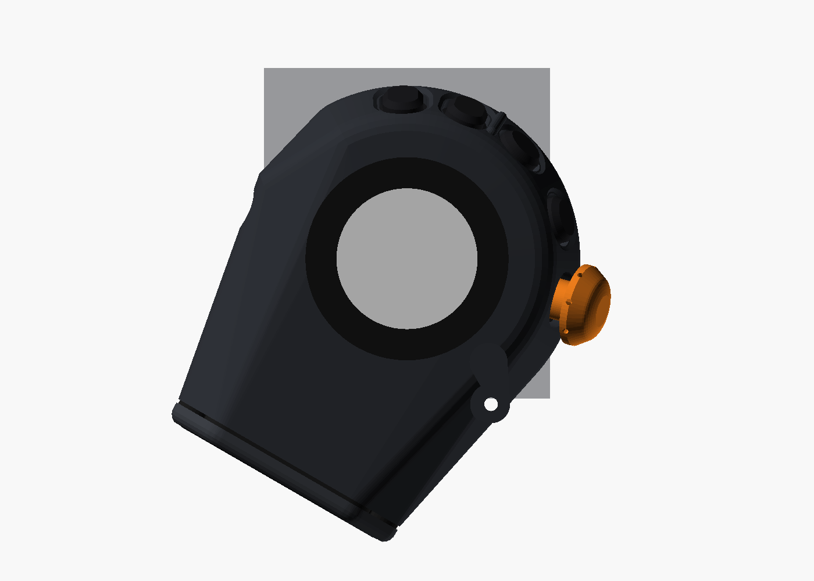

# Handlebar Remote (v1): a slim thumb controller between the grip and the switch cube

**Status: designed and modelled (v1, checked in CAD, not printed or built yet).** The firmware comes next.

One slim collar on the **left handlebar, between the grip and the bike's switch cube**: the controls on a face that curves round the back and the top of the bar (the joystick at the back under your thumb, the buttons above it), tilted toward the grip, and the electronics in a slim bay underneath. **Nothing stands higher than the switch cube**, so it hides nothing of the bike's own instruments. It works **digital displays without letting go of the bar**: the [Handlebar Dash](../handlebar_dash_v1/) over its own wiring, and a **phone** (or anything else that takes a Bluetooth keyboard or remote) over Bluetooth. It's general purpose: the bar size, the gap and the controls' angles are settings, so it fits any bike.

**Owner's choices:**
- 2026-11-24: a 5-way joystick (up, down, left, right, press) and 2 buttons, glove-friendly and used without looking; wired to the dash (one of its expansion slots: power and the dash bus) **and** Bluetooth for a phone.
- 2026-11-25: "between the grips and the control panel, a slim control unit".
- 2026-11-25: "the electronic box is too big, make it more compact and attached to the buttons; make the buttons more ergonomic, tilt it to the grip side". So the separate box became a bay in the collar itself, and the controls tilt 20° toward the grip.
- 2026-11-25: "why is it square, make it an organic shape". So the collar is now one smooth pebble: a single rounded body flowing from the controls on top round the bar into the bay underneath, with no flat-sided boxes or square ears.
- 2026-11-25: "make the button faceplate more rounded and organic rather than a box, and have the door on the back side, on the handle side: it will help it be more airtight". So the face plate and its 4 screws are gone: the controls' whole top is **one smooth domed cover** with the buttons in it, its only seam low down round the pod's sides, sealed by the keypad, and its screws hidden underneath and at the back.
- 2026-11-25: "could we add more buttons", choosing 2 more on top, in line. So there are **4 buttons**, all in one row round the bar with the joystick in the middle: the collar is too narrow (19 mm) for two rows. The pod is longer (66 mm instead of 45). `buttons` = 2 gives the shorter 2-button pod back.
- 2026-11-25: "it still not ergonomic ... the buttons are just like a box, not a control unit", choosing a **sculpted thumb pad**. So the flat face became a **thumb cradle**: curved along your thumb's sweep, every button in its own cup tilted toward your thumb, ridges between the buttons, round inner buttons and pill-shaped outer ones, and the joystick standing up out of the middle. (The earlier versions are in git history.)
- 2026-11-27: "the buttons ... obstruct the bike's instrument cluster: move the joystick below to the last and the buttons on the top, but in a way that it doesn't obstruct the original instrument cluster", choosing **"curve round the bar"**. The straight face's top end stood 42.7 mm above the bar's centre, 13 mm higher than the switch cube's top (30 mm); a straight face can't come lower and still clear the bar. So the face now **curves round the bar**: the joystick at the back under your thumb (a little below the bar's centre, where a horn button sits), then buttons 1 to 4 going up and over the top. Its highest point is **27.7 mm** above the bar's centre, and the model refuses settings that would put anything higher than the switch cube's top (less 0.5 mm). The curved face can't take one flat switch board, so the switches now sit in **2 printed carriers**, and the collar's halves are **hinged at the back** and closed by one screw at the front.

## What it does

| Control | On the dash | On a phone (Bluetooth) |
|---|---|---|
| Joystick up / down | move through the menu or the screens | arrow keys up / down |
| Joystick left / right | previous / next screen | arrow keys left / right |
| Joystick press | select | Enter |
| Button 1 (just above the joystick) | back | Escape (back) |
| Button 2 (the next one up) | the trip / INFO screen | play / pause (media) |
| Button 3 (the next one up, a pill) | day / night brightness | volume down |
| Button 4 (at the top, a pill) | home (the main screen) | volume up |
| Button 2, held 1 s | switch between controlling the dash and the phone | the same |

The functions are only the firmware's defaults (it isn't written yet), so they can change.

- **On a phone**, the remote is a standard Bluetooth keyboard with media keys, so it needs no app. Navigation apps that take a keyboard or a "remote" (for example OsmAnd, Locus Map and DMD2) can be driven with the arrows; media keys work with any music app. Google Maps reacts to few keys, so it's mostly music and volume there.
- **On the dash**, the remote sends its keys as messages on the dash bus (below), and the dash's firmware decides what each one does.
- **Without the dash:** it also works alone, as a Bluetooth remote, powered from any 5 V USB socket on the bike.

## How it's built: one smooth collar

The whole collar is **one smooth, rounded body** (a "pebble"): the ring's edges are rounded, the face is a smooth band curving round the bar with its ends rolled over, the body flows down round the bar into the bay, and the bay's cap is a rounded dish. The halves, the insides and the holes are all cut from it.

**Where it goes:** a **19 mm** collar in a 20 mm gap on the bar (`gap_w`). On most bikes the switch cube sits against the grip: slide it about 20 mm inboard (if it has a locating pin, the bar needs a new 4–5 mm hole for it, or file the pin off).

**The controls: a face curved round the bar.** In plain words: instead of a flat strip standing up off the bar (which had to stick up 43 mm to clear it), the face is a band wrapped round the bar like the switch cube's own rounded back, **25.3 mm from the bar's centre** (`R_f`, the least that leaves room for the switches and their wires), and **tilted 20° toward the grip** (`pod_tilt`) so your thumb meets it square from the grip.
- **The joystick at the back**, under your thumb (`joy_a` 195° round the bar: straight back toward you, 6 mm below the bar's centre, about where a horn button sits). Its cap floats 2.4 mm over the face; the model checks that it clears the face, tilted 14° each way.
- **The buttons above it, up and over the top:** button 1 at 166°, button 2 at 136°, button 3 at 112° and button 4 at 89° (just past straight up), 13 mm, 13 mm and 10.5 mm apart along the face. Buttons 1 and 2 are round, 3 and 4 wider pills; each sits in its own shallow cup and stands 0.7 mm proud, with a ridge between 2 and 3, so you can count them with gloves on. With `buttons` = 2 the face stops after button 2.
- **The height:** the face's highest point is **27.7 mm** above the bar's centre (the switch cube's top is at 30 mm); the model refuses settings that would put anything higher than the cube's top, less 0.5 mm (`top_room`), so it never hides the bike's instruments behind it.

  
- **Inside:** no switch board (a flat board can't follow the curve). The switches sit in **2 printed switch carriers**: one for the joystick and button 1, one for buttons 2 to 4. Each switch stands in its own flat pocket, its legs through the carrier, soldered to the wires in a channel underneath. The tactile switches are all **6 × 6 × 6 mm** (the model picks the height: the shortest whose actuator reaches just up into its dome).
- **The keypad (TPU)** is a liner inside the face, in one piece: a sheet under the face, whose hollow domes stand through it as the buttons (each switch's round actuator reaches into its dome) and which hugs the joystick cap's sleeve, and a skirt round its edge. The carriers press the skirt 0.2 mm up against the face: that is the seal. Water on the face meets one continuous rubber sheet; the only joints are inside the ring, against the bar.
- **How they go in:** the face is part of the collar's top half, hollow inside and open toward the bar. With the top half off the bike, push the keypad in from the bar's side, then the joystick's carrier, then the buttons' carrier. Each carrier slides straight in along its own middle direction; where they meet (between buttons 1 and 2) each is trimmed so the other's way in stays clear, and the model checks both ways in. The self-adhesive rubber strip in the bore then holds them in.
- **The joystick cap** (13 mm) pushes onto the switch's stem through the face and the keypad.

**Underneath: the electronics.** A slim **bay** hangs under the bar, turned 30° forward (`bay_a` 300°) to leave room for the hinge, **as wide as the collar** (19 mm), 30 mm across (40 at its cap's screw lobes), reaching about 41 mm from the bar's centre. The **ESP32-C3 Super Mini** and the **CAN transceiver** stand on edge side by side, the ESP32's USB-C at the bottom (reachable with the cap off). A **cap** with a TPU gasket closes it from below (2 M2 screws), and the 4-core cable to the dash comes in through the cap (sealed with silicone).

**The collar's two halves:** the top half (the ring's top and the face) wraps 205° of the bar; the bottom half (the ring's bottom and the bay) the rest. They are **hinged at the back** (a 2 mm steel pin through 3 knuckles, at 240° round the bar, below the joystick) and **closed at the front by one M2.5 × 8 socket cap screw**, its head in a tunnel from underneath and its tip in an insert in the top half. A 1 mm self-adhesive rubber strip lines the ring.

**Order on the bike:**
1. Solder each switch's legs to its wires under its carrier; run the wires along the carriers' channels.
2. Keypad, the joystick's carrier, the buttons' carrier into the top half (from the bar's side); stick the rubber strip in over the carriers.
3. Pin the halves together at the back.
4. Put the top half over the bar, swing the bottom half up under it, and fit the front screw from underneath.
5. **The switches' 10 wires** (8 with 2 buttons; thin 30 AWG wire-wrap wire) run in a groove in the ring's bore, round the back of the bar under the hinge, and up a slot into the bay. Seal the slot with a dab of silicone.

## Electronics

| Part | Job |
|---|---|
| **5-way navigation switch**, 10 × 10 mm, about 7 mm tall | the joystick. It's the switch on the common "5-way navigation button module": buy the module and take the switch off (or buy the switch on its own) |
| **4 tactile switches**, 6 × 6 × 6 mm | the 4 buttons (2 with `buttons` = 2) |
| **ESP32-C3 Super Mini** (22.5 × 18 mm) | reads the switches; Bluetooth LE (keyboard + media keys); its own CAN controller for the dash bus |
| **SN65HVD230 CAN transceiver module** | the dash bus (remove its 120 Ω resistor: see below) |

**The 10 wires, face to bay:** UP, DOWN, LEFT, RIGHT, PRESS, BUTTON 1 to 4 and COMMON (every switch connects its wire to COMMON when pressed).

**In the bay (ESP32-C3 Super Mini):**

| GPIO | To |
|---|---|
| 0, 1, 3, 4, 5 | UP, DOWN, LEFT, RIGHT, PRESS (the ESP32's own pull-ups; COMMON to ground) |
| 6, 7 | BUTTON 1, BUTTON 2 |
| 10, 9 | BUTTON 3, BUTTON 4 (GPIO 9 is also the board's BOOT button: don't hold button 4 while powering up, or the board starts in programming mode) |
| 21 | CAN TX → transceiver D |
| 20 | CAN RX ← transceiver R |
| 5V, GND | from the dash's cable |
| 3V3 | the transceiver's supply |

GPIO 2 and 8 are left free (a start-up pin and the board's LED).

**The cable to the dash:**
- **To the dash:** a 4-core cable and a **GX12 6-pin plug** into one of the dash's expansion slots. Slot pin 2 is +5 V, 3 ground, 4 CAN H and 5 CAN L; pins 1 (12 V) and 6 (spare) aren't used.
- **Without the dash:** a USB-A plug into the bike's USB socket for 5 V (Bluetooth only).
- **Termination:** the dash bus already has its two 120 Ω terminators, at the dash's interface box and its display. The remote is a short branch, so **remove the 120 Ω resistor** from its SN65HVD230 module.

## Messages on the dash bus

The remote's messages, so the dash (or anything else on the dash bus) can use them. 500 kbit/s, standard 11-bit IDs:

| ID | Sent | Bytes |
|---|---|---|
| **0x340** keys | on every change, every 100 ms while a key is held, and every second as a heartbeat | 0–1: the keys held, one bit each, low byte first (0 up, 1 down, 2 left, 3 right, 4 press, 5 button 1, 6 button 2, 7 button 3, 8 button 4). 2: the event (0 none, 1 pressed, 2 released, 3 held 1 s, 4 repeat). 3: which key (its bit number). 4: a counter |
| **0x341** status | every second | 0: what it's controlling (0 the dash, 1 the phone). 1: Bluetooth (0 off, 1 waiting to pair, 2 connected) |

## Settings to measure

None of these parts has a published drawing, so the sizes in `handlebar_remote.scad` are placeholders (marked MEASURE):
- **Your bike:** the bar's diameter (`bar_d`, 22.2 mm); the gap you can make between the grip and the switch cube (`gap_w`, 20 mm); the switch cube's size and the grip's diameter (the fit check). And, to suit your thumb: `buttons` (4 or 2), `joy_a` (where the joystick sits round the bar, 195°: straight back and a little below the bar's centre; 185 to 200) and `pod_tilt` (how far the face tilts toward the grip, 20°, up to 25°). The switch cube's top above the bar's centre (`cube`, 30 mm) sets the height limit. Check the bay (30° forward of straight down, reaching 41 mm from the bar's centre) clears your clutch lever's travel and cables.
- **The switches:** the 5-way switch's body (10 × 10 × 4 mm), its stem (7 mm above its base, 3.5 mm across; at least 7 mm for the cap to grip it), its legs (`nav_legs`) and where it pivots (taken at the body's top); the tactile switches' heights (6 mm, actuator included: if yours differ, list them in `tact_heights` and the model picks again).
- **The boards in the bay:** the ESP32-C3 Super Mini's thickness with its parts (4.5 mm); the SN65HVD230 module's size (26 × 16 × 6 mm).

The model adapts and refuses what doesn't fit: anything higher than the switch cube's top, a gap under 19 mm, switches that would meet under the face, tactile switches the wrong height for the domes, a stem too short for its cap to grip, the face running into the front screw or the hinge (`joy_a` outside about 185–200), boards too thick to stand side by side in the bay, a tilt over 25°.

## Checks done (CAD)

- every part exports as one watertight body;
- nothing (the face, the keypad, the joystick's cap) stands higher than the switch cube's top less 0.5 mm;
- the switches only touch their carriers; nothing else touches them; the boards fit the bay;
- **the carriers' way in:** each carrier with its switches, moved back along its way in (0.6 to 12 mm), clears the collar's top half, the keypad and (for the buttons' carrier) the joystick's carrier already in place;
- **the hinge opens:** the bottom half, swung open 3° to 70° about the pin, clears the top half;
- the joystick's cap, tilted 14° each way, clears the face and the buttons; its stem grips the cap;
- the keypad hugs the cap's sleeve, the carriers squeeze its skirt against the face, the bay's gasket is squeezed by its cap (all deliberate);
- the halves, the carriers, the keypad, the cap and the bay's cap only touch where they should; the front screw, its insert and the pin stay inside the body and clear of the insides, the bay, the wires and the bar; the screw's head goes in from below without passing the bay;
- the collar clears the grip and the switch cube;
- all of the above also with 2 buttons, `joy_a` 185 and 200, no tilt and 25° of tilt, a 19 mm and a 30 mm gap, and a 25.4 mm (1") bar.

**Not yet:** printed and tried on a bike; the firmware; the real parts measured.

## Printing

| Part | Material | How |
|---|---|---|
| `collar_top`, `collar_bottom` | ASA (PETG for a first try), 100 % infill round the ring | on their flat switch-cube side (the rings print round) |
| `carrier_joy`, `carrier_btn` | ASA / PETG | on their flat switch-cube side |
| `joy_cap` | ASA / PETG (or TPU for grip) | flat top down |
| `keypad`, `bay_gasket` | TPU 85A–95A | the keypad as an arch, its sheet on top (with supports under it); the gasket flat |
| `bay_cap` | ASA / PETG | its outside down |

Parts and where to buy them: [`COMPONENTS.md`](COMPONENTS.md), and the project's page on the website.
