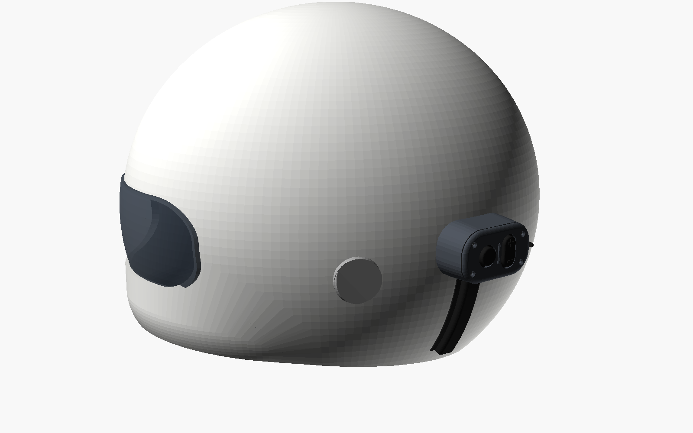
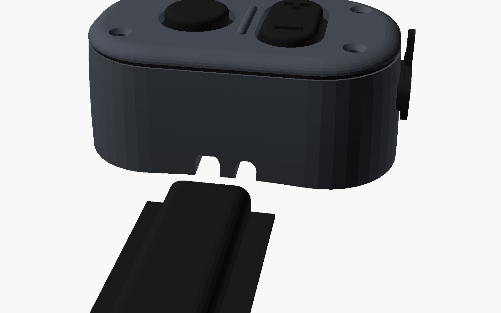
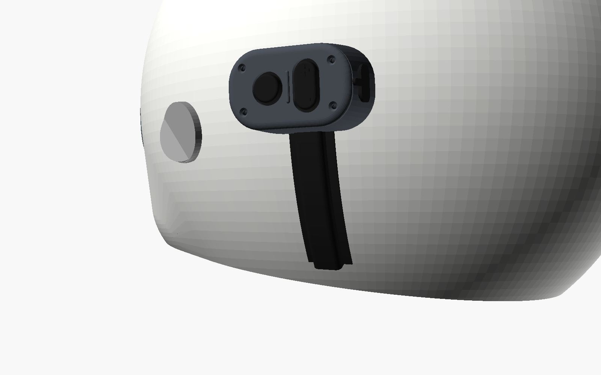

# Helmet Headset (v1): a cheap Bluetooth neckband rebuilt as a helmet headset

**Status: designed and modelled (v1, checked in CAD, not printed or built yet).** By default the pod has room for the board and battery of **most** cheap neckbands (not all: the biggest won't fit), with the board stacked on the battery to keep it small: **about 60 × 37 mm and 22 mm proud of the shell**. A bigger neckband: enter its sizes and the pod grows.

Take a cheap Bluetooth neckband apart and rebuild it inside a motorcycle helmet: music, calls and navigation voice for about ₹1,850–3,250 (est.) instead of a ₹5,000+ helmet communicator. **Everything that makes sound or picks it up is the neckband's own:** its board (Bluetooth, amplifier, charging), its battery, its two speakers and its mic. This project only moves them to the right places in the helmet and adds printed housings; the only things you buy besides the neckband are small hardware bits (tape, screws, 3 switches, foam, wire). It's general purpose: the helmet's curve and the neckband's parts are settings.

**Owner's choices (2026-11-26):**
- "using a cheap neckband and then dismantle this and use this as a helmet headset";
- designed first for a **modular (flip-up) helmet**;
- the neckband picked for the owner (below);
- the board, battery and buttons in a **slim pod stuck to the outside on the left** (no holes in the helmet);
- **the neckband's own speakers and mic** ("that the reason i am using it on the first place"). Bigger 40 mm speakers are only an optional upgrade;
- **wires in from below, no hole in the helmet, in grooves** ("routed not using some hole in the helmet instead from below the helmet so have some grooves to route those wires"): a flexible cable channel from the pod down to the shell's lower edge;
- **a pod that fits most neckbands** ("make the 3d pod fit most of the headsets"), then **a lot smaller** ("its too big ... it fine if some neckbands dont fit ... make it a lot smaller"): room for most, not all, with the board **stacked** on the battery (chosen over a flat, longer pod); and **a dedicated volume rocker** ("have a dedicated volumen button"), separate from the play/call button;
- **the cables out of the pod's bottom long side** ("as the mounting will be on the side with the long side laying horizontally on the helmet i feel the holes groves should open on the long side which means it will exit on the bottom side of the helmet"): the openings face down, and the channel runs straight down to the edge. (Before that they left through the pod's back end, with a turn in the channel.)

## What goes where

| Where | What | Why there |
|---|---|---|
| **Pod, outside, left side, behind the chin bar's pivot** | the neckband's board (Bluetooth, amplifier, charging, its USB-C socket), its battery, a play/call button and a volume rocker | buttons you can find and press with gloves on; charging without taking anything out; the battery isn't against your head |
| **Ear pockets in the liner** | the earbuds' own speakers (10 mm), each in a printed puck | the liner already has these pockets: nothing is cut |
| **On a boom in front of your mouth** | the neckband's own mic, on longer wires | a mic needs to be close to the mouth to beat wind noise |
| **Out of the pod's bottom side, straight down the outside of the shell, then in under its lower edge** | 2 thin cables from the pod to the speakers and the mic, in the grooves of a flexible **cable channel** | no holes in the shell; the openings face down, so water runs away from them |

**Why the mic boom isn't on the chin bar:** on a modular helmet the chin bar flips up. A mic stuck to the chin bar would need its wire to cross the hinge, where it gets pinched and broken. So the boom is held by a thin plate on the **fixed** part of the helmet, low on the left behind the chin bar, and bends forward to sit in front of your mouth. When you flip the chin bar up, it swings over the boom; the boom stays put. (Commercial headsets for modular helmets do the same.)

**Why nothing is drilled:** the shell and the foam liner are what protect your head. Holes in the shell, or foam cut away, weaken them. The pod is stuck on with VHB tape, the speakers sit in the existing ear pockets and the wires go in from below, under the edge trim.

## The neckband: boAt Rockerz 255 Pro+

**Picked: the boAt Rockerz 255 Pro+**, about ₹1,100–1,300 (est.) on Amazon.in and Flipkart (Smartprix showed ₹1,199 in November 2025). It's the commonest neckband in India, so it's easy to buy and there are plenty of repair videos to learn from. boAt's manual lists **Bluetooth 5.0, IPX7, one built-in mic (−42 dB sensitivity)**. Retailers disagree on the battery (Blinkit says 300 mAh). Nobody has published a teardown with sizes.

**Most neckbands fit the default pod.** Its room (estimated from common neckband and LiPo sizes, since no maker publishes the insides; kept as small as possible, so the biggest neckbands don't fit):

| Part | Room in the default pod | Fits, for example |
|---|---|---|
| The main board | up to **38 × 12 mm**, 1 mm thick, parts up to 1.5 mm under and 2.5 mm on top; its USB-C socket on its end | most neckband boards (they're long and narrow, to fit the neckband's end) |
| The battery | up to **35 × 20 × 5 mm** | pouch cells such as 401230, 402030, 502030, 502035 (roughly 100–250 mAh) |

Smaller parts are packed with foam (thin double-sided foam tape under the battery and between it and the board, a scrap of foam in the gaps), so nothing rattles. **If yours is bigger, enter its sizes** (`nb_len`, `nb_w`, `nb_t`, `nb_under`, `nb_over`, `usb_out`, `batt_l`, `batt_w`, `batt_t`) in `helmet_headset.scad` or on the website's "Make it your size", and the pod grows to fit. For example, a 300 mAh-class cell (boAt lists 300 mAh for the 255 Pro+), say 35 × 25 × 6 mm, makes it about 60 × 41 mm and 23 mm proud; a big neckband (a 50 mm board, a 50 × 28 × 7 mm battery) about 75 × 44 × 24.5 mm. The buttons are wired, so where the board's own buttons sit doesn't matter. Things to check on whichever neckband you get:

1. **The power switch.** Some neckbands turn on and off when their magnetic earbuds are pulled apart or clicked together: a small magnet sensor (hall sensor or reed switch) inside. Once the earbuds are gone, such a board can stay on or stay off. Find the sensor (near where the earbuds click together) and work out which state means "on": you may have to glue a small magnet next to it, or bridge it. The power button must still turn it off, or the battery drains.
2. **The mic.** It goes to the boom on longer wires. How depends on what it is:
   - **a round electret capsule on 2 wires** (the usual case in cheap neckbands): just extend its 2 wires to the boom (thin shielded cable, about 60 cm);
   - **a tiny MEMS mic soldered on the board** (a small metal box with 3–6 pads): move it on a small piece of perfboard on thin wires, one per pad (keep them short, about 30 cm at most, twisted). Only if that doesn't work (a pad lifts, or it's too noisy) fall back on an optional 6 mm electret capsule (₹10–40): capsule + to the board's output pad, − to ground, a 2.2 kΩ resistor from the supply pad to the output pad. This works only for an analog MEMS mic (3–4 pads), not a digital one (5–6 pads, with CLK and DATA).
   - **Two mics** (some "ENx" noise-cancelling models): the main one goes to the boom; leave the second one in the pod. If calls sound worse, disconnect the second one.
3. **The speakers.** Each earbud's speaker is a 10 mm driver (boAt's spec) glued in a small shell. Prise the shell open (it's usually glued in two halves; a craft knife round the seam), take the driver out with its two wires, and note which wire went where. Some boards have 4 separate speaker pads (L+, L−, R+, R−), some share a ground. **Keep the speakers wired exactly as they were. Don't join grounds that weren't joined**: some amplifiers drive both wires, and joining them would short the amplifier. The earbuds' own thin wires are usually too short to reach round the helmet: extend them with ordinary wire (below).
4. **The battery.** Check that it fits the room above, or measure it and set its size (the pod grows). Only if it's a long curved cell that doesn't fit at all, use a flat **502035 LiPo** (35 × 20 × 5 mm, about 250 mAh, the default room; with its protection board, optional, ₹150–300 est.). Match + and −; the board's charger works with it.
5. **The charging socket.** The pod's back end has a hole for a USB-C socket on the end of the board. Shim the board with foam so its socket lines up with the hole. If your board's socket is on its side, or it's micro-USB, there's an optional fallback: a small **USB-C charging breakout** (6-pin, with its 5.1 kΩ resistors, ₹20–60 est.) glued in the hole and wired to the board's charging pads (+5 V and ground).

## The pod

A small pod with rounded ends, **about 60 × 37 mm and 22 mm proud of the shell at its middle** (59.7 × 36.8 × 21.8 mm). To keep it short, the board lies **on top of** the battery instead of beside it (a flat pod with them end to end would be about 90 mm long and 16.5 mm proud). Its underside is curved to fit the shell. Inside, from the shell outward:

1. **The body**, stuck on with **1.1 mm VHB tape** (3M 4910 or 5952). Its floor follows the shell; ribs give the battery and the board a flat seat.
2. **The battery** on the floor, in the middle, on a strip of foam tape.
3. **The neckband's board** lying on the battery on a 1.5 mm foam pad (thicker or thinner so its USB-C socket lines up with the hole in the back end). The cables run down beside the battery to the notches in the bottom side.
4. **The switch board:** a piece of perfboard about 27 × 30 mm (its length fits between the lid's screw posts; its width is the pod's inside width less 0.6 mm) with **3 tactile switches, 6 × 6 × 7 mm**, resting on ledges along the walls, and the volume rocker's small printed **pivot post** glued between its two switches. Each switch is wired across one of the board's own buttons (in parallel), so pressing it is the same as pressing that button. This way the board's buttons can be anywhere, and you get big glove-friendly keys in the right place. (These 3 switches, ₹10–30, are the one electronic part not taken from the neckband: its own buttons are tiny, often on the board's edge, and in places nobody knows until it's open. If yours happen to sit in a row on the board's top, they could be pressed through the keys directly instead; tell me their positions after you open it.)
5. **The keypad (TPU):** one flat rubber sheet with 2 keys, and its edge is the **gasket**: the lid squeezes it 0.2 mm onto the body's rim. The sheet is thinner round each key, so the key moves easily when pressed.
   - **The multi-function button** (front): a round dome, 12 mm across: play/pause, answer/end calls, voice assistant, power.
   - **The volume rocker** (behind it): a long key, 10 × 20 mm, lying **across** the pod (up and down on the helmet). **Press its top end for louder, its bottom end for quieter.** A raised **+** on the top end and **−** on the bottom end let you feel which is which with gloves.
6. **The lid**, with a rolled edge, 4 countersunk M2 × 6 screws into heat-set inserts, and a small ridge between the two keys.

**How the rocker works.** It's one rubber key over 2 switches, 12 mm apart. Its middle is solid and rests on a small printed post (3 × 3 mm, `rocker_post`) glued to the switch board between them. Press one end and the key tips over the post, pressing only that end's switch. The two switches are wired across the neckband's own volume + and volume − buttons, so it's the neckband that changes the volume. As on the neckband, holding an end for about 2 seconds may skip a track (that's in the neckband's own software).

- **Keys:** the round **multi-function** button at the front (play/pause, answer/end call, voice assistant, power), then the **volume rocker** (top end louder, bottom end quieter).
- **USB-C:** in the back end, sealed by a small **TPU plug** with a pull tab (pointing up). Charge with the plug out; put it back before riding.
- **Cables:** 2 notches in the pod's **bottom long side**, right at the shell, under the neckband's board (between two of the floor's ribs): 4.2 mm for the speakers' 4-core cable (the one nearer the front), 3.4 mm for the mic's shielded cable (old USB and audio cables work). The cables come out flat against the shell, pointing straight down, into the cable channel. Seal the notches with neutral-cure silicone.

  **Why the bottom side, for water:** the pod lies along the helmet, so its bottom long side faces the ground. The notches open downward: rain running down the pod flows past them and off, and water would have to climb up against gravity to get in. The channel's top end butts against the pod's side and covers them.

  
- **Sun:** a LiPo in a dark box on a helmet in the Mumbai sun gets hot. Print the pod in a light colour if you can, and don't leave the helmet in direct sun.

**Fitting it to your helmet's curve.** The pod's underside is cut to the shell's curve where it goes, which has two radii: along the pod (front to back, `shell_rl`, 175 mm) and across it (up and down, `shell_rw`, 160 mm). To measure each one, lay a straight ruler across the spot, measure its length L where it touches and the gap h under its middle:

> radius = L × L / (8 × h) + h / 2. For example, L = 100 mm and h = 7 mm gives 100 × 100 / 56 + 3.5 = 182 mm.

The 1.1 mm VHB tape takes up small differences. Clean the spot with isopropyl alcohol first, press hard for 30 seconds, and leave it 24 hours before riding.

## Speakers and mic

- **Speakers: the earbuds' own.** Each 10 mm driver sits in a **printed puck**, 40 mm across and 6.7 mm deep, that fills the ear pocket and holds the driver at its middle, close to your ear, with a small closed space behind it. The back is hollowed out to save plastic; a strip of double-sided tape (or a Velcro dot) holds it in the pocket. **Measure your ear pockets** (`ear_d`, `ear_depth`, 52 × 10 mm by default) and the drivers (`spk_d`, `spk_t`, 10 × 4): the model refuses a puck that doesn't fit.
- **How loud?** Earbuds are loud because they seal inside your ear; in a helmet they sit about 1–2 cm away, so expect less volume and bass than wearing them. That's likely fine in town; at highway speed with wind noise it may be too quiet. Try them first. **Optional upgrade, only if they are:** 2 × 40 mm 32 Ω helmet speakers (₹100–600 the pair, est.) fit the same puck: set `spk_d` 40, `spk_t` 5.5 (it becomes 44 × 8.2 mm). Not 8 Ω: that would overload the neckband's amplifier.
- **Mic: the neckband's own,** in a printed **mic cup** (sized for a 6 × 2.7 mm capsule, `mic`: MEASURE yours) with a foam windscreen over it (a lapel-mic foam, or a scrap of open-cell foam), on the end of a **boom**: 2 mm aluminium craft wire (or a stiff copper wire) with the mic cable alongside, in 5 mm heat-shrink, about 12 cm long, bent by hand to sit 1–2 cm in front of your lips.
- **Boom mount:** a thin plate (1.6 mm) that slides between the shell and the liner, low on the left behind the chin bar, or is stuck to the inside of the shell with VHB. The boom pushes into its socket; the mic cable comes in behind it.

## Wiring

| From the neckband's board | To | Cable |
|---|---|---|
| Left speaker pads (where the left earbud was) | the left earbud's speaker | speakers' 4-core cable (an old USB cable works) |
| Right speaker pads | the right earbud's speaker, round the back inside the neck roll | same cable, split at the pod |
| Mic pads | the neckband's mic, on the boom | thin shielded cable (an old audio cable: one core and the shield) |
| Multi-function button's 2 pads | the round button's switch (front) | short wires inside the pod |
| Volume + button's 2 pads | the rocker's top switch | " |
| Volume − button's 2 pads | the rocker's bottom switch | " |
| Battery pads | the battery (red +, black −) | as it was |

### Routing the cables: the cable channel

No hole in the helmet: the cables go in **from below**.
1. **Out of the pod:** through the 2 notches in its bottom side, flat against the shell.
2. **Down the shell:** in the **cable channel**, a flexible TPU strip, 21.6 mm wide and 5.6 mm tall. It runs straight down from the pod's bottom side for `run_l` (90 mm: measure from the pod's bottom edge to the shell's lower edge, along the shell). Its top end butts against the pod's side and covers the notches. It has **2 grooves on its underside**, one per cable, lined up with the notches. Lay the cables on the shell, press the channel over them, and it holds them flat against the shell. It's TPU, so it bends to follow the shell's curve. Thin flanges either side take strips of VHB tape (or a thin line of silicone). Its lower end slopes down so the cables come out flat at the edge.
3. **In under the edge:** at the shell's lower edge, gently lift the rubber edge trim, lay the cables over the edge and press the trim back over them. Many helmets also have a gap between the shell and the liner there; the cables slide up into it.
4. **Inside:** between the foam liner and the comfort padding: the speaker cable to the left ear pocket, and on round the back inside the neck roll to the right one; the mic cable to the boom mount next to it.

## Build order

1. Buy the neckband, charge it, **pair it and try it as it is** (so you know it works before you open it).
2. Open it. Find the board, the battery, the mic and any magnet sensor; take the speakers out of the earbuds. Check that the board and the battery fit the pod's room (above); if not, **measure** them and set them in `helmet_headset.scad` or on the website's "Make it your size". Measure the speakers, your helmet's curve and its ear pockets.
3. Print the parts, fit 4 M2 heat-set inserts in the pod's pillars.
4. Wire the switch board and the cables; test everything on the bench (pairing, music on both sides, a call, the button and both ends of the rocker, charging).
5. Fit it all in the pod: the battery on foam tape, the board on its foam pad on top (so the USB-C socket lines up with its hole), the cables down beside the battery and out of the notches, foam in the gaps so nothing rattles; glue the rocker's post on the switch board; lay the keypad on, screw the lid down evenly.
6. Stick the pod on the helmet, fit the speakers and the boom, lay the cables down the shell, press the cable channel over them and tuck them in under the edge trim.
7. Test on the bike at low speed; bend the boom until callers hear you clearly.

## Settings to measure

All in `helmet_headset.scad` (MEASURE lines), or on the website ("Make it your size"):
- **Your helmet:** the shell's 2 radii at the pod's spot (`shell_rl`, `shell_rw`); the ear pockets' diameter and depth (`ear_d`, `ear_depth`).
- **The neckband (only if its parts are bigger than the default room, or to shrink the pod further):** the board's length, width and thickness (`nb_len`, `nb_w`, `nb_t`: default 38 × 12 × 1.0); the tallest parts under and on it (`nb_under` 1.5, `nb_over` 2.5); how far its USB-C socket sticks out past its end (`usb_out` 0.5); the battery (`batt_l`, `batt_w`, `batt_t`: default 35 × 20 × 5). Always measure the earbuds' speakers (`spk_d`, `spk_t`: 10 × 4); the mic (`mic`, 6 × 2.7).
- **The bits you buy:** the tactile switches' height (`tact_h`, 7); the boom's thickness (`boom_d`, 5); the cables (`cable_d`).
- **The cable channel's length** (`run_l`, 90): along the shell, from the pod's bottom edge straight down to the shell's lower edge.

The pod grows to fit what you enter. The model refuses what doesn't fit: switches too short to reach the keys, a battery or board that would hit the pillars or the rounded ends, a puck bigger than the ear pocket.

## Checks done (CAD)

- every printed part exports as one watertight body;
- the battery, the neckband's board, the switch board and the switches fit inside the pod: they only touch the floor, the ribs and the ledges;
- the body and the lid don't touch (the keypad is between them); the lid squeezes the keypad's edge 0.2 mm (deliberate);
- the switches aren't pressed at rest, and pressing a key 0.5 mm reaches its switch (each end of the rocker too); the rocker's middle rests on its pivot post;
- a big neckband (a 50 × 15 mm board, a 50 × 28 × 7 mm battery) and a tiny one (a 30 × 9 mm board, a 25 × 12 × 4 mm battery) still pass every check: the pod grows or shrinks to fit;
- the USB plug fits its hole without touching the wall;
- the pod's underside stays clear of the shell by the tape's thickness;
- each cable, lying on the shell, passes through its notch in the pod's bottom side without touching it; the notches stay on the straight part of the side, clear of the rounded back end and the battery (asserts).

**Not yet:** the neckband opened and measured; printed and fitted to a real helmet; the shell's curve measured.

## Printing

| Part | Material | How |
|---|---|---|
| `pod_body` | PETG or ASA (light colour) | open side down (the floor prints as a bridge across the inside) |
| `pod_lid` | PETG / ASA | flat underside down |
| `keypad`, `usb_plug` | TPU 85A–95A | the keypad flat, keys up; the plug on its flange |
| `rocker_post` | PETG | on its end (tiny: print it with another part) |
| `cable_channel` | TPU 85A–95A | flanges down (the grooves bridge 4.6 mm) |
| `speaker_puck` × 2 | PETG | front down (the hollowed back up) |
| `mic_cup`, `boom_mount` | PETG | back down; the plate flat |

About 25 g of PETG and 8 g of TPU. Parts and where to buy them: [`COMPONENTS.md`](COMPONENTS.md), and the project's page on the website.

## Safety

- Keep the volume low enough to hear traffic and horns.
- Don't drill the shell or cut the liner (above).
- The pod is outside, low and rounded, so in a fall it can slide or break off rather than catch. If the helmet takes a hit, replace the helmet as usual.
