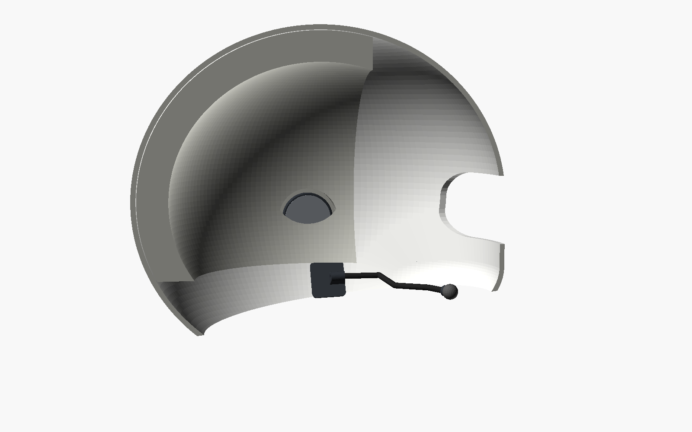
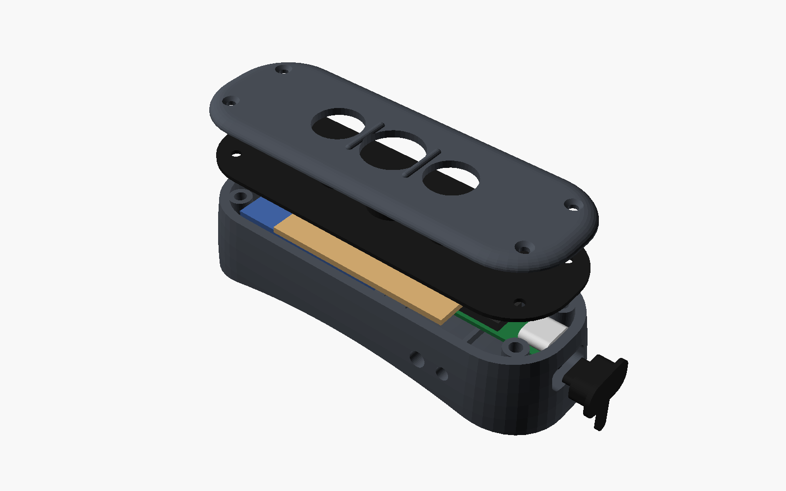

# Helmet Headset (v1): a cheap Bluetooth neckband rebuilt as a helmet headset

**Status: designed and modelled (v1, checked in CAD, not printed or built yet).** The neckband is picked but not opened yet, so its board and battery sizes are placeholders (MEASURE).

Take a cheap Bluetooth neckband apart and rebuild it inside a motorcycle helmet: music, calls and navigation voice for about ₹2,000–4,000 (est.) instead of a ₹5,000+ helmet communicator. The neckband already has everything that's hard to make: Bluetooth, the amplifier, the mic circuit, charging and the battery. This project only moves those parts to better places and adds printed housings. It's general purpose: the helmet's curve, the neckband's parts and the speakers are all settings.

**Owner's choices (2026-11-26):**
- "using a cheap neckband and then dismantle this and use this as a helmet headset";
- designed first for a **modular (flip-up) helmet**;
- the neckband picked for the owner (below);
- the board, battery and buttons in a **slim pod stuck to the outside on the left** (no holes in the helmet).

## What goes where

| Where | What | Why there |
|---|---|---|
| **Pod, outside, left side, behind the chin bar's pivot** | the neckband's board (Bluetooth, amplifier, charging, its USB-C socket), its battery, 3 big buttons | buttons you can find and press with gloves on; charging without taking anything out; the battery isn't against your head |
| **Ear pockets in the liner** | 2 × 40 mm speakers in printed pucks | the liner already has these pockets: nothing is cut |
| **On a boom in front of your mouth** | the mic | a mic needs to be close to the mouth to beat wind noise |
| **Under the shell's edge** | thin cables from the pod to the speakers and the mic | no holes in the shell |

**Why the mic boom isn't on the chin bar:** on a modular helmet the chin bar flips up. A mic stuck to the chin bar would need its wire to cross the hinge, where it gets pinched and broken. So the boom is held by a thin plate on the **fixed** part of the helmet, low on the left behind the chin bar, and bends forward to sit in front of your mouth. When you flip the chin bar up, it swings over the boom; the boom stays put. (Commercial headsets for modular helmets do the same.)

**Why nothing is drilled:** the shell and the foam liner are what protect your head. Holes in the shell, or foam cut away, weaken them. The pod is stuck on with VHB tape, the speakers sit in the existing ear pockets and the wires go in under the edge trim.

## The neckband: boAt Rockerz 255 Pro+

**Picked: the boAt Rockerz 255 Pro+**, about ₹1,100–1,300 (est.) on Amazon.in and Flipkart (Smartprix showed ₹1,199 in November 2025). It's the commonest neckband in India, so it's easy to buy and there are plenty of repair videos to learn from. boAt's manual lists **Bluetooth 5.0, IPX7, one built-in mic (−42 dB sensitivity)**. Retailers disagree on the battery (Blinkit says 300 mAh). Nobody has published a teardown with sizes, so the board and the battery are **placeholders until you open it**.

**Any neckband works.** The pod is made around the sizes you measure (`nb_pcb`, `nb_under`, `nb_over`, `usb_out`, `batt`). The buttons are wired, so where the board's own buttons sit doesn't matter. Things to check on whichever one you get:

1. **The power switch.** Some neckbands turn on and off when their magnetic earbuds are pulled apart or clicked together: a small magnet sensor (hall sensor or reed switch) inside. Once the earbuds are gone, such a board can stay on or stay off. Find the sensor (near where the earbuds click together) and work out which state means "on": you may have to glue a small magnet next to it, or bridge it. The power button must still turn it off, or the battery drains.
2. **The mic.** Look at what the mic is, and keep it with its wires:
   - **a round electret capsule on 2 wires** (the easy case): extend the wires to the boom (thin shielded cable, about 60 cm);
   - **an analog MEMS mic** (a tiny metal box with 3–4 pads on the board): carefully remove it and wire a **6 mm electret capsule** in its place (capsule + to the output pad, capsule − to ground, and a 2.2 kΩ resistor from the supply pad to the output pad: this is the standard way an electret is powered);
   - **a digital (PDM) MEMS mic** (5–6 pads, with CLK and DATA): don't swap it. Move it on a small piece of board on 5 thin wires (keep them short, about 30 cm at most, twisted).
   - **Two mics** (some "ENx" noise-cancelling models): the main one goes to the boom; leave the second one in the pod. If calls sound worse, disconnect the second one.
3. **The speakers.** Note how each earbud is wired: some boards have 4 separate speaker pads (L+, L−, R+, R−), some share a ground. **Wire the new speakers exactly like the earbuds were. Don't join grounds that weren't joined**: some amplifiers drive both wires, and joining them would short the amplifier.
4. **The battery.** If the neckband's own battery fits the pod's battery space (`batt`, 40 × 25 × 5.2 mm by default), reuse it. If it's a long curved cell that doesn't fit, use a flat **502540 LiPo** (about 500 mAh, with its protection board) instead. Match + and −; the board's charger works with it (charging just takes longer).

## The pod

A slim pod with rounded ends, **102 × 37 mm and 16.5 mm proud of the shell at its middle** (a commercial helmet communicator is about 20 mm). Its underside is curved to fit the shell, so it hugs the helmet along its length. Inside, from the shell outward:

1. **The body**, stuck on with **1.1 mm VHB tape** (3M 4910 or 5952). Its floor follows the shell; ribs give the battery and the board a flat seat.
2. **The battery** at the front end and **the neckband's board** at the back end, its USB-C socket at the back wall.
3. **The switch board:** a 50 × 28 mm piece of perfboard with **3 tactile switches, 6 × 6 × 7 mm**, resting on ledges along the walls. Each switch is wired across one of the board's own buttons (in parallel), so pressing it is the same as pressing that button. This way the board's buttons can be anywhere, and you get big glove-friendly buttons in the right place.
4. **The keypad (TPU):** one flat rubber sheet. Its 3 hollow domes are the buttons (a big round one in the middle for play/pause and calls, smaller ones either side for volume), and its edge is the **gasket**: the lid squeezes it 0.2 mm onto the body's rim. The sheet is thinner round each dome, so the dome moves easily when pressed.
5. **The lid**, with a rolled edge, 4 countersunk M2 × 6 screws into heat-set inserts, and small ridges between the buttons so you can count them with gloves.

- **Buttons** (front to back, as on the neckband): volume + (and next track, if the neckband does that on a long press), **multi-function** (play/pause, answer/end call, voice assistant, power), volume −.
- **USB-C:** in the back end, sealed by a small **TPU plug** with a pull tab. Charge with the plug out; put it back before riding.
- **Cables:** 2 holes low on the bottom wall (4.2 mm for the speakers' 4-core cable, 3.4 mm for the mic's shielded cable). Seal them with neutral-cure silicone.
- **Sun:** a LiPo in a dark box on a helmet in the Mumbai sun gets hot. Print the pod in a light colour if you can, and don't leave the helmet in direct sun.

**Fitting it to your helmet's curve.** The pod's underside is cut to the shell's curve where it goes, which has two radii: along the pod (front to back, `shell_rl`, 175 mm) and across it (up and down, `shell_rw`, 160 mm). To measure each one, lay a straight ruler across the spot, measure its length L where it touches and the gap h under its middle:

> radius = L × L / (8 × h) + h / 2. For example, L = 100 mm and h = 7 mm gives 100 × 100 / 56 + 3.5 = 182 mm.

The 1.1 mm VHB tape takes up small differences. Clean the spot with isopropyl alcohol first, press hard for 30 seconds, and leave it 24 hours before riding.

## Speakers and mic

- **Speakers:** 2 × **40 mm, 32 Ω** speakers (helmet speakers, or bare 40 mm 32 Ω speakers) in **printed pucks** 44 mm across and 8.2 mm deep, with a closed back for more bass. A hook-and-loop (Velcro) dot sticks the puck into the ear pocket. **Measure your ear pockets** (`ear_pocket`, 52 × 10 mm by default): the model refuses a puck that doesn't fit. Use speakers of **at least the earbuds' impedance**: measure an earbud with a multimeter (usually 16 or 32 Ω). 32 Ω speakers are safe either way; 8 Ω speakers would overload the amplifier. The earbuds' own tiny drivers fit the puck too (`spk = [13, 4]`), but they are too quiet at speed.
- **Mic:** the capsule in a printed **mic cup** with a foam windscreen over it, on the end of a **boom**: 2 mm aluminium craft wire with the mic cable alongside, in 5 mm heat-shrink, about 12 cm long, bent by hand to sit 1–2 cm in front of your lips.
- **Boom mount:** a thin plate (1.6 mm) that slides between the shell and the liner, low on the left behind the chin bar, or is stuck to the inside of the shell with VHB. The boom pushes into its socket; the mic cable comes in behind it.

## Wiring

| From the neckband's board | To | Cable |
|---|---|---|
| Left speaker pads (where the left earbud was) | left speaker | speakers' 4-core cable (an old USB cable works) |
| Right speaker pads | right speaker, round the back inside the neck roll | same cable, split at the pod |
| Mic pads (see "The mic" above) | the boom's capsule | thin shielded cable (one core and the shield) |
| Volume + button's 2 pads | switch 1 (front) | short wires inside the pod |
| Multi-function button's 2 pads | switch 2 (middle) | " |
| Volume − button's 2 pads | switch 3 (back) | " |
| Battery pads | the battery (red +, black −) | as it was |

The cables leave the pod low on its bottom wall, run down the outside of the shell (a few dabs of clear silicone or small adhesive clips) and go in under the rubber edge trim at the bottom. Inside, they run between the liner and the comfort padding to the ear pockets and the boom.

## Build order

1. Buy the neckband, charge it, **pair it and try it as it is** (so you know it works before you open it).
2. Open it. Find the board, the battery, the mic and any magnet sensor. **Measure** the board, the battery and the earbuds (below), and set them in `helmet_headset.scad`, or on the website's "Make it your size". Measure your helmet's curve and ear pockets.
3. Print the parts, fit 4 M2 heat-set inserts in the pod's pillars.
4. Wire the switch board and the cables; test everything on the bench (pairing, music on both sides, a call, all 3 buttons, charging).
5. Fit it all in the pod, lay the keypad on, screw the lid down evenly.
6. Stick the pod on the helmet, fit the speakers and the boom, route the cables.
7. Test on the bike at low speed; bend the boom until callers hear you clearly.

## Settings to measure

All in `helmet_headset.scad` (MEASURE lines), or on the website ("Make it your size"):
- **Your helmet:** the shell's 2 radii at the pod's spot (`shell_rl`, `shell_rw`); the ear pockets' diameter and depth (`ear_pocket`).
- **The neckband (after opening it):** the board's length, width and thickness (`nb_pcb`, 42 × 11 × 1.0); the tallest parts under and on it (`nb_under` 1.5, `nb_over` 2.5); how far its USB-C socket sticks out past its end (`usb_out` 0.6); the battery (`batt`, 40 × 25 × 5.2).
- **The parts you buy:** the speakers (`spk`, 40 × 5.5); the tactile switches' height (`tact_h`, 7); the boom's thickness (`boom_d`, 5); the cables (`cable_d`).

The pod grows to fit what you enter. The model refuses what doesn't fit: switches too short to reach the domes, a battery or board that would hit the pillars or the rounded ends, a puck bigger than the ear pocket.

## Checks done (CAD)

- every printed part exports as one watertight body;
- the battery, the neckband's board, the switch board and the switches fit inside the pod: they only touch the floor, the ribs and the ledges;
- the body and the lid don't touch (the keypad is between them); the lid squeezes the keypad's edge 0.2 mm (deliberate);
- the switches aren't pressed at rest, and pressing a dome 0.5 mm reaches its switch;
- the USB plug fits its hole without touching the wall;
- the pod's underside stays clear of the shell by the tape's thickness.

**Not yet:** the neckband opened and measured; printed and fitted to a real helmet; the shell's curve measured.

## Printing

| Part | Material | How |
|---|---|---|
| `pod_body` | PETG or ASA (light colour) | open side down (the floor prints as a bridge across the inside) |
| `pod_lid` | PETG / ASA | flat underside down |
| `keypad`, `usb_plug` | TPU 85A–95A | the keypad flat, domes up; the plug on its flange |
| `speaker_puck` × 2 | PETG | back down |
| `mic_cup`, `boom_mount` | PETG | back down; the plate flat |

About 30–35 g of PETG and 5 g of TPU. Parts and where to buy them: [`COMPONENTS.md`](COMPONENTS.md), and the project's page on the website.

## Safety

- Keep the volume low enough to hear traffic and horns.
- Don't drill the shell or cut the liner (above).
- The pod is outside, low and rounded, so in a fall it can slide or break off rather than catch. If the helmet takes a hit, replace the helmet as usual.
