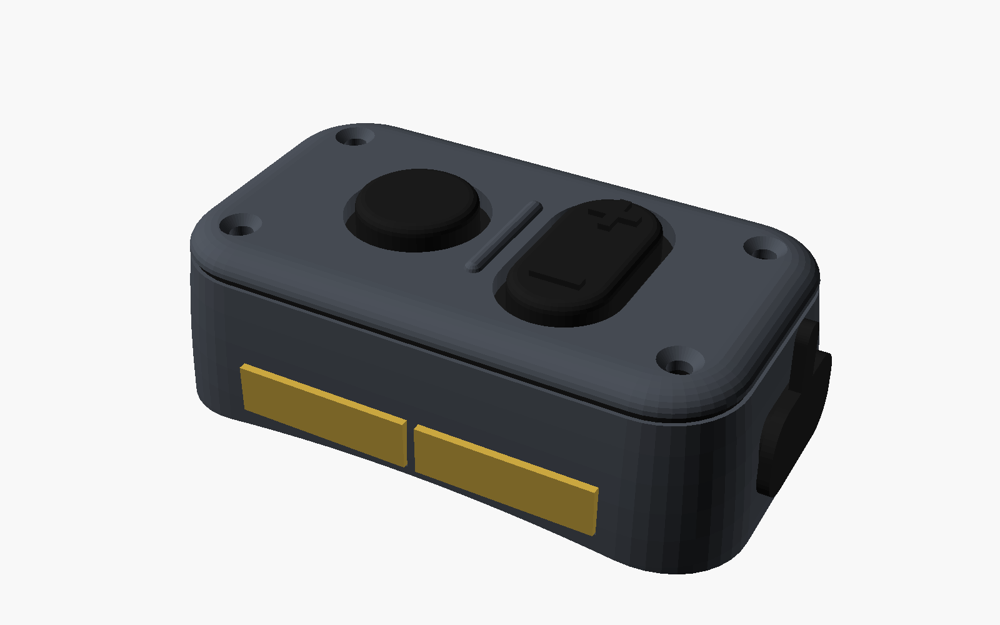
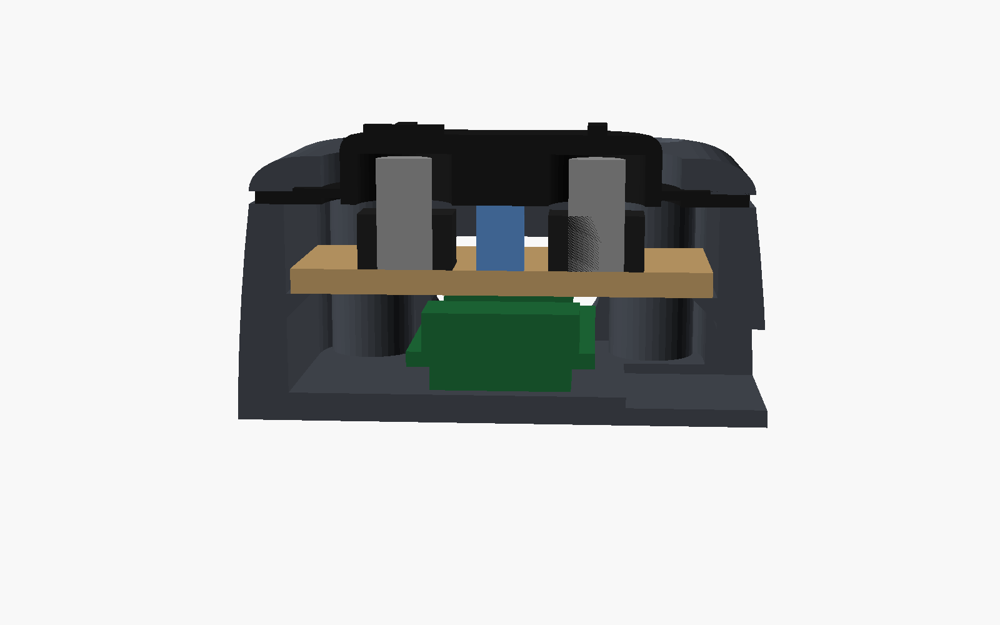
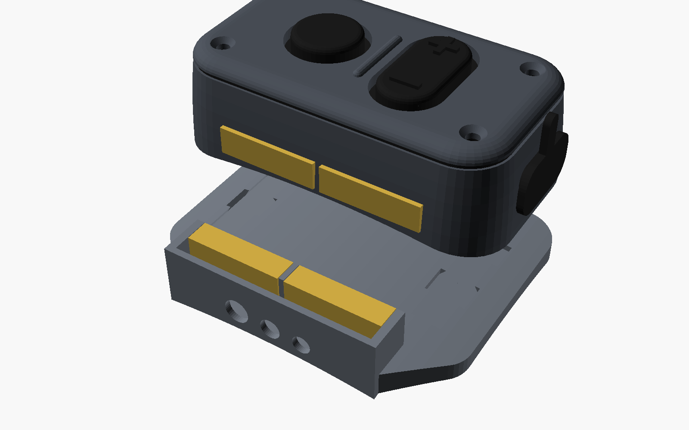
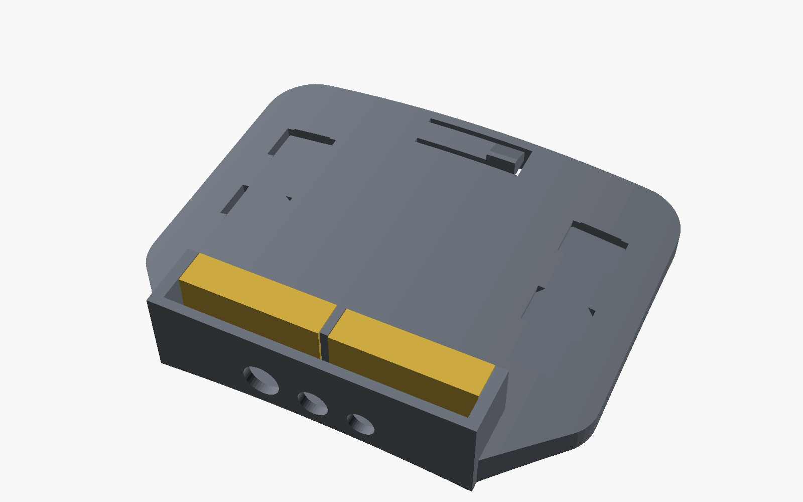
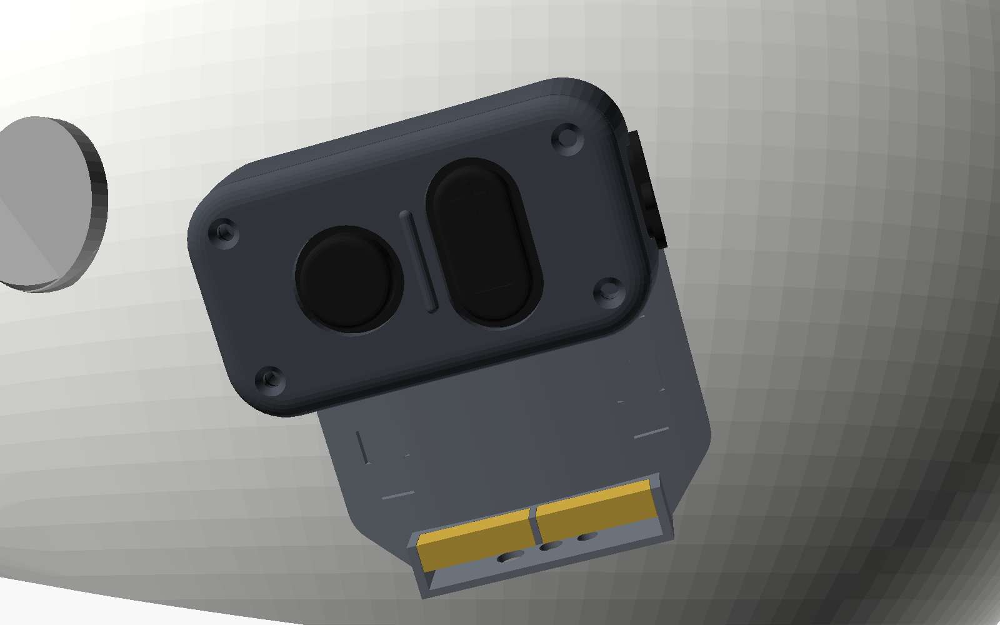
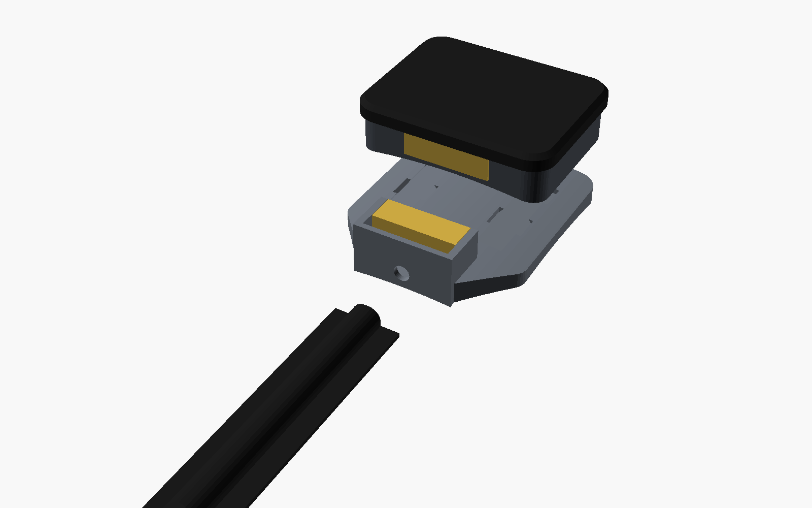
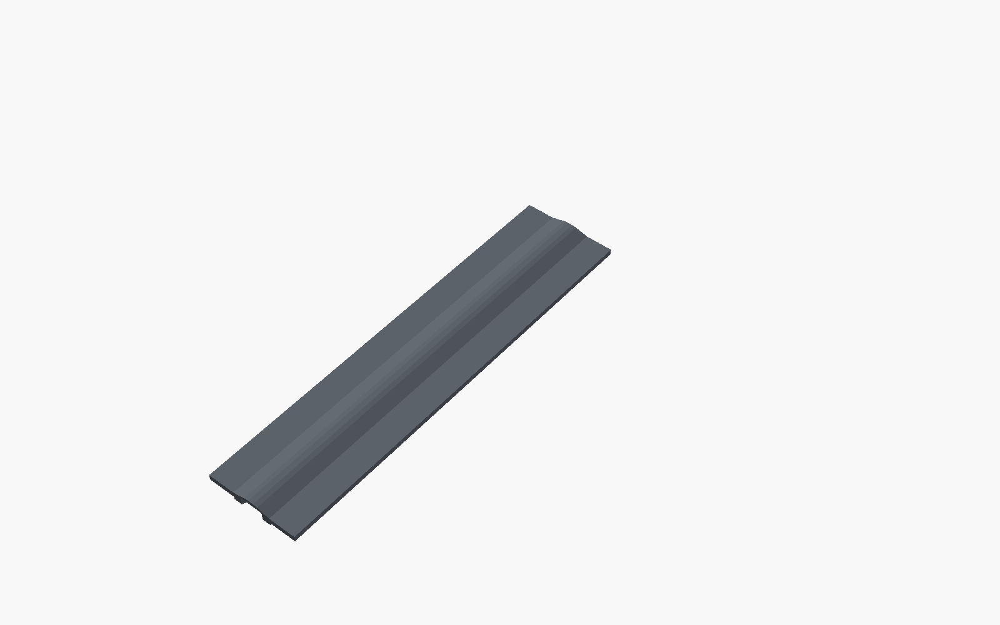

# Helmet Headset (v1): a cheap Bluetooth neckband rebuilt as a helmet headset

**Status: designed and modelled (v1, checked in CAD, not printed or built yet).** By default the neckband's **battery goes in its own slim box on the back of the helmet** (41 × 32 mm, 12 mm proud), so the side pod with the board and the keys is only **about 59 × 34 mm and 19 mm proud**. Or keep the battery in the pod (`batt_at` = "pod": 25 mm proud). **Both come off for cleaning:** each clips onto a cradle that stays stuck to the helmet, with the electrical contacts in the cradle (sizes above include the cradles). The pod has room for the board and battery of **most** cheap neckbands (not all: the biggest won't fit); a bigger neckband: enter its sizes and the pod grows.

Take a cheap Bluetooth neckband apart and rebuild it inside a motorcycle helmet: music, calls and navigation voice for about ₹2,650–4,100 (est.) instead of a ₹5,000+ helmet communicator. **Everything that makes sound or picks it up is the neckband's own:** its board (Bluetooth, amplifier, charging), its battery, its two speakers and its mic. This project only moves them to the right places in the helmet and adds printed housings; the only things you buy besides the neckband are 3 small magnetic connectors and hardware bits (tape, screws, 3 switches, foam, wire). It's general purpose: the helmet's curve and the neckband's parts are settings.

**Owner's choices (2026-11-26):**
- "using a cheap neckband and then dismantle this and use this as a helmet headset";
- designed first for a **modular (flip-up) helmet**;
- the neckband picked for the owner (below);
- the board, battery and buttons in a **slim pod stuck to the outside on the left** (no holes in the helmet);
- **the neckband's own speakers and mic** ("that the reason i am using it on the first place"). Bigger 40 mm speakers are only an optional upgrade;
- **wires in from below, no hole in the helmet, in grooves** ("routed not using some hole in the helmet instead from below the helmet so have some grooves to route those wires"): a flexible cable channel from the pod down to the shell's lower edge;
- **a pod that fits most neckbands** ("make the 3d pod fit most of the headsets"), then **a lot smaller** ("its too big ... it fine if some neckbands dont fit ... make it a lot smaller"): room for most, not all, with the board **stacked** on the battery (chosen over a flat, longer pod); and **a dedicated volume rocker** ("have a dedicated volumen button"), separate from the play/call button;
- **the cables out of the pod's bottom long side** ("as the mounting will be on the side with the long side laying horizontally on the helmet i feel the holes groves should open on the long side which means it will exit on the bottom side of the helmet"): the openings face down, and the channel runs straight down to the edge. (Before that they left through the pod's back end, with a turn in the channel.)
- **the battery on the back** (2026-11-27: "build a version where the battery is in a different compartment maybe on the back of the helmet to reduce the bulk on the sides"): the battery moved to its own slim **back box**, and the side pod lost 6 mm (23 → 17 mm proud). The battery's lead runs in from below like the other cables. Keeping it in the pod is still an option (`batt_at` = "pod").
- **no cable channel on the side** (2026-11-27: "cable channel from the side is not need but is need for the back", choosing "pod at the lower edge"): the pod now sits **along the shell's lower edge**, its cable notches 3 mm above it, so the cables go straight in under the edge trim. Only the back box keeps a short channel.
- **detachable** (2026-11-27: "i need detachable mounting for the battery as well as the control unit as i would need to detach them while cleaning the helmet, so the mounting hardware will be permanently stuck to the helmet and the hardware will be clipped on to it, and the electrical connection too will be in the mount itself"): each unit now clips onto a **cradle** stuck to the helmet, and **magnetic pogo connectors** in the cradle carry all the wires (below, "Taking it off").

## What goes where

| Where | What | Why there |
|---|---|---|
| **Pod, outside, left side, along the shell's lower edge, behind the chin bar's pivot** | the neckband's board (Bluetooth, amplifier, charging, its USB-C socket), a play/call button and a volume rocker | buttons you can find and press with gloves on; charging without taking anything out; its cables go straight in under the edge |
| **Back box, outside, on the back of the helmet** | the neckband's battery (or in the pod, with `batt_at` = "pod") | it takes the battery's bulk off the side; the battery isn't against your head |
| **Ear pockets in the liner** | the earbuds' own speakers (10 mm), each in a printed puck | the liner already has these pockets: nothing is cut |
| **On a boom in front of your mouth** | the neckband's own mic, on longer wires | a mic needs to be close to the mouth to beat wind noise |
| **Cradles, stuck to the shell under the pod and the back box** | the contacts (magnetic connectors) and all the helmet's wiring | the pod and the back box come off for cleaning; nothing is unplugged or unsoldered |
| **Out of the pod's cradle's bottom side, straight in under the shell's lower edge** | 3 thin cables: to the speakers, the mic and the battery; the battery's lead goes round inside the lower edge to the back, and out to the back box's cradle in its own short **channel** | no holes in the shell; the openings face down, so water runs away from them |

**Why the mic boom isn't on the chin bar:** on a modular helmet the chin bar flips up. A mic stuck to the chin bar would need its wire to cross the hinge, where it gets pinched and broken. So the boom is held by a thin plate on the **fixed** part of the helmet, low on the left behind the chin bar, and bends forward to sit in front of your mouth. When you flip the chin bar up, it swings over the boom; the boom stays put. (Commercial headsets for modular helmets do the same.)

**Why nothing is drilled:** the shell and the foam liner are what protect your head. Holes in the shell, or foam cut away, weaken them. The cradles are stuck on with VHB tape, the speakers sit in the existing ear pockets and the wires go in from below, under the edge trim.

## The neckband: boAt Rockerz 255 Pro+

**Picked: the boAt Rockerz 255 Pro+**, about ₹1,100–1,300 (est.) on Amazon.in and Flipkart (Smartprix showed ₹1,199 in November 2025). It's the commonest neckband in India, so it's easy to buy and there are plenty of repair videos to learn from. boAt's manual lists **Bluetooth 5.0, IPX7, one built-in mic (−42 dB sensitivity)**. Retailers disagree on the battery (Blinkit says 300 mAh). Nobody has published a teardown with sizes.

**Most neckbands fit the default pod.** Its room (estimated from common neckband and LiPo sizes, since no maker publishes the insides; kept as small as possible, so the biggest neckbands don't fit):

| Part | Room in the default pod | Fits, for example |
|---|---|---|
| The main board | up to **50 × 12 mm**, 1 mm thick, parts up to 1.5 mm under and 2.5 mm on top; its USB-C socket on its end | most neckband boards (they're long and narrow, to fit the neckband's end) |
| The battery | up to **35 × 20 × 6 mm**, or a long thin one up to **12 × 50 mm** (it slides between the lid's screw posts) | pouch cells such as 401230, 402030, 502030, 602030 (roughly 100–300 mAh), and long thin ones such as 501245 |

Smaller parts are packed with foam (thin double-sided foam tape under the battery and between it and the board, a scrap of foam in the gaps), so nothing rattles. **If yours is bigger, enter its sizes** (`nb_len`, `nb_w`, `nb_t`, `nb_under`, `nb_over`, `usb_out`, `batt_l`, `batt_w`, `batt_t`) in `helmet_headset.scad` or on the website's "Make it your size", and the pod grows to fit. For example, a wider 300 mAh cell, 35 × 25 × 6 mm, makes it about 60 × 41 mm; a big neckband (a 50 × 15 mm board, a 50 × 28 × 7 mm battery) about 75 × 44 × 24.5 mm.

**Which neckbands it fits.** No maker publishes its board or battery size, so this goes by the battery capacity each one lists and the usual cell for that capacity. Likely, not checked: open yours and compare it with the room above.

| Neckband | Listed battery | Usual cell | Fits the default pod? |
|---|---|---|---|
| boAt Rockerz 255 | [110 mAh](https://support.boat-lifestyle.com/articles/rockerz-wireless/rockerz-255/6214ce6a34563f6c3d77d5b4) | 401230 | likely |
| boAt Rockerz 275 V2 | [150 mAh](https://www.boat-lifestyle.com/en-kw/products/rockerz-275-v2) | about 30–35 × 12–20 × 4–5 mm | likely |
| DIZO Wireless Power (realme TechLife) | [150 mAh](https://www.flipkart.com/dizo-wireless-power-environmental-noise-cancellation-enc-by-realme-techlife-bluetooth-headset/p/itmfcb13a175f17f) | the same | likely |
| boAt 102 Wireless | [160 mAh](https://www.boat-lifestyle.com/en-kw/products/boat-102-wireless) | the same | likely |
| boAt Rockerz Uno | [200 mAh](https://www.boat-lifestyle.com/products/boat-rockerz-uno) | 402030 | likely |
| boAt Rockerz Apex | [220 mAh](https://croma.com/boat-rockerz-apex-neckband-with-environmental-noise-cancellation-ipx4-water-resistant-asap-charge-lime-/p/269220) | 502030 | likely |
| OnePlus Bullets Wireless Z3 | about 220 mAh (store listings) | 502030 | likely |
| boAt Rockerz 255 Pro+ (the pick) | [300 mAh](https://www.boat-lifestyle.com/en-sg/products/boat-rockerz-255-pro-plus) (one listing) | 602030 | likely |

What most often won't fit: a board wider than 12 mm, or a cell over 6 mm thick or over 20 mm wide (unless it's 12 mm wide or less). Then enter its size: the pod grows. The buttons are wired, so where the board's own buttons sit doesn't matter. Things to check on whichever neckband you get:

1. **The power switch.** Some neckbands turn on and off when their magnetic earbuds are pulled apart or clicked together: a small magnet sensor (hall sensor or reed switch) inside. Once the earbuds are gone, such a board can stay on or stay off. Find the sensor (near where the earbuds click together) and work out which state means "on": you may have to glue a small magnet next to it, or bridge it. The power button must still turn it off, or the battery drains.
2. **The mic.** It goes to the boom on longer wires. How depends on what it is:
   - **a round electret capsule on 2 wires** (the usual case in cheap neckbands): just extend its 2 wires to the boom (thin shielded cable, about 60 cm);
   - **a tiny MEMS mic soldered on the board** (a small metal box with 3–6 pads): move it on a small piece of perfboard on thin wires, one per pad (keep them short, about 30 cm at most, twisted). Only if that doesn't work (a pad lifts, or it's too noisy) fall back on an optional 6 mm electret capsule (₹10–40): capsule + to the board's output pad, − to ground, a 2.2 kΩ resistor from the supply pad to the output pad. This works only for an analog MEMS mic (3–4 pads), not a digital one (5–6 pads, with CLK and DATA).
   - **Two mics** (some "ENx" noise-cancelling models): the main one goes to the boom; leave the second one in the pod. If calls sound worse, disconnect the second one.
3. **The speakers.** Each earbud's speaker is a 10 mm driver (boAt's spec) glued in a small shell. Prise the shell open (it's usually glued in two halves; a craft knife round the seam), take the driver out with its two wires, and note which wire went where. Some boards have 4 separate speaker pads (L+, L−, R+, R−), some share a ground. **Keep the speakers wired exactly as they were. Don't join grounds that weren't joined**: some amplifiers drive both wires, and joining them would short the amplifier. The earbuds' own thin wires are usually too short to reach round the helmet: extend them with ordinary wire (below).
4. **The battery.** Check that it fits the room above, or measure it and set its size (the pod grows). Only if it's a long curved cell that doesn't fit at all, use a flat **602030 LiPo** (30 × 20 × 6 mm, about 300 mAh, fits the default room; with its protection board, optional, ₹150–300 est.). Match + and −; the board's charger works with it.
5. **The charging socket.** The pod's back end has a hole for a USB-C socket on the end of the board. Shim the board with foam so its socket lines up with the hole. If your board's socket is on its side, or it's micro-USB, there's an optional fallback: a small **USB-C charging breakout** (6-pin, with its 5.1 kΩ resistors, ₹20–60 est.) glued in the hole and wired to the board's charging pads (+5 V and ground).

## The pod

A small pod with rounded ends, **about 59 × 34 mm and 19 mm proud of the shell at its middle, with its cradle** (59.3 × 34 mm; 16.8 mm for the pod, 2.4 mm for the cradle under it) with the battery in the back box. With the battery in the pod (`batt_at` = "pod") it's 59.3 × 38.6 mm and 25.2 mm proud: the board lies **on top of** the battery, to keep it short. Its underside is curved along its length like the shell (and its cradle's top). Inside, from the shell outward:

1. **The body.** Its flat floor sits on its **cradle** (below, "Taking it off"); 2 short dovetail tongues under it. In its **bottom wall, 2 magnetic connectors** (the male halves, spring pins), side by side, their faces 0.3 mm proud.
2. **The neckband's board** on the floor, on a 1.5 mm foam pad (thicker or thinner so its USB-C socket lines up with the hole in the back end). (With `batt_at` = "pod", the battery lies on the floor first and the board on it.) Short wires from its speaker, mic and battery pads to the connectors' tails.
4. **The switch board:** a piece of perfboard about 27 × 30 mm (its length fits between the lid's screw posts; its width is the pod's inside width less 0.6 mm) with **3 tactile switches, 6 × 6 × 7 mm**, resting on ledges along the walls, and the volume rocker's small printed **pivot post** glued between its two switches. Each switch is wired across one of the board's own buttons (in parallel), so pressing it is the same as pressing that button. This way the board's buttons can be anywhere, and you get big glove-friendly keys in the right place. (These 3 switches, ₹10–30, are the one electronic part not taken from the neckband: its own buttons are tiny, often on the board's edge, and in places nobody knows until it's open. If yours happen to sit in a row on the board's top, they could be pressed through the keys directly instead; tell me their positions after you open it.)
5. **The keypad (TPU):** one flat rubber sheet with 2 keys, and its edge is the **gasket**: the lid squeezes it 0.2 mm onto the body's rim. The sheet is thinner round each key, so the key moves easily when pressed.
   - **The multi-function button** (front): a round dome, 12 mm across: play/pause, answer/end calls, voice assistant, power.
   - **The volume rocker** (behind it): a long key, 10 × 20 mm, lying **across** the pod (up and down on the helmet). **Press its top end for louder, its bottom end for quieter.** A raised **+** on the top end and **−** on the bottom end let you feel which is which with gloves.
6. **The lid**, with a rolled edge, 4 countersunk M2 × 6 screws into heat-set inserts, and a small ridge between the two keys.

**How the rocker works.** It's one rubber key over 2 switches, 12 mm apart. Its middle is solid and rests on a small printed post (3 × 3 mm, `rocker_post`) glued to the switch board between them. Press one end and the key tips over the post, pressing only that end's switch. The two switches are wired across the neckband's own volume + and volume − buttons, so it's the neckband that changes the volume. As on the neckband, holding an end for about 2 seconds may skip a track (that's in the neckband's own software).

- **Keys:** the round **multi-function** button at the front (play/pause, answer/end call, voice assistant, power), then the **volume rocker** (top end louder, bottom end quieter).
- **USB-C:** in the back end, sealed by a small **TPU plug** with a pull tab (pointing up). Charge with the plug out; put it back before riding.
- **Contacts:** the 2 connectors in the bottom side (below). No cable goes into the pod itself any more: it's sealed (the keypad's gasket, the USB-C plug, the connectors glued in their holes).
- **Sun:** a LiPo in a dark box on a helmet in the Mumbai sun gets hot. Print the pod in a light colour if you can, and don't leave the helmet in direct sun.

**Fitting it to your helmet's curve.** The cradle's underside is cut to the shell's curve where it goes, which has two radii: along the pod (front to back, `shell_rl`, 175 mm) and across it (up and down, `shell_rw`, 160 mm). To measure each one, lay a straight ruler across the spot, measure its length L where it touches and the gap h under its middle:

> radius = L × L / (8 × h) + h / 2. For example, L = 100 mm and h = 7 mm gives 100 × 100 / 56 + 3.5 = 182 mm.

The 1.1 mm VHB tape takes up small differences. Clean the spot with isopropyl alcohol first, press hard for 30 seconds, and leave it 24 hours before riding.

## Speakers and mic

- **Speakers: the earbuds' own.** Each 10 mm driver sits in a **printed puck**, 40 mm across and 6.7 mm deep, that fills the ear pocket and holds the driver at its middle, close to your ear, with a small closed space behind it. The back is hollowed out to save plastic; a strip of double-sided tape (or a Velcro dot) holds it in the pocket. **Measure your ear pockets** (`ear_d`, `ear_depth`, 52 × 10 mm by default) and the drivers (`spk_d`, `spk_t`, 10 × 4): the model refuses a puck that doesn't fit.
- **How loud?** Earbuds are loud because they seal inside your ear; in a helmet they sit about 1–2 cm away, so expect less volume and bass than wearing them. That's likely fine in town; at highway speed with wind noise it may be too quiet. Try them first. **Optional upgrade, only if they are:** 2 × 40 mm 32 Ω helmet speakers (₹100–600 the pair, est.) fit the same puck: set `spk_d` 40, `spk_t` 5.5 (it becomes 44 × 8.2 mm). Not 8 Ω: that would overload the neckband's amplifier.
- **Mic: the neckband's own,** in a printed **mic cup** (sized for a 6 × 2.7 mm capsule, `mic`: MEASURE yours) with a foam windscreen over it (a lapel-mic foam, or a scrap of open-cell foam), on the end of a **boom**: 2 mm aluminium craft wire (or a stiff copper wire) with the mic cable alongside, in 5 mm heat-shrink, about 12 cm long, bent by hand to sit 1–2 cm in front of your lips.
- **Boom mount:** a thin plate (1.6 mm) that slides between the shell and the liner, low on the left behind the chin bar, or is stuck to the inside of the shell with VHB. The boom pushes into its socket; the mic cable comes in behind it.

## Taking it off: the cradles and the connectors

Both the pod and the back box come off for cleaning the helmet (owner's request). Each sits on its own **cradle**, a thin PETG plate stuck to the shell with the VHB tape that **stays on the helmet**. The cradle's underside follows the shell; its top is curved only along the unit (like a piece of a tube), so the unit can slide straight down it. All the helmet's wiring (speakers, mic, battery lead) is soldered to the cradles; the units just clip on.

- **Putting it on:** hold the unit about 6 mm (`slide`) above its place, press it flat onto the cradle (its 2 dovetail tongues drop into windows in the cradle's 2 grooves) and **slide it down 6 mm**: the tongues go under the grooves' lips, so it can't come away from the helmet, and a **springy tooth** in the cradle clicks up behind the unit's top side, so it can't slide back up. The connectors' magnets pull the last bit home.
- **Taking it off:** press the tooth down (it's just above the unit's top side), slide the unit up 6 mm, lift it off.
- **The contacts:** off-the-shelf **5-pin magnetic pogo connectors** (2.54 mm pitch, rated 1 A per pin): spring pins on one half, flat contacts on the other, magnets at both ends that only mate one way round. The pod has **2** (the spring-pin halves in its bottom wall; their flat halves in its cradle). The back box has **1**, the other way round: the **flat** half in the box, so a battery box off the helmet has no sprung pins to short on a key in your pocket. In each cradle the connectors sit in a **ledge along its bottom side**, facing up; sliding the unit down brings their faces together. The ledge's pocket is open on top: solder the wires to the tails, then fill it with epoxy or silicone. The cables leave the ledge's bottom wall at the shell, facing down.
- **Sizes:** the connector's size isn't published (MEASURE: `mag_l` 18, `mag_h` 5, the male's depth `mag_m` 6, the female's `mag_f` 4.5, their tails `mag_tail` 3). Measure yours and enter them: the pod and the cradles follow.

| Connector | Pin 1 | Pin 2 | Pin 3 | Pin 4 | Pin 5 |
|---|---|---|---|---|---|
| **Pod A** (front) | left speaker + | left speaker − | right speaker + | right speaker − | spare |
| **Pod B** (back) | mic + | mic − (shield) | battery − | battery + | battery + |
| **Back box** | battery − | battery − | spare | battery + | battery + |

(With the battery in the pod, Pod B carries only the mic.) The battery's pins are doubled for current; keep the same pin order on both halves of each connector and mark pin 1 before soldering.

**Water:** the connectors face down along the slide, under the unit, and the cradle's ledge covers them. The contacts are gold-plated, but rinse them with fresh water and let them dry if they get salty or muddy. Wash the helmet with the units off and **dab the cradles' connectors dry** before clipping the units back on.

## The battery: in its own box on the back

By default (`batt_at` = "back") the neckband's battery goes in its own **back box**, low on the back of the helmet, so the side pod only holds the board and the keys and is **6 mm thinner** (19 mm proud instead of 25, with its cradle).
- **The box:** **41.4 × 32.3 mm, 12.1 mm proud** of the shell at its middle with its cradle. A PETG **base** on its own **cradle** (the same as the pod's: it clips on and slides off), the cradle stuck on with the same 1.1 mm VHB tape, its underside curved to the back of the shell (2 radii, `shell_bk`: 120 mm across, 140 mm up and down: measure yours the same way as for the pod). The battery lies in it on foam tape, 0.6 mm of foam round it, above its connector (the flat half) in its bottom wall.
- **The cover (TPU), no screws:** it snaps over the base's walls (a 0.4 mm bead round its inside clicks into a groove round them) and its top presses the walls' rim 0.2 mm: the seal. Peel it off by one corner to get at the battery.
- **The lead:** the battery's 2 wires go to the box's connector. On the helmet, a thin 2-core cable (about 50 cm: 26 AWG is plenty) runs from the back cradle's connector out of its ledge's **bottom** side, at the shell, into a **short TPU channel** with one groove (`run_b`, 60 mm: from the cradle's bottom edge down to the shell's lower edge). Under the edge, it goes round **inside** the lower edge (under the edge trim or the neck roll) to the left side, and out under the edge straight into the side pod's cradle (its third cable hole), to Pod B's battery pins.
- **Charging** doesn't change: the neckband's board in the side pod still charges it through its USB-C.
- **Weight:** a 300 mAh cell weighs about 7 g, the box about 4 g.

## Wiring

| From the neckband's board | To | Cable |
|---|---|---|
| Left speaker pads (where the left earbud was) | the left earbud's speaker | speakers' 4-core cable (an old USB cable works) |
| Right speaker pads | the right earbud's speaker, round the back inside the neck roll | same cable, split at the pod |
| Mic pads | the neckband's mic, on the boom | thin shielded cable (an old audio cable: one core and the shield) |
| Multi-function button's 2 pads | the round button's switch (front) | short wires inside the pod |
| Volume + button's 2 pads | the rocker's top switch | " |
| Volume − button's 2 pads | the rocker's bottom switch | " |
| Battery pads | the battery (red +, black −) | in the pod: as it was. In the back box: through Pod B, the 2-core lead on the helmet and the back box's connector; keep red to + |

With the cradles, each cable from the board goes to a connector pin in the pod (short wires inside), and on the helmet the cables start at the cradle's connector (table above, "Taking it off").

### Routing the cables

No hole in the helmet, and no channel on the side: the cables go in **from below**.
1. **Where the pod goes:** along the shell's **lower edge**, on the left behind the chin bar's pivot, its long bottom side parallel to the edge, its cradle's bottom side **about 3 mm above the edge** (`pod_edge`), so the cable holes open right at the edge.
2. **Out of the cradle:** through the 3 holes in its ledge's bottom side (2 with the battery in the pod), flat against the shell, facing down: 4.2 mm for the speakers' 4-core cable, 3.4 mm for the mic's shielded cable (old USB and audio cables work), 3 mm for the battery's lead.
3. **In under the edge:** gently lift the rubber edge trim, lay the cables over the edge and press the trim back over them. Many helmets also have a gap between the shell and the liner there; the cables slide up into it. A dab of silicone where they pass the trim keeps water out.
4. **Inside:** between the foam liner and the comfort padding: the speaker cable to the left ear pocket, and on round the back inside the neck roll to the right one; the mic cable to the boom mount next to it; the battery's lead round the back inside the lower edge, and out under the back edge into the back box's short channel, up to its cradle.

**The back box's channel:** a flexible TPU strip with one groove on its underside, from its cradle's bottom side straight down to the shell's lower edge (`run_b`, 60 mm: measure it along the shell). Lay the lead on the shell, press the channel over it, and stick its thin flanges down with strips of VHB tape (or a thin line of silicone); its lower end slopes down so the lead comes out flat at the edge.

## Build order

1. Buy the neckband, charge it, **pair it and try it as it is** (so you know it works before you open it).
2. Open it. Find the board, the battery, the mic and any magnet sensor; take the speakers out of the earbuds. Check that the board and the battery fit the pod's room (above); if not, **measure** them and set them in `helmet_headset.scad` or on the website's "Make it your size". Measure the speakers, your helmet's curve and its ear pockets.
3. Print the parts, fit 4 M2 heat-set inserts in the pod's pillars.
4. Glue the connectors in: the pod's 2 spring-pin halves in its bottom wall and the back box's flat half in its base (faces 0.3 mm proud; clip each to its other half first so they line up); the other halves in the cradles' ledges. Mark pin 1 on every one.
5. Wire the switch board, the pod's connectors and the cables to the cradles' connectors (pin table above); test everything on the bench with the units clipped onto their cradles (pairing, music on both sides, a call, the button and both ends of the rocker, charging). Then pot the cradles' ledges (epoxy or silicone over the tails).
6. Fit it all in the pod: the board on its foam pad on the floor (with the battery in the pod: the battery on foam tape first, the board on top) (so the USB-C socket lines up with its hole), foam in the gaps so nothing rattles; glue the rocker's post on the switch board; lay the keypad on, screw the lid down evenly. The battery in the back box on foam tape; snap the cover on.
7. Stick the cradles on the helmet (clean with isopropyl alcohol, press hard, 24 hours): the pod's along the lower edge, the back box's low on the back. Fit the speakers and the boom; tuck the cables in under the edge trim; the battery's lead down the back channel, in under the back edge, round inside the edge to the left and out under the edge into the pod's cradle.
8. Clip the units on (drop, slide down, click).
9. Test on the bike at low speed; bend the boom until callers hear you clearly.

## Settings to measure

All in `helmet_headset.scad` (MEASURE lines), or on the website ("Make it your size"):
- **Your helmet:** the shell's 2 radii at the pod's spot (`shell_rl`, `shell_rw`); the ear pockets' diameter and depth (`ear_d`, `ear_depth`).
- **The neckband (only if its parts are bigger than the default room, or to shrink the pod further):** the board's length, width and thickness (`nb_len`, `nb_w`, `nb_t`: default 50 × 12 × 1.0); the tallest parts under and on it (`nb_under` 1.5, `nb_over` 2.5); how far its USB-C socket sticks out past its end (`usb_out` 0.5); the battery (`batt_l`, `batt_w`, `batt_t`: default 35 × 20 × 6; a cell 12 mm wide or less can be up to about 50 long with no change). Always measure the earbuds' speakers (`spk_d`, `spk_t`: 10 × 4); the mic (`mic`, 6 × 2.7).
- **The bits you buy:** the tactile switches' height (`tact_h`, 7); the boom's thickness (`boom_d`, 5); the cables (`cable_d`).
- **The magnetic connectors:** their face (`mag_l` 18 × `mag_h` 5), the depths of the 2 halves (`mag_m` 6, `mag_f` 4.5) and their tails (`mag_tail` 3).
- **Where the battery goes** (`batt_at`: "back" or "pod"); for the back box, the shell's 2 radii at its spot (`shell_bk`, 120 × 140), its channel's length (`run_b`, 60) and the battery lead's thickness (`bat_cable`, 3).

The pod grows to fit what you enter. The model refuses what doesn't fit: switches too short to reach the keys, a battery or board that would hit the pillars or the rounded ends, a puck bigger than the ear pocket, connectors that run into the pillars or the board.

## Checks done (CAD)

- every printed part exports as one watertight body;
- the battery, the neckband's board, the switch board and the switches fit inside the pod: they only touch the floor, the ribs and the ledges; checked with the battery in the back box and in the pod;
- **the back box:** the battery fits (also a 50 × 28 × 7 and a 25 × 12 × 4 mm one), and its connector clears the battery; the cover's top squeezes the base's rim (deliberate);
- **the cradles (both):** each unit sits on its cradle without overlap; at its drop-in place, and half-way down, it doesn't touch the cradle (with the tooth pressed): it goes on; lifted 0.5 mm off the cradle, the tongues hit the grooves' lips, and slid up 0.5 mm it hits the tooth (both deliberate: it can't come off by itself); the connectors' faces meet exactly, the connectors clear everything else; the cradles' undersides stay clear of the shell by the tape; the cables pass their holes; the back box's cover clears its cradle;
- the body and the lid don't touch (the keypad is between them); the lid squeezes the keypad's edge 0.2 mm (deliberate);
- the switches aren't pressed at rest, and pressing a key 0.5 mm reaches its switch (each end of the rocker too); the rocker's middle rests on its pivot post;
- a big neckband (a 50 × 15 mm board, a 50 × 28 × 7 mm battery) and a tiny one (a 30 × 9 mm board, a 25 × 12 × 4 mm battery) still pass every check: the pod grows or shrinks to fit;
- the USB plug fits its hole without touching the wall;
- the USB plug clears the pod's cradle; the connectors stay on the bottom wall's straight part, clear of the lid's pillars, the board and the switch board's ledges (asserts; a bigger connector lengthens the pod or raises the switch board).

**Not yet:** the neckband opened and measured; printed and fitted to a real helmet; the shell's curve measured.

## Printing

| Part | Material | How |
|---|---|---|
| `pod_body` | PETG or ASA (light colour) | open side down (the floor prints as a bridge across the inside) |
| `pod_lid` | PETG / ASA | flat underside down |
| `keypad`, `usb_plug` | TPU 85A–95A | the keypad flat, keys up; the plug on its flange |
| `rocker_post` | PETG | on its end (tiny: print it with another part) |
| `pod_cradle`, `bb_cradle` | PETG / ASA | top up, supports under it (its underside is a shallow dish) |
| `bb_base` (the back box) | PETG / ASA (light colour) | its open top (the rim) down: the floor and the tongues up |
| `bb_cover`, `bb_channel` | TPU 85A–95A | the cover top down; the channel flanges down |
| `speaker_puck` × 2 | PETG | front down (the hollowed back up) |
| `mic_cup`, `boom_mount` | PETG | back down; the plate flat |

About 46 g of PETG and 7 g of TPU (with the back box and the 2 cradles). Parts and where to buy them: [`COMPONENTS.md`](COMPONENTS.md), and the project's page on the website.

## Safety

- Keep the volume low enough to hear traffic and horns.
- Don't drill the shell or cut the liner (above).
- **The battery's contacts:** with the back box on its cradle and the pod off, the pod's cradle carries the battery's voltage on its flat contacts. Take the **back box off first** and put it back **last**. Keep the cell's own protection board (the small board taped to its end) when you rewire it: it cuts off on a short.
- The pod is outside, low and rounded, so in a fall it can slide or break off rather than catch. If the helmet takes a hit, replace the helmet as usual.
