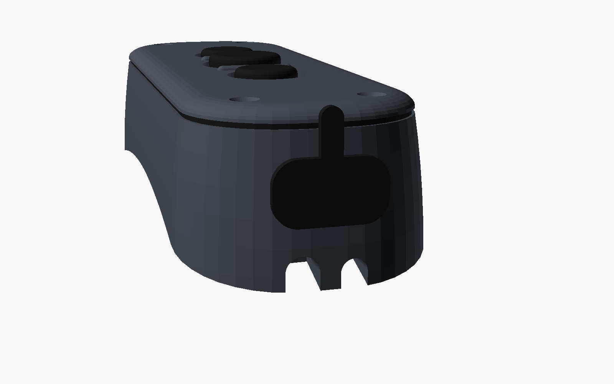
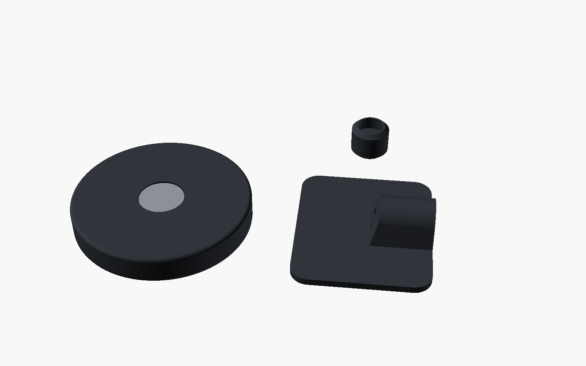

# Helmet Headset (v1): a cheap Bluetooth neckband rebuilt as a helmet headset

**Status: designed and modelled (v1, checked in CAD, not printed or built yet).** The neckband is picked but not opened yet, so its board and battery sizes are placeholders (MEASURE).

Take a cheap Bluetooth neckband apart and rebuild it inside a motorcycle helmet: music, calls and navigation voice for about ₹1,800–3,200 (est.) instead of a ₹5,000+ helmet communicator. **Everything that makes sound or picks it up is the neckband's own:** its board (Bluetooth, amplifier, charging), its battery, its two speakers and its mic. This project only moves them to the right places in the helmet and adds printed housings; the only things you buy besides the neckband are small hardware bits (tape, screws, 3 switches, wire). It's general purpose: the helmet's curve and the neckband's parts are settings.

**Owner's choices (2026-11-26):**
- "using a cheap neckband and then dismantle this and use this as a helmet headset";
- designed first for a **modular (flip-up) helmet**;
- the neckband picked for the owner (below);
- the board, battery and buttons in a **slim pod stuck to the outside on the left** (no holes in the helmet);
- **the neckband's own speakers and mic** ("that the reason i am using it on the first place"). Bigger 40 mm speakers are only an optional upgrade;
- **wires in from below, no hole in the helmet, in grooves** ("routed not using some hole in the helmet instead from below the helmet so have some grooves to route those wires"): a flexible cable channel from the pod down to the shell's lower edge;
- **the cables out of the pod's back end** ("the cable go on the back part and have groves too will help in water proofing too"): facing away from rain and the wind, under the USB-C.

## What goes where

| Where | What | Why there |
|---|---|---|
| **Pod, outside, left side, behind the chin bar's pivot** | the neckband's board (Bluetooth, amplifier, charging, its USB-C socket), its battery, 3 big buttons | buttons you can find and press with gloves on; charging without taking anything out; the battery isn't against your head |
| **Ear pockets in the liner** | the earbuds' own speakers (10 mm), each in a printed puck | the liner already has these pockets: nothing is cut |
| **On a boom in front of your mouth** | the neckband's own mic, on longer wires | a mic needs to be close to the mouth to beat wind noise |
| **Out of the pod's back end, down the outside of the shell, then in under its lower edge** | 2 thin cables from the pod to the speakers and the mic, in the grooves of a flexible **cable channel** | no holes in the shell; the exit faces away from rain and wind |

**Why the mic boom isn't on the chin bar:** on a modular helmet the chin bar flips up. A mic stuck to the chin bar would need its wire to cross the hinge, where it gets pinched and broken. So the boom is held by a thin plate on the **fixed** part of the helmet, low on the left behind the chin bar, and bends forward to sit in front of your mouth. When you flip the chin bar up, it swings over the boom; the boom stays put. (Commercial headsets for modular helmets do the same.)

**Why nothing is drilled:** the shell and the foam liner are what protect your head. Holes in the shell, or foam cut away, weaken them. The pod is stuck on with VHB tape, the speakers sit in the existing ear pockets and the wires go in from below, under the edge trim.

## The neckband: boAt Rockerz 255 Pro+

**Picked: the boAt Rockerz 255 Pro+**, about ₹1,100–1,300 (est.) on Amazon.in and Flipkart (Smartprix showed ₹1,199 in November 2025). It's the commonest neckband in India, so it's easy to buy and there are plenty of repair videos to learn from. boAt's manual lists **Bluetooth 5.0, IPX7, one built-in mic (−42 dB sensitivity)**. Retailers disagree on the battery (Blinkit says 300 mAh). Nobody has published a teardown with sizes, so the board and the battery are **placeholders until you open it**.

**Any neckband works.** The pod is made around the sizes you measure (`nb_len`, `nb_w`, `nb_t`, `nb_under`, `nb_over`, `usb_out`, `batt_l`, `batt_w`, `batt_t`). The buttons are wired, so where the board's own buttons sit doesn't matter. Things to check on whichever one you get:

1. **The power switch.** Some neckbands turn on and off when their magnetic earbuds are pulled apart or clicked together: a small magnet sensor (hall sensor or reed switch) inside. Once the earbuds are gone, such a board can stay on or stay off. Find the sensor (near where the earbuds click together) and work out which state means "on": you may have to glue a small magnet next to it, or bridge it. The power button must still turn it off, or the battery drains.
2. **The mic.** It goes to the boom on longer wires. How depends on what it is:
   - **a round electret capsule on 2 wires** (the usual case in cheap neckbands): just extend its 2 wires to the boom (thin shielded cable, about 60 cm);
   - **a tiny MEMS mic soldered on the board** (a small metal box with 3–6 pads): move it on a small piece of perfboard on thin wires, one per pad (keep them short, about 30 cm at most, twisted). Only if that doesn't work (a pad lifts, or it's too noisy) fall back on an optional 6 mm electret capsule (₹10–40): capsule + to the board's output pad, − to ground, a 2.2 kΩ resistor from the supply pad to the output pad. This works only for an analog MEMS mic (3–4 pads), not a digital one (5–6 pads, with CLK and DATA).
   - **Two mics** (some "ENx" noise-cancelling models): the main one goes to the boom; leave the second one in the pod. If calls sound worse, disconnect the second one.
3. **The speakers.** Each earbud's speaker is a 10 mm driver (boAt's spec) glued in a small shell. Prise the shell open (it's usually glued in two halves; a craft knife round the seam), take the driver out with its two wires, and note which wire went where. Some boards have 4 separate speaker pads (L+, L−, R+, R−), some share a ground. **Keep the speakers wired exactly as they were. Don't join grounds that weren't joined**: some amplifiers drive both wires, and joining them would short the amplifier. The earbuds' own thin wires are usually too short to reach round the helmet: extend them with ordinary wire (below).
4. **The battery.** Measure it and set its size: the pod is made around it. Only if it's a long curved cell that doesn't fit at all, use a flat **502540 LiPo** (about 500 mAh, with its protection board, optional, ₹150–300 est.). Match + and −; the board's charger works with it.

## The pod

A slim pod with rounded ends, **102 × 37 mm and 16.5 mm proud of the shell at its middle** (a commercial helmet communicator is about 20 mm). Its underside is curved to fit the shell, so it hugs the helmet along its length. Inside, from the shell outward:

1. **The body**, stuck on with **1.1 mm VHB tape** (3M 4910 or 5952). Its floor follows the shell; ribs give the battery and the board a flat seat.
2. **The battery** at the front end and **the neckband's board** at the back end, its USB-C socket at the back wall.
3. **The switch board:** a 50 × 28 mm piece of perfboard with **3 tactile switches, 6 × 6 × 7 mm**, resting on ledges along the walls. Each switch is wired across one of the board's own buttons (in parallel), so pressing it is the same as pressing that button. This way the board's buttons can be anywhere, and you get big glove-friendly buttons in the right place. (These 3 switches, ₹10–30, are the one electronic part not taken from the neckband: its own buttons are tiny, often on the board's edge, and in places nobody knows until it's open. If yours happen to sit in a row on the board's top, they could be pressed through the domes directly instead; tell me their positions after you open it.)
4. **The keypad (TPU):** one flat rubber sheet. Its 3 hollow domes are the buttons (a big round one in the middle for play/pause and calls, smaller ones either side for volume), and its edge is the **gasket**: the lid squeezes it 0.2 mm onto the body's rim. The sheet is thinner round each dome, so the dome moves easily when pressed.
5. **The lid**, with a rolled edge, 4 countersunk M2 × 6 screws into heat-set inserts, and small ridges between the buttons so you can count them with gloves.

- **Buttons** (front to back, as on the neckband): volume + (and next track, if the neckband does that on a long press), **multi-function** (play/pause, answer/end call, voice assistant, power), volume −.
- **USB-C:** in the back end, sealed by a small **TPU plug** with a pull tab (pointing up, clear of the cable channel). Charge with the plug out; put it back before riding.
- **Cables:** 2 notches at the bottom of the pod's **back end**, under the USB-C, right at the shell (4.2 mm for the speakers' 4-core cable, 3.4 mm for the mic's shielded cable: old USB and audio cables work). The cables come out flat against the shell, straight into the cable channel. Seal the notches with neutral-cure silicone.

  **Why the back end, for water:** riding, rain and spray hit the helmet from the front; the back end faces away from them and sits in the shell's wind shadow. The notches open at the very bottom, against the shell, and the channel's top end covers them, so water would have to run backward and climb up to get in.

  
- **Sun:** a LiPo in a dark box on a helmet in the Mumbai sun gets hot. Print the pod in a light colour if you can, and don't leave the helmet in direct sun.

**Fitting it to your helmet's curve.** The pod's underside is cut to the shell's curve where it goes, which has two radii: along the pod (front to back, `shell_rl`, 175 mm) and across it (up and down, `shell_rw`, 160 mm). To measure each one, lay a straight ruler across the spot, measure its length L where it touches and the gap h under its middle:

> radius = L × L / (8 × h) + h / 2. For example, L = 100 mm and h = 7 mm gives 100 × 100 / 56 + 3.5 = 182 mm.

The 1.1 mm VHB tape takes up small differences. Clean the spot with isopropyl alcohol first, press hard for 30 seconds, and leave it 24 hours before riding.

## Speakers and mic

- **Speakers: the earbuds' own.** Each 10 mm driver sits in a **printed puck**, 40 mm across and 6.7 mm deep, that fills the ear pocket and holds the driver at its middle, close to your ear, with a small closed space behind it. The back is hollowed out to save plastic; a strip of double-sided tape (or a Velcro dot) holds it in the pocket. **Measure your ear pockets** (`ear_d`, `ear_depth`, 52 × 10 mm by default) and the drivers (`spk_d`, `spk_t`, 10 × 4): the model refuses a puck that doesn't fit.
- **How loud?** Earbuds are loud because they seal inside your ear; in a helmet they sit about 1–2 cm away, so expect less volume and bass than wearing them. That's likely fine in town; at highway speed with wind noise it may be too quiet. Try them first. **Optional upgrade, only if they are:** 2 × 40 mm 32 Ω helmet speakers (₹100–600 the pair, est.) fit the same puck: set `spk_d` 40, `spk_t` 5.5 (it becomes 44 × 8.2 mm). Not 8 Ω: that would overload the neckband's amplifier.
- **Mic: the neckband's own,** in a printed **mic cup** (sized for a 6 × 2.7 mm capsule, `mic`: MEASURE yours) with a foam windscreen over it (a lapel-mic foam, or a scrap of open-cell foam), on the end of a **boom**: 2 mm aluminium craft wire (or a stiff copper wire) with the mic cable alongside, in 5 mm heat-shrink, about 12 cm long, bent by hand to sit 1–2 cm in front of your lips.
- **Boom mount:** a thin plate (1.6 mm) that slides between the shell and the liner, low on the left behind the chin bar, or is stuck to the inside of the shell with VHB. The boom pushes into its socket; the mic cable comes in behind it.

## Wiring

| From the neckband's board | To | Cable |
|---|---|---|
| Left speaker pads (where the left earbud was) | the left earbud's speaker | speakers' 4-core cable (an old USB cable works) |
| Right speaker pads | the right earbud's speaker, round the back inside the neck roll | same cable, split at the pod |
| Mic pads | the neckband's mic, on the boom | thin shielded cable (an old audio cable: one core and the shield) |
| Volume + button's 2 pads | switch 1 (front) | short wires inside the pod |
| Multi-function button's 2 pads | switch 2 (middle) | " |
| Volume − button's 2 pads | switch 3 (back) | " |
| Battery pads | the battery (red +, black −) | as it was |

### Routing the cables: the cable channel

No hole in the helmet: the cables go in **from below**.
1. **Out of the pod:** through the 2 notches at the bottom of its back end, flat against the shell.
2. **Down the shell:** in the **cable channel**, a flexible TPU strip, 21.6 mm wide and 5.6 mm tall. It leaves the pod's back end backward, curves round a quarter turn (16 mm radius) and runs straight down for `run_l` (90 mm: measure from where the turn ends to the shell's lower edge, along the shell). Its top end is shaped to fit round the pod's rounded end and covers the notches. It has **2 grooves on its underside**, one per cable, lined up with the notches. Lay the cables on the shell, press the channel over them, and it holds them flat against the shell. It's TPU, so it bends to follow the shell's curve. Thin flanges either side take strips of VHB tape (or a thin line of silicone). Its lower end slopes down so the cables come out flat at the edge.
3. **In under the edge:** at the shell's lower edge, gently lift the rubber edge trim, lay the cables over the edge and press the trim back over them. Many helmets also have a gap between the shell and the liner there; the cables slide up into it.
4. **Inside:** between the foam liner and the comfort padding: the speaker cable to the left ear pocket, and on round the back inside the neck roll to the right one; the mic cable to the boom mount next to it.

## Build order

1. Buy the neckband, charge it, **pair it and try it as it is** (so you know it works before you open it).
2. Open it. Find the board, the battery, the mic and any magnet sensor; take the speakers out of the earbuds. **Measure** the board, the battery and the speakers (below), and set them in `helmet_headset.scad`, or on the website's "Make it your size". Measure your helmet's curve and ear pockets.
3. Print the parts, fit 4 M2 heat-set inserts in the pod's pillars.
4. Wire the switch board and the cables; test everything on the bench (pairing, music on both sides, a call, all 3 buttons, charging).
5. Fit it all in the pod, lay the keypad on, screw the lid down evenly.
6. Stick the pod on the helmet, fit the speakers and the boom, lay the cables down the shell, press the cable channel over them and tuck them in under the edge trim.
7. Test on the bike at low speed; bend the boom until callers hear you clearly.

## Settings to measure

All in `helmet_headset.scad` (MEASURE lines), or on the website ("Make it your size"):
- **Your helmet:** the shell's 2 radii at the pod's spot (`shell_rl`, `shell_rw`); the ear pockets' diameter and depth (`ear_d`, `ear_depth`).
- **The neckband (after opening it):** the board's length, width and thickness (`nb_len`, `nb_w`, `nb_t`: 42 × 11 × 1.0); the tallest parts under and on it (`nb_under` 1.5, `nb_over` 2.5); how far its USB-C socket sticks out past its end (`usb_out` 0.6); the battery (`batt_l`, `batt_w`, `batt_t`: 40 × 25 × 5.2); the earbuds' speakers (`spk_d`, `spk_t`: 10 × 4); the mic (`mic`, 6 × 2.7).
- **The bits you buy:** the tactile switches' height (`tact_h`, 7); the boom's thickness (`boom_d`, 5); the cables (`cable_d`).
- **The cable channel's length** (`run_l`, 90): along the shell, from about 20 mm behind the pod's back end (where the channel's turn ends) down to the shell's lower edge.

The pod grows to fit what you enter. The model refuses what doesn't fit: switches too short to reach the domes, a battery or board that would hit the pillars or the rounded ends, a puck bigger than the ear pocket.

## Checks done (CAD)

- every printed part exports as one watertight body;
- the battery, the neckband's board, the switch board and the switches fit inside the pod: they only touch the floor, the ribs and the ledges;
- the body and the lid don't touch (the keypad is between them); the lid squeezes the keypad's edge 0.2 mm (deliberate);
- the switches aren't pressed at rest, and pressing a dome 0.5 mm reaches its switch;
- the USB plug fits its hole without touching the wall;
- the pod's underside stays clear of the shell by the tape's thickness;
- each cable, lying on the shell, passes through its notch in the pod's back end without touching it; the notches clear the lid's pillars and the USB-C opening (asserts).

**Not yet:** the neckband opened and measured; printed and fitted to a real helmet; the shell's curve measured.

## Printing

| Part | Material | How |
|---|---|---|
| `pod_body` | PETG or ASA (light colour) | open side down (the floor prints as a bridge across the inside) |
| `pod_lid` | PETG / ASA | flat underside down |
| `keypad`, `usb_plug` | TPU 85A–95A | the keypad flat, domes up; the plug on its flange |
| `cable_channel` | TPU 85A–95A | flanges down (the grooves bridge 4.6 mm) |
| `speaker_puck` × 2 | PETG | front down (the hollowed back up) |
| `mic_cup`, `boom_mount` | PETG | back down; the plate flat |

About 30 g of PETG and 10 g of TPU. Parts and where to buy them: [`COMPONENTS.md`](COMPONENTS.md), and the project's page on the website.

## Safety

- Keep the volume low enough to hear traffic and horns.
- Don't drill the shell or cut the liner (above).
- The pod is outside, low and rounded, so in a fall it can slide or break off rather than catch. If the helmet takes a hit, replace the helmet as usual.
