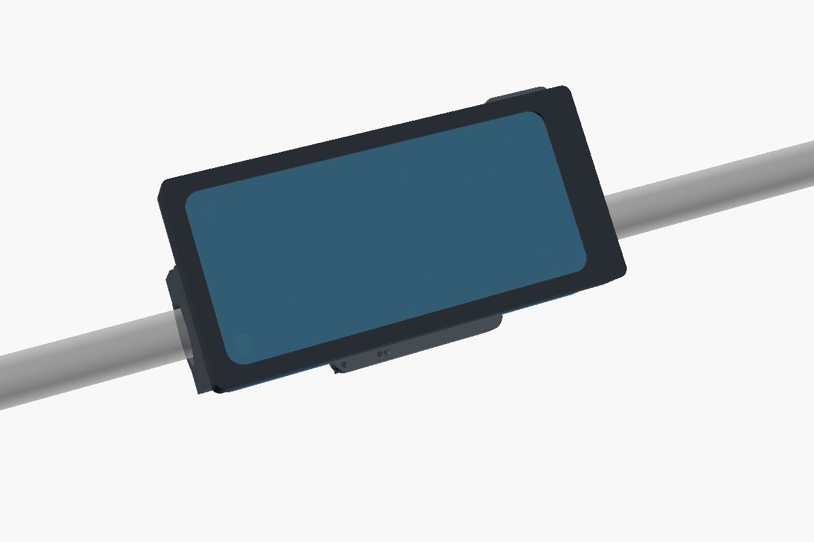
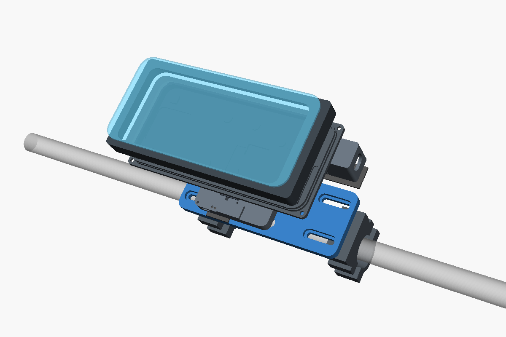
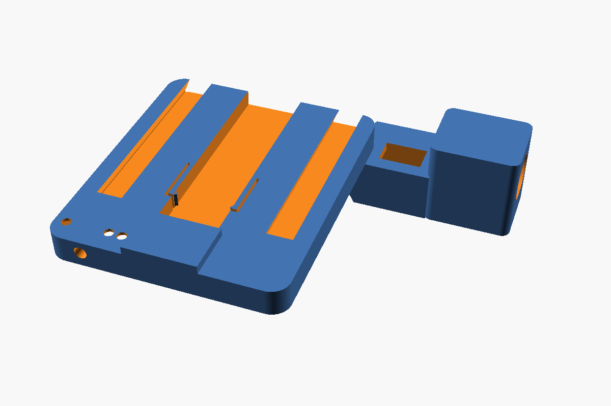
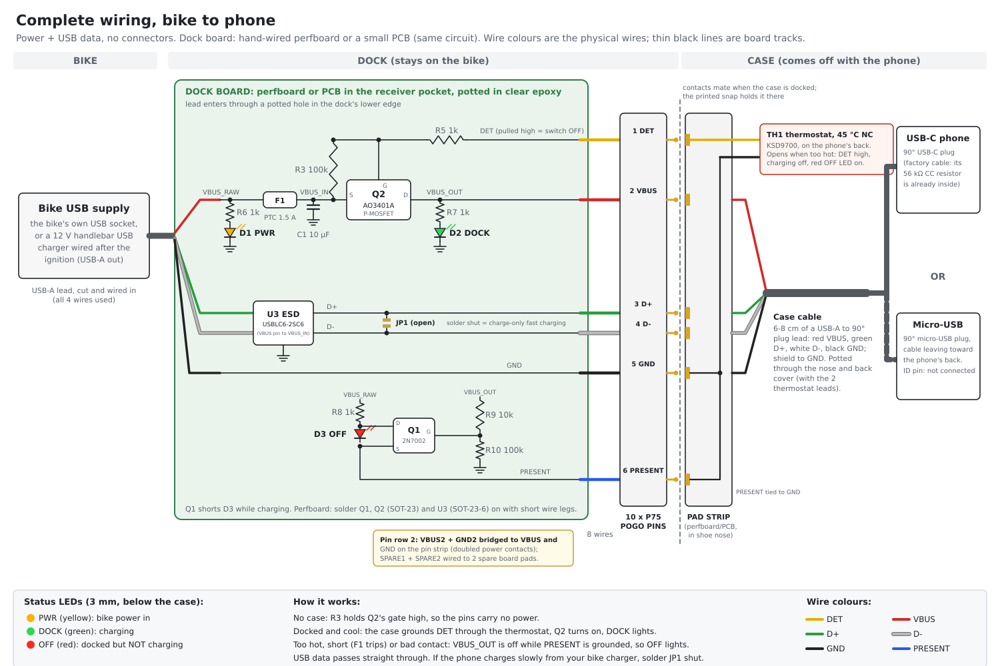

# Modular handlebar navigation dock

**Project:** Old phone converted into a permanent motorcycle navigation screen (landscape)
**First bike:** Royal Enfield Meteor 350 (2025). The design is adjustable for most bikes with a round handlebar.
**Revision:** 0.5 concept prototype: slim case and compact dock (0.2–0.4 are in `archive/`)
**CAD:** OpenSCAD 2021.01, millimetres

> **One design, about ₹3,400–5,000 in Mumbai** ([`SHOPPING_LIST_INDIA.md`](SHOPPING_LIST_INDIA.md)). The only choice is how you build the dock's electronics: **hand-wired on perfboard**, or on a **small ordered PCB** (same circuit and parts, about ₹700–2,300 more). Everything printed is the same either way; see [`WIRING.md`](WIRING.md).
>
> Video: `video/mechanism_demo.mp4`.
>
> **Website:** https://praneth2580.github.io/3D-Models/ (3D viewer and free downloads). **License:** CC BY-NC-SA 4.0, see [`LICENSE.md`](LICENSE.md).

> **Prototype status:** this is a dimensioned concept model. It has not been tested on the road, for water ingress, for heat or for vibration. Anything marked **MEASURE** or **SELECT** in the `.scad` file is a placeholder.



## What changed in 0.5 (slimmer)

All figures are for the example 160 × 75 × 9 mm phone.

| | v0.4 | v0.5 |
|---|---|---|
| Case outside size | 197 × 100 × 22 mm (with bezel and window) | **178 × 85 × 19 mm** |
| Border, outer edge to the visible screen | about 15 mm (+12 mm at the USB end) | **about 7 mm** (+8 mm at the USB end) |
| Front fixings | 8 screws through a separate bezel and the window | **none on the front**: 4 hidden screws in the back corners |
| Dock (receiver) | 112 × 119 × 44 mm, 123 cm³, wide ledge and side lock housing | **76 × 85 mm, 9 mm-thick plate**, plus a compact side lock pod behind the case's upper-right corner (57 cm³ in all) |
| Top of the case above the bar (40° tilt) | about 98 mm | **about 91 mm** with the placeholder clamp measurements (down to about 82 mm if your bike's clamp is low, see *Height above the bar*). The first v0.5 layout was 78 mm; moving the lock to the top cost 13 mm (see below) |
| Overall width | 228 mm (base plate) | **178 mm**: the base plate (172 mm) and clamps hide behind the case |

How the bulk was removed:
- **Case:**
  - The case is now **rear-loading**. The window is bonded behind a 1.6 mm front lip, so no front frame or screws are needed.
  - The back cover seals with an **O-ring around its raised rim** (a radial seal), so the screws only need to hold it in place, not squeeze a gasket. That removes the old 12 mm flange.
  - Four M3 screws go into the shell's corners, which have square-ish outer corners to make room.
- **Dock:**
  - The contacts moved from a ledge below the case to a small **nose** at the bottom of the rear plate (the "shoe"). The nose slides in a centre channel and presses onto the spring pins at the end of its travel.
  - The lock sits in a compact pod behind the case's upper-right corner. Its key goes in from the side, and it drives a flat steel bolt up into the strike block on the shoe, where it bears on a steel block (see *Docking and locking*).
- **USB end:** the bay is 8 mm instead of 12 mm. Use a low-profile 90° plug. Phones with USB-C or micro-USB are both supported (`phone_port`; micro-USB makes the bay 9 mm and the case 1 mm wider).

### Update 2026-11-20: lock at the top, flat bolt

- **Lock moved from the bottom to the top of the dock.**
  - The old pod hung 30 mm behind the case's lower-right corner. That was the lowest, rearmost part of the whole mount, so it was the part most likely to reach the fuel tank at full steering lock.
  - The pod now sits behind the **upper-right** corner.
  - To make room, the base plate sits 20 mm lower on the case (`amps_offset_y` changed from +10 to −10). So the case sits 13 mm higher and 15 mm further forward on the bike.
  - Measured at 40° tilt:

    | | Before | Now |
    |---|---|---|
    | Lowest point of the case and dock | 18.9 mm below bar level | **8.9 mm above** it |
    | Rearmost edge | 88 mm behind the bar | **73 mm** behind the bar |
    | Top of the case | 78 mm above the bar | **91 mm** above the bar |

  - The pod's top edge shows about 6 mm above the case's top-right corner, just as it used to show below the lower corner.
- **Larger contact patch between the lock and the case.**
  - The 8 mm round bolt and its drill bushing are replaced by a **flat 14 × 9 mm steel bolt** (DIN 6885 key steel).
  - The bolt rises into a window in the printed strike block. The window's load side is a **10 mm block of the same 14 × 9 mm key steel**, glued into a pocket.
  - When the case is pulled, the bolt's whole 14 mm face sits flat against that steel: a 14 × 6 mm patch. The round bolt only touched along a line.
  - The bolt's cross-section is 2.5× the old rod's (126 mm² against 50 mm²).
  - **No custom steel parts.** The bolt and the bearing block are two pieces cut from one bought bar, and the crank is the lock's own cam with one hole drilled in it.
  - The first version of this update used a laser-cut 6 mm steel keeper plate. It is still available with `steel_keeper = true` (`strike_keeper_2d.dxf`).

## The module stack

| # | Module | Files | Interface to the layer above |
|---|---|---|---|
| 1 | **Handlebar clamps** (×2) | `clamp_body.stl`, `clamp_cap.stl`, `bar_shim.stl`, `pad_spacer.stl` | **A:** each clamp pad has 2 × M5 inserts, 36 mm apart fore-aft |
| 2 | **Base plate** (swap later for a smart base) | `base_plate.stl` or `base_plate.dxf` (metal) | **B:** AMPS pattern (4 × M5, 30 × 38 mm) through rubber grommets, plus a Ø14 mm cable hole |
| 3 | **Dock / receiver** | `receiver.stl` (includes the lock pod), `dock_lid.stl`, `lock_cover.stl`, `lock_yoke.stl`, `crank_template.stl` (drilling guide for the lock's cam) | **C:** dovetail rails, a central nose with the contact pads, and a printed strike block (with a key-steel bearing block) for the lock bolt |
| 4 | **Phone case** | `case_shell.stl`, `case_back.stl`, `window_template.stl`, `shoe.stl` (the strike is printed with it; `strike_keeper*` only if `steel_keeper = true`) | |

`cam_template.stl` is left over from the earlier cam latch and is no longer used.



## The case

- **Front shell (`case_shell`):**
  - 2.4 mm walls and a 1.6 mm front lip that overlaps the phone's edge by 2 mm.
  - The 2 mm polycarbonate window is cut from `window_template` and **bonded to the inside of the lip** with clear silicone adhesive or VHB tape. That bond is the front seal.
- **Back cover (`case_back`):**
  - A 3.5 mm plate with a 7 mm-tall raised rim (the "tongue") that fits inside the shell.
  - A **1.5 mm silicone O-ring** sits in a groove around the tongue and seals against the shell wall.
  - The phone rests on four pads.
  - The camera bump has a recess.
  - The USB cable runs in a channel along the bottom edge from the USB bay to a **potted cable pass-through**.
- **Assembly:**
  1. Bond the window into the shell.
  2. Plug the short lead (USB-C or micro-USB, see `WIRING.md`) into the phone.
  3. Lay the phone face-down in the shell.
  4. Press the cover in.
  5. Fit 4 × M3 countersunk screws into heat-set inserts in the shell corners.
- **Shoe (`shoe`):** 4 × M3 countersunk screws hold it to the back cover. The pad board sits in the bottom face of the nose. The cable goes from the pass-through straight down into the nose, potted at both ends.
- **Strike block:** part of the shoe, at its upper right.
  - It is printed with the shoe. It has a 14.3 × 9.3 mm window for the bolt, and a pocket on the window's lower side (towards the nose).
  - A **14 × 9 × 10 mm piece of the bolt's key steel**, lying on its side, is glued into that pocket with epoxy. It is the face the bolt bears on. The load pushes it into the plastic, so the glue only has to hold it in place.
  - 2 × M3 socket screws, counterbored from below, fix the block to inserts in the back cover. They sit below the steel block.

To make the window removable instead of bonded, you would need a screwed front frame again, which brings back a wider border. That is the trade-off.

## Docking and locking

1. Turn the key to unlocked. Slide the case down onto the dock; the rails and the nose channel are open at the top.
2. At the bottom of the travel, the **pads on the nose press onto the 10 pogo pins** (2 rows) in the stop block. They mate head-on rather than dragging sideways. The rail end-stop allows only 0.5 mm of over-travel, which protects the pins.
   - **Detent (printed snap):** at the same moment, two spring arms printed into the walls of the centre channel click their bumps into V-notches in the sides of the nose.
     - **The arms:** each is 15 mm long, 1.6 mm thick and attached only at its top end. The nose rides over the bumps' shallow 30° ramps, and their steep 60° faces then hold it.
     - **Holding force:** the pins push the case back up the rails with roughly 5–8 N, and pulling it off takes a firm tug of roughly 14 N (both estimates). So the snap, not the lock, keeps the contacts closed, even with the lock open.
     - **Durability:** the arms bend only 0.6 % (PETG and ASA take this repeatedly), and once docked they sit almost relaxed, with a 0.1 mm preload and no rattle.
     - **Printing:** print the receiver **back face down**, so the arms bend within the print layers. Keep the slots behind and under the arms free of supports.
     - If the case creeps up with the lock open, print the arms 0.2 mm thicker (`flex_t`).
   - **Drains:** rain that runs down the channels leaves through Ø3 mm drains at their lowest points instead of pooling at the pins.
3. Turn the key a quarter turn. A steel crank on the back of the lock lifts a yoke, and the yoke pushes a **flat 14 × 9 mm steel bolt 7 mm straight up** into the window in the shoe's strike block, against its steel bearing block.
   - The pin springs push the case up against the bolt, which takes out the slack. That presses the steel bearing block flat onto the bolt's wide face.
4. **The keyhole is on the right-hand side**, behind the case's upper-right corner, and the key goes in **horizontally from the side**. Tilting the clamps only rotates the mount around the bar, which runs side to side, so the key direction never changes with tilt or mounting height.



**Why the latch is sturdy:**
- **Pulling on the case loads the steel bolt sideways, in shear, over a flat patch.**
  - The bolt's 14 mm-wide face bears flat on the key-steel block over the full 6 mm the bolt goes in: a 14 × 6 mm steel-on-steel contact, instead of the line contact of a round pin.
  - The bolt crosses only a 1 mm gap between the strike and the bolt guide in the dock roof, so it can't bend.
  - Its 14 × 9 mm section is 2.5× the area of the old 8 mm rod.
- **The steel block spreads the load.** It passes the bolt's push into the printed strike over its whole 14 × 9 mm back face, and the strike passes it to the two screws. That is much gentler on the plastic than a bolt digging straight into it.
- **A tug can't open it.** The pull is at right angles to the bolt's travel, and the crank pin runs in a sideways slot, so no pull reaches the lock. When locked, the crank pin sits at top dead centre, so pushing the bolt down can't turn the lock either.
- **Weakest points now:**
  - the printed strike behind the steel block, the two M3 strike screws (in shear) and their inserts in the back cover. For more strength, set `steel_keeper = true` and have the 6 mm steel keeper cut;
  - the 4 M3 screws holding the shoe to the back cover.

  None of this has been load-tested.

**Lock (SELECT):**
- Use a 16 mm (5/8") tubular quarter-turn cam lock with a **key removable only when locked**.
- From the inside face of the 3 mm panel to the cam seat it must measure 16 mm (`lock_body_len`). Its nut must fit within 22 mm (`lock_nut_clear_d`).
- **The lock's own steel cam is the crank.**
  - Choose a lock whose cam is a straight, flat steel bar at least 14 mm long from the spindle centre.
  - Print `crank_template.stl` as a drilling guide. Fit it on the cam's square hole, clamp it, and drill Ø2.5 mm at 7 mm from the spindle centre.
  - Tap the hole M3 (or drill Ø3.2 mm and use a nut), then fit an M3 shoulder screw with a 4 mm shoulder as the crank pin.
  - Set `crank_t` to the cam's thickness.
- It must turn a quarter turn from the pin pointing toward the rider (unlocked) to the pin pointing up (locked).
- **Other parts:**
  - the yoke (`lock_yoke`), printed in PA12 or machined from aluminium;
  - 15 mm of **14 × 9 mm DIN 6885 parallel-key steel** (h9) as the bolt. Press it into the yoke's rectangular pocket with retaining compound;
  - a second **10 mm piece of the same key steel** as the strike's bearing block, plus 2 × M3 × 10 socket screws (see *The case*). Ask the bearing shop to cut both pieces (15 mm and 10 mm) when you buy the bar.
- **Assembly:**
  1. Put the yoke and bolt in from below.
  2. Slide the lock in from the side, so the crank pin enters the yoke slot.
  3. Fit the nut.
  4. Screw on `lock_cover`, which has a drain slot under the bolt.
- **Size:** the pod is 54 × 25 mm. It sits 30 mm deep behind the case back, just above the base plate and clamp pads, and its top edge shows about 6 mm above the case's top-right corner.
- **Security level:** a printed dock stops casual theft, not someone with tools.

## Dock electronics

The dock board sits in a pocket on the left of the dock, behind `dock_lid`. Build it **hand-wired on perfboard or on a small PCB**; the circuit, the parts and the pocket are the same. It carries:
- the **bike's USB lead, wired straight in** (all 4 wires) through a potted hole in the dock's lower edge. There is no connector to corrode; you can open it to repair;
- a **1.5 A resettable fuse** and a **P-MOSFET power switch**, which puts 5 V on the pins only while a case is docked (the DET line);
- **USB data straight through**, with **ESD protection** (USBLC6-2SC6), and a solder jumper (JP1) for charge-only fast charging;
- **three 3 mm status LEDs**, seen through light pipes in the strip of dock just below the case's lower edge:
  - **yellow PWR:** bike power is reaching the dock;
  - **green DOCK:** the case is fully seated and charging;
  - **red OFF:** a case is docked but **charging is switched off**, because it is too hot, there is a fault, or the contacts are bad.

  `WIRING.md` has the full table of what each LED combination means.
- **Over-heat cut-off** (`thermal_cutoff = true`, the default):
  - A 45 °C normally-closed thermostat (KSD9700 type) sits in a pocket in the back cover, pressed onto the phone's back through a 0.5 mm thermal pad. It is wired into the DET line.
  - When the phone gets too hot, it opens, the dock switches charging off, the green LED goes out and the red OFF LED lights.
  - It resets at about 30 °C, and charging resumes by itself.
  - It uses a separate contact (PRESENT), so the dock can tell "too hot" apart from "no case".
- **10 pogo pins in 2 rows:** DET, VBUS, D+, D−, GND and PRESENT, plus a second VBUS and GND (doubled power contacts) and 2 spares for a future smart base.



Eight short wires go through a tunnel to the pin strip. Pot the board in water-clear epoxy, which also seals the light pipes. `WIRING.md` has the circuit, the parts list, and how to build the board either way.

## Adjusting it to a bike

| What to adjust | How | Parameter |
|---|---|---|
| Bar diameter | **TPU shims:** 22.2 / 25.4 mm. **Rubber tape only:** 28.6 mm | `bar_d`, export `bar_shim` |
| Clamp spacing | Slots in the base plate allow 110–154 mm (default 150) | `clamp_spacing`, `slot_in`, `slot_out` |
| Screen tilt | Rotate both clamps on the bar to the same angle | `tilt` (preview only) |
| Height above the bar | **Automatic**: set from your bike's own handlebar clamp (see below). Extra `pad_spacer` blocks if the cluster needs more room | `riser_h`, `riser_d`, `spacer_h` |
| Fore-aft position | Clamp pad offset | `arm_back` |
| Phone's charging port: left or right end | Mirrors the USB bay and cable channel | `usb_side` |
| Phone's port type: USB-C or micro-USB | Sizes the plug bay (8 or 9 mm). Buy the matching right-angle cable (see `WIRING.md`) | `phone_port`, `usb_bay_h` |
| Port off-centre on the phone's end | Moves the end of the cable channel under the port | `usb_port_y` |

**Limits:**
- The clamps need a straight, round section of bar either side of the centre.
- Both clamps must be set to the same angle.
- The base plate is 172 mm long, so it and the clamps stay hidden behind the 178 mm case. If a bike needs clamps wider than 154 mm apart, raise `slot_out` and set `hide_plate=false`; the plate will then stick out past the case.

### Height above the bar

The base plate passes over the bike's own handlebar clamp (riser caps and their bolt heads). When the clamps are rotated to tilt the screen, the plate swings round the bar towards the **rear** bolt heads, so they decide how low it can go. The file keeps the plate **3 mm clear of the farthest point of that clamp at any tilt** and sets the clamp arm height (`arm_up`) to the lowest value that allows. The clamp itself cannot go below 22 mm.

Measure two things on the bike and enter them:
- `riser_h`: how far the top of the highest clamp bolt head sits above the **top** of the handlebar;
- `riser_d`: the fore-aft distance from the **centre** of the bar to the far edge of that bolt head.

The current values (10 mm and 22 mm) are **placeholders, not Meteor measurements**.

| `riser_h` | `riser_d` | `arm_up` | Top of case above bar (40°) |
|---|---|---|---|
| 0 (flush) | 18 | 24 mm | about 84 mm |
| 5 | 22 | 30 mm | about 88 mm |
| 10 (placeholder) | 22 | 33.5 mm | about 91 mm |
| 15 | 26 | 40 mm | about 96 mm |

These heights include the 13 mm from moving the lock to the top (see *Update 2026-11-20*).

The 8 mm stiffening ribs under the plate were removed in this update, because they were the lowest point and sat right where the bike's clamp bolts are. The plate is now flat underneath.

**Size at the default settings** (150 mm clamp spacing, placeholder clamp measurements, `arm_up` 33.5 mm, 40° tilt):
- 178 mm wide (set by the case; the plate and clamps sit behind it);
- the top of the case is about 91 mm above the bar axis;
- the case's lower edge is about 73 mm behind the bar, and the lowest point of the case and dock (the dock's lower corner) is about 9 mm **above** bar level;
- the lock pod is behind the top-right corner; its lowest point is about 40 mm above the bar and 10 mm forward of it.

## Measure before printing

- **Phone:** length, width, thickness, corner radius, camera island, which end the charging port is on, the port type (USB-C or micro-USB) and whether it is centred. These go in `phone_*`, `camera_*`, `usb_side`, `phone_port` and `usb_port_y`. The current values are a dummy 75 × 160 × 9 mm phone. Because the border is now thin, **measure the phone's own front border** and set `screen_mask` so the lip does not cover the screen.
- **Handlebar:** diameter at the clamp positions, the straight length either side of the centre, the bike's handlebar-clamp bolt heads (`riser_h`, `riser_d`; this sets the height) and the clearance to the cluster. For the Meteor 350, check with calipers; aftermarket bars listed for it are 22 mm (7/8"), but the stock bar is not confirmed.
- **Clearance:** full steering lock both ways, with nothing touching the tank, the mirrors or the cables. The lock pod now sits forward, behind the case's top-right corner, so also check it against the instrument cluster and the right-hand switch cables.

## Damping, smart base, materials

- **Damping:** four rubber grommets with steel sleeves (M5, for a 9.5 mm hole in a 3 mm panel) in the base plate at interface B. Use large washers so the dock stays captive if a grommet tears.
- **Smart base later:** keep the clamp slots underneath (M5 on y = ±18 mm, 55–77 mm from the centre), stay within 172 mm wide to remain hidden, and AMPS 30 × 38 on top, and fit anything inside. Note that the dock's AMPS centre is 10 mm **below** the shoe centre, and the lock pod sits just above the base plate's top edge, so a smart base must stay within the same 64 mm depth.
- **Materials:**
  - case, shoe and receiver in ASA or PA12;
  - clamps in PA12, PETG or ASA at 100% infill around the ring;
  - bar shims: strips of old bicycle inner tube (or print `bar_shim` in TPU 95A);
  - window in 2 mm polycarbonate;
  - a 1.5 mm silicone O-ring cord.
- **Fasteners:**
  - M3 (case corners, shoe) into heat-set inserts;
  - M5 (clamps, plate, AMPS);
  - re-check the clamp bolts after the first ride.

## Things to watch with a full-time phone

- **Heat and battery swelling:** the case is smaller now, so there is less air around the phone. The thermostat stops charging at about 45 °C (red OFF LED), but still use a charge limit if the phone has one, and check the temperature on the first long rides. The thermostat only stops *charging*: a phone running navigation in direct sun can still get hot.
- **Safety tether:** fit a short tether from the case to a clamp until the whole system has been tested.

## Build order

1. Make a cardboard mock-up on the bike (178 × 85 mm). Measure the bar and choose the clamp spacing.
2. Print and fit the clamps and base plate. Check the clearance and steering lock.
3. Measure the phone. Print the shell and back cover. Check the phone fit, the O-ring fit and the camera relief before bonding the window.
4. Buy the 16 mm lock, the 14 × 9 mm key steel, 10 P75 pogo pins, the thermostat, the dock-board parts (`WIRING.md` parts list) and the grommets. `SHOPPING_LIST_INDIA.md` has links, prices and an estimated total for buying in Mumbai. Decide on perfboard or a PCB for the dock board. Update the SELECT parameters, print the shoe, receiver and yoke, and bench-test docking. Also test that the key goes in easily from the side, behind the top corner, once the case is on the bike.
5. Do a spray test with dry tissue inside, then a ride test without the phone, then a heat test with the phone.

## Exporting

```sh
openscad -D 'PART="case_shell"' -o case_shell.stl phone_dock_v0.5.scad
openscad -D 'PART="bar_shim"' -D 'bar_d=25.4' -o bar_shim_25.stl phone_dock_v0.5.scad
```

`video/mechanism_demo.mp4` shows how every v0.5 mechanism works. To re-render it after a design change, see `video/README.md`.
