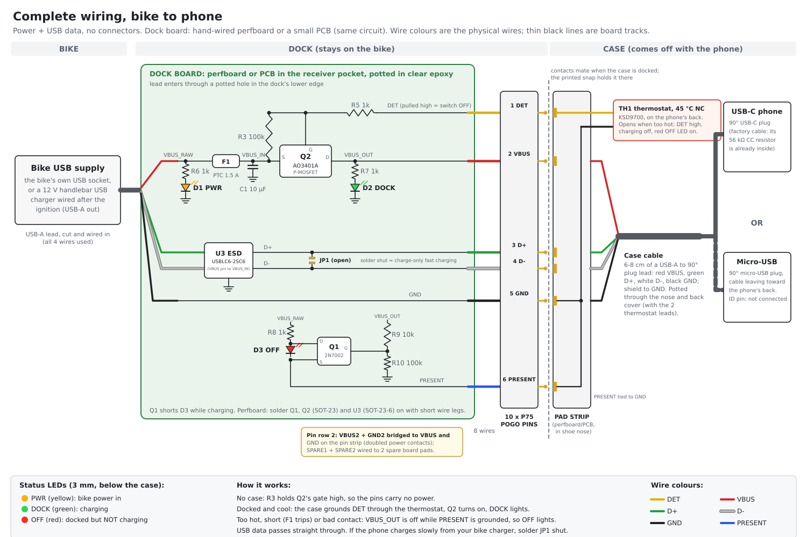
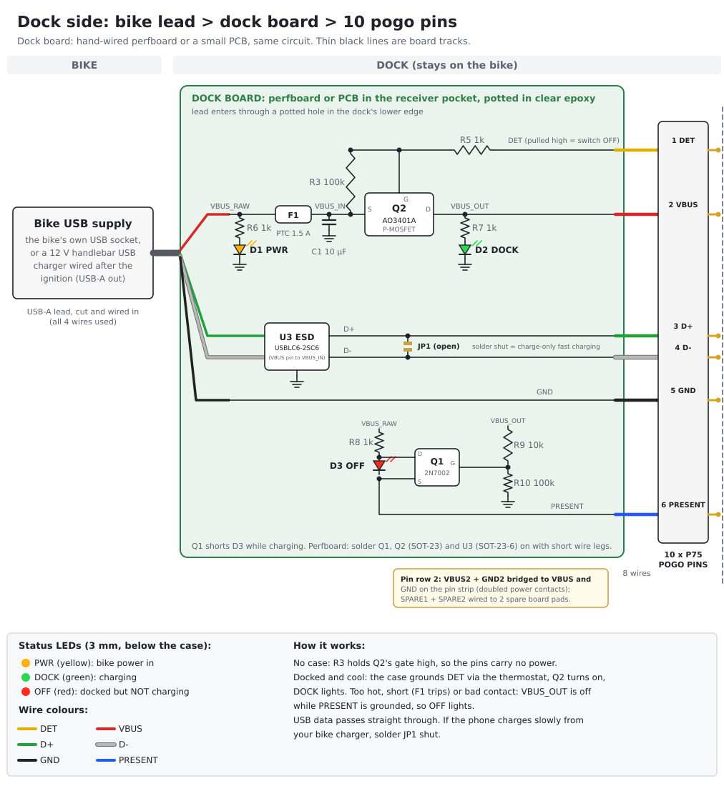
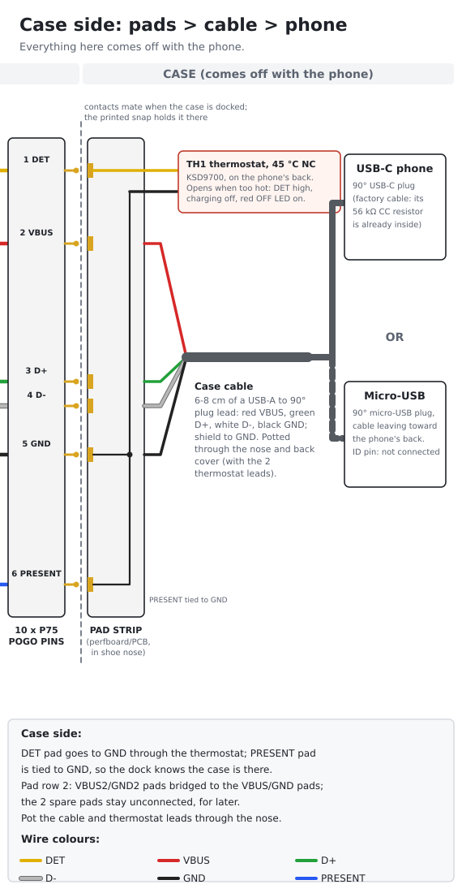
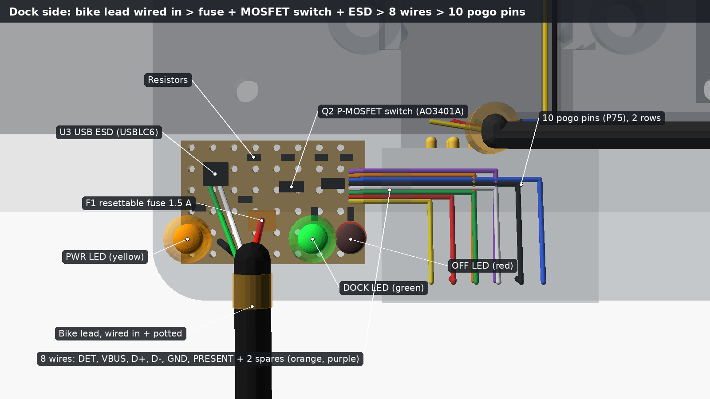
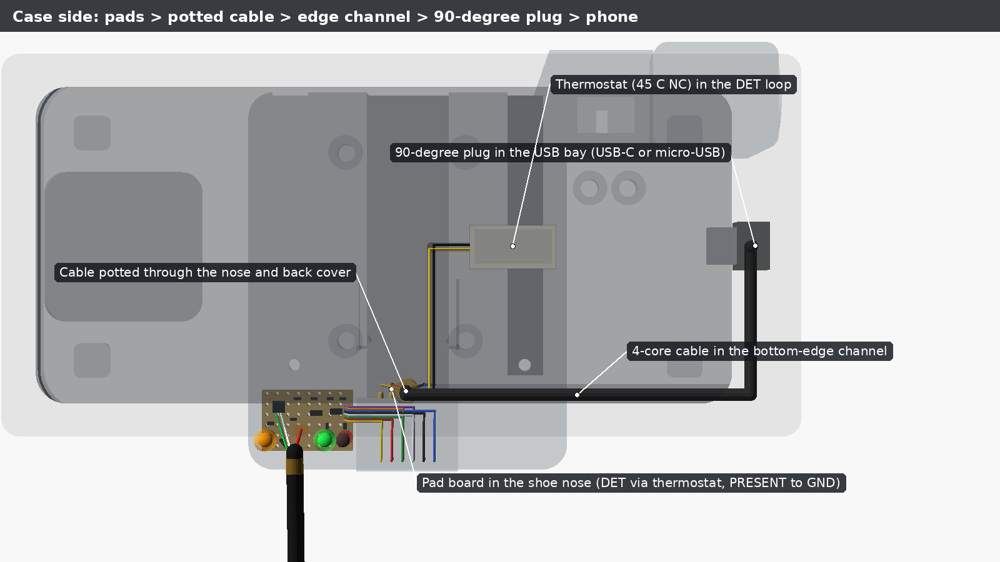

# Power and USB data path

There is **one design**: the case, the dock and every printed part are the same for everyone. The only choice is how you build the dock's electronics:

- **Option A, hand-wired:** the circuit is built on perfboard with short wires. It is the cheapest option, and you can open it up and repair it.
- **Option B, PCB:** the same circuit and parts on a small ordered PCB. It is tidier and quicker to assemble, and it costs about ₹700–2,300 more.

Both use the same parts, the same 1.6 mm board thickness and the same pocket, so nothing in the CAD changes. Prices are in [`SHOPPING_LIST_INDIA.md`](SHOPPING_LIST_INDIA.md).

## Wiring at a glance

The complete harness: the bike's USB lead, the dock board, the 10 pogo pins and pads, and the case cable to the phone's plug (USB-C or micro-USB).



The same wiring split in two, larger, each half with its own legend.

**Dock side** (stays on the bike): bike lead → dock board → 10 pogo pins.



**Case side** (comes off with the phone): pads → thermostat → cable → phone plug.



PNG copies for any image viewer: `images/wiring_diagram.png`, `images/wiring_diagram_dock.png`, `images/wiring_diagram_case.png`.

Where the wires physically run. These are x-ray renders of the CAD, with the case docked:





**Regenerating the images:**
- **Diagrams:** `images/make_wiring_diagram.py` draws them. Its layout is placed by hand, so update it if the circuit below changes.
  - `python3 make_wiring_diagram.py wiring_diagram.svg` draws the full diagram; add `dock` or `case` as a second argument for one side.
  - The PNGs are headless-Chrome screenshots of the SVGs, for example `google-chrome --headless=new --force-device-scale-factor=1.5 --window-size=1012,1100 --screenshot=wiring_diagram_dock.png wiring_diagram_dock.svg`.
- **Renders:** they follow the CAD. Regenerate them with `python3 video/make_video.py --stills`.
- **Wire colours** are the same everywhere: DET yellow, VBUS red, D+ green, D− white, GND black, PRESENT blue, spares orange and purple.

## Block diagram

```text
Bike USB socket, or a 12 V -> 5 V USB charger wired after the ignition
        |
        |  USB-A lead, cut and wired straight into the dock (all 4 wires), potted in its hole
        v
[DOCK]  dock board (perfboard or PCB) in the pocket on the left of the dock, under dock_lid
        |   VBUS_RAW -> D1 yellow PWR LED (lit = bike power in)
        |   VBUS_RAW -> F1 1.5 A resettable fuse -> VBUS_IN
        |   VBUS_IN  -> Q2 AO3401A P-MOSFET switch -> VBUS_OUT -> VBUS + VBUS2 pins
        |                  ^ gate: pulled up by R3, pulled low through R5 by the DET pin (case docked)
        |   VBUS_OUT -> D2 green DOCK LED (lit = charging)
        |   red OFF LED D3 -> PRESENT pin; shorted by Q1 while VBUS_OUT is on (lit = docked but NOT charging)
        |   D+ / D- -> U3 USBLC6-2SC6 ESD -> D+ / D- pins      (JP1: solder shut for charge-only mode)
        |   GND -> GND + GND2 pins
        |
        |   10 x P75 pogo pins in 2 rows, in the dock's stop block, pointing up the rails
        |   ~~~ case slides down; the nose presses onto the pins; the printed snap clicks; key turned ~~~
        |   2-row pad strip in the bottom face of the shoe's nose
        v
[SHOE]  pad strip: PRESENT pad tied to GND; DET pad -> thermostat -> GND pad (2 leads into the case)
        |   cable + thermostat leads straight up through the potted pass-through in the back cover
        v
[CASE]  thermostat (45 C NC) pressed on the phone's back: opens when too hot -> DET high -> charging off
        cable runs in the channel along the bottom edge to the side plug bay
        right-angle plug -> phone: USB-C (the cable's plug has the 56 kOhm resistor) or micro-USB (ID pin open),
        set by phone_port in the .scad
```

## Contact pinout

Looking at the pin faces, left to right:

| | 1 | 2 | 3 | 4 | 5 | 6 |
|---|---|---|---|---|---|---|
| **Row 1** (towards the case's back) | DET | VBUS | D+ | D− | GND | PRESENT |
| **Row 2** | (empty) | VBUS2 | SPARE1 | SPARE2 | GND2 | (empty) |

- **Pitch:** 2.54 mm in both directions, so the pins fit standard perfboard or a PCB with 2.54 mm holes.
- **DET:** on the case side it goes to GND **through the thermostat** (or a wire link if `thermal_cutoff = false`). On the dock side it is pulled up, and switches VBUS on when pulled low.
- **VBUS and VBUS2:** both are live only while the case is docked and the phone is cool. They are bridged on the pin strip **and** on the pad strip, so power has two contacts. That halves the current through each pin, and charging carries on if one contact gets dirty.
- **GND and GND2:** bridged the same way.
- **D+ and D−:** USB 2.0 data. Keep the wires short and twisted together.
- **PRESENT:** tied to GND in the case. On the dock it is the red OFF LED's return, so that LED can only light while a case is docked.
- **SPARE1 and SPARE2:** wired through to spare pads on both boards, unused for now. They are there for a future smart base, so you won't need to reprint anything.
- **Wet contacts:** if rain bridges PRESENT and GND with no case docked, the red LED glows faintly. That works as a warning, and nothing is powered.
- **Why DET sits next to VBUS:** if rain bridges the bare pins, DET is most likely to short to VBUS. That keeps it pulled **high**, so the switch stays off.

## Dock electronics

The dock board does five jobs:
- takes power and data straight from the bike's USB lead;
- switches 5 V onto the pins **only while a case is docked and the phone isn't too hot**;
- protects against shorts (F1) and static on the data lines (U3);
- shows three status LEDs;
- tells you when charging has been switched off.

The video shows it working: the dock-electronics scene runs from 45 to 54 s, and the over-heat cut-off from 54 to 60 s.

### What the LEDs mean

| Yellow PWR | Green DOCK | Red OFF | Meaning |
|---|---|---|---|
| off | off | off | No bike power (ignition off) |
| **on** | off | off | Powered, no case docked. The pins are dead |
| **on** | **on** | off | Case docked and charging |
| **on** | off | **on** | Case docked but **charging is OFF**. Either the phone is too hot (the thermostat has opened), the case isn't fully down, or the DET contact is dirty |
| **on** | off | **on** | The same pattern also shows when F1 has tripped (a short, or water across the pins). It resets by itself once the fault clears |
| **on** | off | faint | No case, but the PRESENT and GND pins are bridged by water ("wet contacts") |

After an over-heat cut-off, charging **resumes by itself** once the phone cools to about 30 °C and the thermostat recloses. The red LED goes out and the green one comes back.

### Circuit

```text
 bike lead red ---- VBUS_RAW --+-- R6 1k -- D1 yellow PWR -- GND
                               |
                               +-- F1 PTC 1.5 A -- VBUS_IN --+-- C1 10 uF -- GND
                               |                             +-- U3 pin 5 (VBUS)
                               |                             +-- R3 100k --+
                               |                             |             |
                               |                     Q2 AO3401A S          GATE --- R5 1k --- pin DET
                               |                             |   G --------+
                               |                     Q2 D = VBUS_OUT --+--> pins VBUS, VBUS2
                               |                                       +-- R7 1k -- D2 green DOCK -- GND
                               |                                       +-- R9 10k --+-- Q1 gate
                               |                                                    +-- R10 100k -- GND
                               +-- R8 1k --+-- D3 red OFF (anode)
                                           |   D3 cathode --+--> pin PRESENT
                                    Q1 2N7002 drain         |
                                    Q1 source --------------+     (Q1 on = D3 shorted = OFF dark)

 bike lead green --- U3 USBLC6-2SC6 (pins 1/6) --- pin D+     JP1: two pads between D+ and D-, normally OPEN
 bike lead white --- U3 USBLC6-2SC6 (pins 3/4) --- pin D-
 bike lead black + shield --- GND --- pins GND, GND2;  U3 pin 2 (GND)
 SPARE1, SPARE2 pins --- two spare pads on the board (unused)
```

**How it works:**
- **No case:** R3 holds Q2's gate at VBUS_IN, so Q2 is off and the pins are dead.
- **Case docked and cool:** the case pulls DET to GND through the thermostat, so Q2 turns on and the green DOCK LED lights. VBUS_OUT turns Q1 on, which shorts the red LED out.
- **Too hot, a short (F1 trips) or a bad contact:** VBUS_OUT is off while PRESENT is still grounded by the case. Q1 is off, so the red OFF LED lights.
- **JP1:** solder it shut only if the phone charges slowly from your bike charger. That tells the phone it is on a dedicated charger, so it fast-charges (up to about 1.5 A), but USB data is then off.

### Parts (one set)

The same parts for both options. Resistors can be through-hole or SMD (0805 is easy to hand-solder).

| Ref | Part | Notes |
|---|---|---|
| F1 | Resettable fuse 1.5 A, ASMD1210-150 (1210) | |
| Q2 | AO3401A P-MOSFET, SOT-23 | The power switch |
| Q1 | 2N7002 N-MOSFET, SOT-23 | Shorts the red LED while charging |
| U3 | USBLC6-2SC6 USB ESD, SOT-23-6 | |
| C1 | 10 µF, 10 V or more | |
| R3, R10 | 100 kΩ | |
| R5, R6, R7, R8 | 1 kΩ | |
| R9 | 10 kΩ | |
| D1, D2, D3 | 3 mm LEDs: yellow, green, red | Standing up into the Ø3.2 mm light pipes |
| JP1 | Two pads (solder jumper) | Normally open |
| — | 10 × P75-B1 pogo pins | 2 rows on a 2.54 mm pitch |
| TH1 | KSD9700 thermostat, 45 °C, normally closed | In the case's back cover |

### Building the dock board

Both options produce a board the same size, with the same LED positions:

- **Board:** 21.5 × 14.5 mm, 1.6 mm thick. The pocket is 22.5 × 15.3 × 6 mm.
- **Bike lead:** it enters through the Ø4.2 mm hole in the dock's lower edge, 10 mm from the pocket's left end. Put a cable tie on it inside the pocket for strain relief.
- **LEDs:** 3 mm LEDs standing upright, 3.5 mm in from the pocket's lower wall. Their tops poke into the Ø3.2 mm light pipes in the pocket's roof. Measured from the pocket's left end:
  - **PWR (yellow)** at 2.0 mm;
  - **DOCK (green)** at 16.2 mm;
  - **OFF (red)** at 20.5 mm.
- **Wires to the pins:** 8 wires (DET, VBUS, D+, D−, GND, PRESENT, SPARE1, SPARE2) leave from the board's right end through a 4.5 × 2.5 mm tunnel. The tunnel starts 7.5 mm from the pocket's lower wall.
- **Sealing:** pot the pocket, the light pipes and the lead's hole with water-clear epoxy (Araldite Klear), then glue on `dock_lid`. The clear epoxy turns the light pipes into sealed windows.

**Option A: hand-wired on perfboard**
- Cut the dock board from double-sided 2.54 mm perfboard, then follow the circuit above.
- Solder the SOT-23 and SOT-23-6 parts (Q1, Q2, U3) on with short wire legs, or glue them on their backs and wire to their legs.
- Make JP1 two adjacent pads with a gap.
- Check every connection with a multimeter before potting.

**Option B: ordered PCB**
- **Board:** a 2-layer board, 21.5 × 14.5 mm, 1.6 mm thick (the standard thickness at most fabs, and what the pocket assumes).
  - Put the parts on the top side and a ground pour on the bottom.
  - Leave a 1 mm keep-out round the edge so the potting can flow underneath.
- **Footprints:**
  - F1: 1210.
  - Q1, Q2: SOT-23.
  - U3: SOT-23-6.
  - Resistors and C1: 0805.
  - LEDs: 3 mm through-hole, at the positions above.
  - JP1: a 2-pad solder jumper, normally open.
  - Pads for the bike lead's 4 wires, and for the 8 wires to the pins.
- **Tracks:** make the VBUS and GND tracks at least 0.6 mm wide. Route D+ and D− side by side and short.
- **Pin strip and pad strip:** these can be PCBs too.
  - **Pin strip:** 16.8 × 5.8 mm, 2 rows × 6 plated holes on a 2.54 mm pitch, sized for the P75 barrels (about 1.1–1.2 mm holes; measure yours).
  - **Pad strip:** 16.8 × 4.8 mm, 2 rows of SMD pads 2.0 × 1.8 mm on a 2.54 mm pitch.
  - Choose an **ENIG (gold)** finish for the pad strip if the fab offers it. It resists corrosion better than tin.
- **Ordering:** put all three boards in one order, or on one small panel if the fab allows that. See `SHOPPING_LIST_INDIA.md`.

### Pogo pins

- **Fitting the pins:** solder the 10 P75 pins through a 2 × 6-hole strip (perfboard or the pin-strip PCB), holding them by their barrels.
  - Set them so about **1.5 mm** of each tip sticks out past the pin face once fitted.
  - Fill the holes as in the pinout table.
- **On the strip:**
  - Bridge VBUS2 to VBUS, and GND2 to GND.
  - Wire SPARE1 and SPARE2 to the two spare pads on the dock board.
- **Fitting the strip:** slide it into the 17.2 × 6.0 × 15.6 mm pin pocket, run the 8 wires through the tunnel, and pot the back so water can't reach the joints.
- **Wires:** keep D+ and D− as a short twisted pair, and use at least 28 AWG for VBUS and GND.
- **Spring force:** the 10 pins push the case back with roughly 5–8 N (estimated). That is well under what the printed snap holds. If the case creeps up the rails with the lock open, print the snap arms 0.2 mm thicker (`flex_t`).

### Drains

The centre channel and both rail channels have a Ø3 mm drain at their lowest point, out through the back of the dock. Keep them clear.

## Case side

The case takes either kind of phone port. Set `phone_port` in the `.scad` to `"usbc"` or `"microusb"`. That sizes the plug bay (8 or 9 mm), and `usb_port_y` moves the end of the cable channel under an off-centre port.

The easiest way to build the case-side cable correctly:

1. Buy a good **USB-A to right-angle** cable with the phone's plug:
   - **USB-C phone:** a USB-A to 90° USB-C cable. USB-C is reversible, so any 90° plug can be turned so its cable leaves toward the phone's back.
   - **Micro-USB phone:** a USB-A to 90° micro-USB cable. Micro-USB only fits one way up, so the angle variant matters. Sellers call them "up" or "down" angle, and the naming isn't consistent. Before cutting, plug it in and check that **the cable leaves toward the phone's back**, because it has to drop into the channel in the back cover.
   - Either way, measure the plug head from the phone's edge to its far side. It must be no more than **7 mm for USB-C or 8 mm for micro-USB** (the bay minus 1 mm). If yours is bigger, raise `usb_bay_h`; the case gets wider by the same amount.
2. Cut it about 6–8 cm from the phone plug.
3. Feed the cut end through the back cover's pass-through and the shoe's nose.
4. Solder its four wires to the pad strip: red to VBUS, green to D+, white to D−, black to GND, and the shield to GND.

**USB-C:** that kind of cable's C plug already contains the 56 kΩ pull-up the phone needs to treat the cable as a power source and charge from it. A bare USB-C plug board without it may not charge the phone at all.

**Micro-USB:** there is no resistor to worry about. Leave the plug's ID pin unconnected, so the phone stays a USB device that charges.

**Then:**
- **Pad strip:**
  - 2 rows of pads in line with the pins. Face to face, the pad order is the **mirror** of the pin order, so wire by function and check each one with a multimeter.
  - Bridge the VBUS2 pad to VBUS, and GND2 to GND.
  - Tie the PRESENT pad to GND.
  - Leave the two spare pads unconnected.
- **Thermostat:**
  - Solder its two leads to the DET pad and the GND pad. Without the thermostat, link DET to GND instead.
  - Feed the leads through the pass-through with the cable. The pass-through is Ø5.5 mm when `thermal_cutoff` is on.
  - Lay the leads in the groove in the back cover's inner face, and press the thermostat into its pocket behind the middle of the phone.
  - Put a 0.5 mm silicone thermal pad on top, so it touches the phone's back once the cover is closed.
- **Potting:**
  - Pot the pad strip into the nose pocket, and pot the cable in the back cover's pass-through, with epoxy.
  - The pass-through is the only hole through the sealed case. Seal it well.

## Data: what to expect

- **The phone is always the USB device.** Data only works if whatever is at the other end of the bike lead is a USB **host**, for example a small computer or head unit. Treat the bike's own USB socket as **power-only** unless you have proved otherwise.
- **Speed:** USB 2.0 over short pogo pins usually works at full speed, and often at high speed (480 Mbit/s), but this is not guaranteed. Test it with your pins before relying on it.
- **Charging speed:** many phones decide how fast to charge from the D+/D− lines. A proper USB charger at the bike end gives full-speed charging, while a power-only socket may limit the phone to a slow 0.5 A. JP1 fixes that, at the cost of data.

## Bring-up checklist

1. **Power, no case:** bike power on (or a USB power bank on the bike lead). Only the **yellow** LED is lit, and the VBUS pins read 0 V.
2. **Fake a dock:** short DET to GND by hand. VBUS switches on and the green LED lights. Release DET: VBUS and the green LED go off at once.
3. **Dock the case with the phone:**
   - The snap clicks, and with the lock still **open** the **green** LED lights and the phone charges. Then lock it.
   - If the phone shows slow charging, solder JP1 shut.
   - If you need data, check that the phone shows up on a USB host at the bike end.
4. **Over-heat test:** warm the back of the case gently with a hair dryer. At about 45 °C the green LED goes off, the red OFF LED lights and charging stops. As it cools to about 30 °C, charging resumes by itself.
5. **PRESENT check:** with no case docked, short PRESENT to GND by hand. The red LED lights; release it and the LED goes off.
6. **Contact test:** dock and undock 20 times, and wiggle the docked case. The snap should hold the case on the contacts with the lock **open**.
7. **Water test:** spray the empty dock with the case removed, and check the water runs out of the drains. Dry it, then repeat steps 1–3.

## Future smart base (Arduino, speakers, ...)

The base plate is a separate module, so it can later become an electronics box. The cleanest way to connect it:

- **Power:** the bike feeds the smart base, and the dock's lead is wired to the smart base instead of the bike, routed through the Ø14 mm hole in the base.
- **Audio:** the phone can reach the base's speakers over Bluetooth to an audio board, with no extra contacts.
- **Data:** if the smart base contains a USB **host** (for example a Raspberry Pi-class board, or a microcontroller with USB host support), it can talk to the phone over D+/D−. A plain Arduino Uno or Nano cannot act as a USB host without an add-on.
- **Spare contacts:** SPARE1 and SPARE2 already run from the dock board to the case's pad strip, for example for a handlebar button or a sensor in the case. No reprint is needed.
