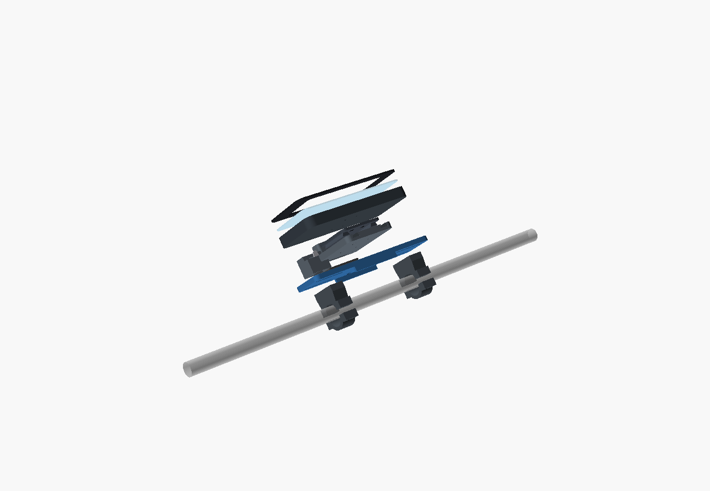

# Modular handlebar navigation dock

**Project:** Old phone converted into a permanent motorcycle navigation screen (landscape)
**First bike:** Royal Enfield Meteor 350 (2025). The design is adjustable for most bikes with a round handlebar.
**Revision:** 0.4 concept prototype (0.2 and 0.3 are in `archive/`)
**CAD:** OpenSCAD 2021.01, millimetres

> **Prototype status:** this is a dimensioned concept model. It has not been tested on the road, for water ingress, for heat or for vibration. Anything marked **MEASURE** or **SELECT** in the `.scad` file is a placeholder.



## The module stack

Each layer bolts to the next through a fixed interface, so any layer can be redesigned or upgraded without touching the others.

| # | Module | Files | Interface to the layer above |
|---|---|---|---|
| 1 | **Handlebar clamps** (×2, left and right of the bar centre) | `clamp_body.stl`, `clamp_cap.stl`, `bar_shim.stl`, `pad_spacer.stl` | **A:** each clamp pad has 2 × M5 inserts, 36 mm apart fore-aft |
| 2 | **Base plate** (swap later for a smart base) | `base_plate.stl` or `base_plate.dxf` (metal) | **B:** AMPS pattern (4 × M5, 30 × 38 mm) through rubber grommets, plus a Ø14 mm cable hole |
| 3 | **Dock / receiver** | `receiver.stl`, `ledge_lid.stl`, `cam_template.stl` | **C:** dovetail shoe, 5 spring contacts on the bottom edge, and a lock slot |
| 4 | **Phone case** (phone-specific) | `case.stl`, `bezel.stl`, `window_template.stl`, `shoe.stl` | |

**Why AMPS for interface B?** It is the standard 4-hole pattern used by RAM, Garmin and most mount makers. The dock can therefore also bolt onto off-the-shelf AMPS mounts, and the base plate can carry any AMPS device.

## Adjusting it to a bike

| What to adjust | How | Parameter |
|---|---|---|
| Bar diameter | **TPU shim half-shells:** 22.2 mm (7/8"), 25.4 mm (1"). **0.5 mm rubber tape only:** 28.6 mm (1-1/8") | `bar_d`, then export `bar_shim` |
| Clamp spacing | Slots in the base plate allow 110–210 mm centre-to-centre | `clamp_spacing`, `slot_in`, `slot_out` |
| Screen tilt | Rotate both clamps on the bar to the same angle, then tighten | `tilt` (preview only) |
| Height above the bar | Add `pad_spacer` blocks under the plate, or lengthen the clamp arm | `spacer_h`, `arm_up` |
| Fore-aft position | Offset the clamp pad behind or ahead of the bar | `arm_back` |
| USB-C on the left or right | Mirrors the USB bay and cable route inside the case | `usb_side` |

**Limits:**
- Both clamps must sit on a **straight, round** part of the bar, one either side of the riser clamps or instrument cluster. Swept or kinked sections will not work.
- Both clamps need the same tilt angle, or the plate will twist.
- The plate must clear the riser clamps, the cluster and the brake/clutch reservoirs. Raise it with `arm_up` or spacers if not.

**Size at the default settings** (160 mm clamp spacing, `arm_up` 38 mm, 40° tilt):
- the dock is 228 mm wide;
- the top of the case is about 98 mm above the bar axis, and the front edge about 29 mm ahead of it;
- the lower edge (lock and USB socket) is about 100 mm behind the bar and about 27 mm below bar level, toward the tank.

At 20° the top is about 97 mm high; at 60° about 88 mm.

## Measure before printing

- **Phone:** body length, width, thickness, corner radius, camera island and USB-C side. These go in `phone_*`, `camera_*` and `usb_side`. The current values are a dummy 75 × 160 × 9 mm phone.
- **Handlebar:** diameter at the clamp positions, the length of straight bar either side of the centre, and the clearance over the riser clamps and cluster.
  - For the Meteor 350, check the bar size with calipers. Aftermarket bars listed for it are 22 mm (7/8"), but the stock bar is not confirmed.
- **Clearance:** full steering lock in both directions, with nothing touching the tank, the mirrors or the cables.
- **Mock-up first:** a 197 × 100 mm piece of cardboard taped at the planned position will show whether the speedometer stays visible.

## How docking and locking work

1. Turn the key to unlocked. Slide the case down onto the dock; the rails are open at the top edge.
2. The flat pads on the case's bottom edge press onto the spring pins in the dock's ledge, and a foam seal around the pins compresses.
3. Turn the key a quarter turn. The steel cam swings up into a slot in the case's bottom flange.
   - The case cannot lift out, because the 4 mm lip under the slot hits the cam.
   - The pin springs push the case up against the cam, which takes out the slack.
4. Power reaches the pins only when the case is docked (see `WIRING.md`).
5. The key goes in from the **rider-facing lower edge**, next to the dock's USB-C socket.

**Lock (SELECT):**
- Use a 19 mm (3/4") tubular quarter-turn cam lock with a **key removable only when locked**.
- Its body must reach 20 mm from the panel to the cam.
- Cut its steel cam to 18 mm from the axis (`cam_template.stl`).
- Check that it turns the right way: from horizontal, pointing away from the rails, to pointing up toward the case.
- **Security level:** a printed dock stops casual theft, not someone with tools.

## Damping

There are four rubber grommets with steel sleeves (M5, for a 9.5 mm hole in a 3 mm panel) in the base plate, at interface B. Everything above the base plate floats on them:
- the dock;
- the case;
- the phone.

Bolt from under the plate through each grommet into the dock's M5 inserts. Use a large washer under each bolt head, so the dock stays captive if a grommet tears.

## Upgrading to a "smart base" later

A replacement base only has to keep two things:
1. **Underneath:** two pairs of M5 slots on y = ±18 mm, between 55 and 105 mm from the centre each side. These fit the clamps (interface A).
2. **On top:** AMPS 30 × 38 mm M5, ideally with the same grommets, plus a cable opening (interface B).

Inside it you are free to add, for example:
- an Arduino or ESP32;
- speakers or a buzzer, which fit well at the two ends beyond the clamps;
- a battery or power board;
- sensors;
- a fan.

The dock's USB-C socket can be fed from the smart base instead of directly from the bike. That lets the smart base switch power, monitor temperature or act as a USB host for data. See the notes in `WIRING.md`.

## Materials and hardware

| Item | Starting choice |
|---|---|
| Case, bezel | ASA (FDM) or PA12 (SLS/MJF) |
| Shoe, receiver, lid | PA12 / ASA |
| Base plate | PA12 / ASA (228 mm long, so check the printer bed), or 5–6 mm aluminium cut from `base_plate.dxf` (counterbores then done by hand) |
| Clamps | PA12 or PETG/ASA at 100% infill around the ring; shims in TPU 95A |
| Window | 2 mm polycarbonate, with 8 holes drilled from the template |
| Seals | Silicone cord in the window groove; foam or silicone around the dock pins; foam under the ledge lid |
| Clamp bolts | 2 × M5 per clamp into heat-set inserts. Tighten evenly and check them after the first ride, because plastic clamps relax over time. |
| Plate bolts | 4 × M5 button heads (interface A); 4 × M5 through the grommets (interface B) |
| Other fasteners | M3 stainless (bezel, lid); M4 countersunk (shoe to case) |

## Things to watch with a full-time phone

- **Heat and battery swelling:** charging all day inside a sealed case in the sun is hard on an old phone. Use a charge limit if the phone has one, watch the temperature on the first long rides, and inspect the battery regularly.
- **Safety tether:** fit a short tether from the case to a clamp until the whole system has been tested.

## Build order

1. Make the cardboard mock-up on the bike. Measure the bar and choose the clamp spacing.
2. Print the clamps and shims. Check their grip and rotation on the bar, and set the tilt.
3. Print the base plate and fit it. Check the clearance over the cluster and at full steering lock.
4. Measure the phone, update the profile and print the case. Check the fit, the camera relief and the USB-C plug.
5. Buy the lock, the pogo/target connector pair, the USB-C panel socket and the grommets. Update the SELECT parameters, print the receiver and bench-test docking.
6. Do a spray test with dry tissue inside, then a ride test without the phone, then a heat test with the phone.

## Exporting

Set `PART` to a part name and press F6, then Export as STL. Use `base_plate_2d` and Export as DXF for the metal plate. From the command line:

```sh
openscad -D 'PART="clamp_body"' -o clamp_body.stl phone_dock_v1.scad
openscad -D 'PART="bar_shim"' -D 'bar_d=25.4' -o bar_shim_25.stl phone_dock_v1.scad
```

## Changes from 0.3

- **Case:** turned to landscape. The cable now runs in a channel under the phone from the side USB bay to the bottom contacts.
- **Mounting:** two adjustable handlebar clamps and a base plate replace the plate under the clamp bolts and the toothed pivot. The tilt now comes from rotating the clamps on the bar.
- **Interfaces:** standard interfaces between the layers (clamp pad, AMPS), so the base plate can be swapped for a smart base.
- **Lock:** moved to the rider-facing lower edge. The cam now locks into the case itself, so the striker bar on the shoe is gone.
- **Rails:** spacing widened to 56 mm, to make room for the AMPS inserts.
