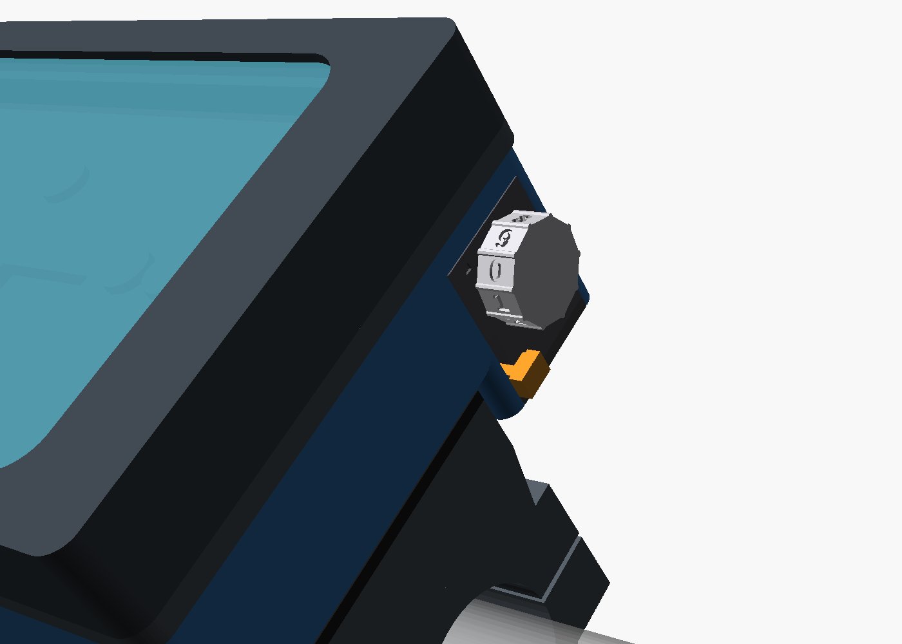

# Dial combination lock (demo)

A **fully mechanical** combination lock for the dock, with **one dial**, like a safe: no key and no power. The dial is numbered 0–9 round its rim, and your code is **4, 5 or 6 digits**. **Dial the code to open; press the button to lock.** That one press also clears the code. It comes in its own lock cartridge, so it fits the same lock bay as the store-bought cam lock and the printed lock (`lock_type = "dial"`). The dock, the lock cover, the steel bolt and the strike are unchanged.

> **A demo / concept.** It is checked in CAD, but not printed or tested. A patient person can feel out the code of a printed dial lock, so treat it as a deterrent, and keep the store lock for the best security.




Watch it work in `video/lock_demo.mp4`: its third part shows the wheels cut in half, the fence, the latch, the reset hammer and the button.

## Using it

- **To unlock:** dial the code like a safe. With the example code 3-7-1-9:
  1. turn **right** (clockwise) a few turns, and stop at **3**;
  2. turn **left**, past 7 once, and stop at **7** the second time;
  3. turn **right**, stop at **1**;
  4. turn **left**, stop at **9**.

  With the last digit, the **button pops out** and the bolt drops. Slide the case off.
- **The rule for any length:** for an N-digit code, turn right for the 1st digit, passing it N−1 times and stopping on the Nth. Then go left for the 2nd, passing it N−2 times. Keep alternating; for the last digit, turn straight to it. Read the number on the dial's **rim**, next to the index mark (the small triangle on the face plate, at the dial's upper left as you face the side of the dock). That part of the rim faces the rider, so you can read it from the seat.
- **To lock:** dock the case and **press the button in**. That's all. The bolt goes up into the case, and the button stays in.
  - The press also **clears the code**: a small hammer snaps the front wheel back to its "home" position, so the lock can only be opened again by dialling the whole code.
  - The button also clears it on its way out when you unlock, so the dial never sits at your code.

## How it works

- **Dial, spindle and drive cam:** the dial turns a spindle through a fixed tube in the face plate. At the spindle's rear end is the drive cam.
  - The dial has **ten flats round its rim**, with 0–9 engraved on them, upright as you read them (like a luggage lock), and a grip rib on each corner.
- **Wheels:** one per digit, turning freely on the tube.
  - Each wheel and the cam have small pins (**flies**) on their faces. Turning the dial, the cam picks up the first wheel after nearly a turn, that wheel picks up the next, and so on. That's why each digit needs one fewer turn than the one before, as on a safe.
  - Each wheel has one **notch** in its rim. Where the notch sits on the wheel sets that wheel's digit.
- **Fence and latch:**
  - The fence is a bar under the wheels, pushed up by a small spring. When every notch is at the bottom (only with the right code), it rises 1.5 mm into them.
  - A **latch** is printed on the fence: a thin springy arm with a tooth at its end. The tooth sits in a notch in the button's bar and holds the button in.
  - When the fence rises, it lifts the tooth out: the button's spring pushes the button out, and the lifter's spring pulls the bolt down.
- **Button:**
  - Pressed in, its 40° ramp lifts the lifter's pin 7 mm, and with it the bolt.
  - While the button was out, the tooth rode on top of the bar with its arm bent. When the notch comes under it, the arm snaps the tooth in: locked.
- **Reset (the code is cleared):**
  - The front wheel (the one next to the dial) has a **heart-shaped cam** on its front half. Under it sits a small **hammer**, lifted for a moment by a hump in a groove in the button's bar, each time the button goes in or out.
  - Pushed against the heart, the hammer turns the front wheel to "home", like a stopwatch's reset button. At home the wheel's notch is at the top, away from the fence.
  - To bring the front wheel back to its digit, the dial has to pick it up through every other wheel. That moves them all, so the **whole code** has to be dialled again. That's why one press is enough to lock it securely.
  - The hammer is back down before the button is fully in, so the dial is free to turn.
- **The lifter** carries the same steel bolt, on the same arm as the store lock's yoke.
  - **Locked, its pin sits on the button bar's flat top.** Pushing the bolt down presses straight down on the bar, so it can't push the button out.

## Parts

STLs are in [`dial_lock/`](dial_lock/), made with the example code `[3, 7, 1, 9]`. Print your own wheels with your code.

| Part | File | Qty | How to print |
|---|---|---|---|
| Cartridge | `dl_cartridge.stl` | 1 | Standing on its bottom face, as it sits in the dock. It includes the fixed tube the wheels turn on. It replaces `lock_cartridge` |
| Wheels | `dl_wheel_1.stl` … `dl_wheel_4.stl` (or `dl_wheels.stl`) | 1 each | Flat, 100 % infill, 0.12–0.16 mm layers. **They differ** (each notch is in a different place). Wheel 1 is the front one, next to the dial, with the heart cam |
| Spindle with drive cam | `dl_spindle.stl` | 1 | On its side, 100 % infill, PETG or PA12 |
| Dial | `dl_dial.stl` | 1 | Face down (the face is plain; the numbers are on the rim's ten flats). Fine layers so the numbers come out; rub white paint into them to make them easy to read |
| Fence with latch | `dl_fence.stl` | 1 | On its bottom, 100 % infill, PETG (the latch arm flexes) |
| Reset hammer | `dl_hammer.stl` | 1 | Flat, 100 % infill |
| Button (bar) | `dl_plunger.stl` | 1 | On its bottom, 100 % infill |
| Lifter | `dl_lifter.stl` | 1 | Standing on its pin and beam, 100 % infill. It replaces `lock_yoke` |

**Bought parts (India, est.):** 3 small compression springs, all from one assortment kit (Amazon.in, or Lamington Road), about ₹100–250:

| Spring | Size |
|---|---|
| Lifter spring | 5 mm OD, about 18 mm long (works at 9–16 mm) |
| Button spring | 4 mm OD, about 17 mm long, solid at 3 mm or less |
| Fence spring | 3 mm OD, 0.3 mm wire, about 8 mm long (works at 5–6.5 mm) |

The latch has no spring of its own: its arm is printed springy (it bends 1.5 mm over 10 mm, under 2 % strain).

It also uses the steel bolt, the bearing block, the standard `lock_cover` and its 3 screws, as the store lock does.

**Total:** about ₹150–350 (est.): the springs, plus about 12 cm³ of printing. That's a little under the ₹270 store lock.

## Choose your code

**To look at the lock in OpenSCAD, open `dial_lock.scad`** (not the file in `lib/`, which only holds the parts and settings and gives errors on its own). It shows `PART="dl_exploded"`; change `PART` at its end to see or export any part.

In `lib/dial_lock.scad`, set `dial_code`: 4, 5 or 6 digits, 0–9. The wheels follow it. With 6 digits the wheel pack just fits between the face plate and the lifter (an assert checks it). Then export the wheels:

```sh
openscad -D 'lock_type="dial"' -D 'PART="dl_wheels"' -o dl_wheels.stl phone_dock_v0.5.scad
openscad -D 'lock_type="dial"' -D 'PART="lock_cartridge"' -o dl_cartridge.stl phone_dock_v0.5.scad   # its tube length follows the code
```

The other parts don't depend on the code. Don't publish the wheels with your own code.

**How the notch angles are worked out:** the last wheel each step leaves behind trails the dial by the flies' contact angle (16.1° per wheel in the chain), in the direction you turned. `dl_gate_a()` places each notch accordingly, so the code you dial is the code you set. The lock video's script simulates the pickup and checks that dialling the code lines every notch up exactly.

## Assembly

On the bench first, then into the dock:
1. **Wheels and spindle:**
   - Slide the wheels onto the cartridge's tube from behind: wheel 1 first (it goes nearest the face plate).
   - Push the spindle through the tube from behind, cam last.
   - Press the dial onto its front end, on the flat, with 0 at the index mark when the cam's pin is at the top.
2. **Fence and hammer:**
   - Put the fence's spring on the lock cover's position (under the fence's rear end), and fit the fence under the wheels, its latch beside the button's path.
   - Fit the hammer under the front wheel's heart, its peg facing the button's bar.
3. **Button:** put the button spring in its channel, and slide the bar in from below, with its tab against the spring, the hammer's peg in its groove and its front out through the face plate.
4. **Lifter:** press the bolt into the lifter with retaining compound. Fit its spring and the lifter, with its pin over the button's bar.
5. **Into the dock:** push the cartridge up into the bay from below, with the bolt going up through the guide in the pod's roof. Screw on the lock cover.
6. **Test:**
   - Press the button: it stays in, and the bolt is up.
   - Dial the code: the button pops out and the bolt drops.
   - Press it again, and try to open it by turning the dial back to the last digit: it must stay locked (the press cleared the code).
   - Try a wrong code: the button must stay in.

## Checked in CAD

These checks are built in as `PART="dl_check_*"`, run with `lock_type="dial"`. They were run on the one-piece and the modular dock, with 4- and 6-digit codes.

| Check | Result |
|---|---|
| Button, lifter, fence and latch, hammer, spindle and wheels vs the cartridge, in 6 states: locked; code set; on the way out, halfway up the hump and at its top; out; on the way in (`dl_check_cart`) | No overlap |
| The same parts, the dial and the bolt vs the dock (`dl_check_dock`) | No overlap |
| The parts vs each other (`dl_check_parts`) | Touching only: the latch's tooth rests on the button's bar while it's out |
| The parts vs the lock cover (`dl_check_cover`) | No overlap |
| **Must collide:** the fence pushed 0.5 mm up with the wheels off the code (`dl_check_scrambled`) | **Blocked** by every wheel (2.38 mm³ with 4) |
| **Must collide:** the button pushed 0.5 mm out while latched (`dl_check_held`) | **Blocked** (0.63 mm³) |
| **Must collide:** the raised hammer vs a front wheel that isn't at home (`dl_check_reset`) | **Pushes it** (6.38 mm³): the heart is turned home |
| **Must collide:** the bolt pushed down 0.5 mm while locked (`dl_check_backdrive`) | **Blocked** (2.64 mm³): the pin sits on the flat |
| Cartridge vs the dock, in place and on its way in; pulled out 0.5 mm | No overlap; **blocked** (63.7 mm³) |
| The dialling, simulated (video script) | Dialling the code lines up every notch to within 0.5° |
| All parts | Watertight single bodies (`dl_wheels` is 4 on purpose) |

**Not checked:**
- the springs' real forces and the friction of the wheels on the tube;
- how sharply the latch lets go, and how long its printed arm lasts;
- the hammer's reset under the springs' real forces;
- how well a printer holds the 1.5 mm fence rise and the small flies;
- rain.
