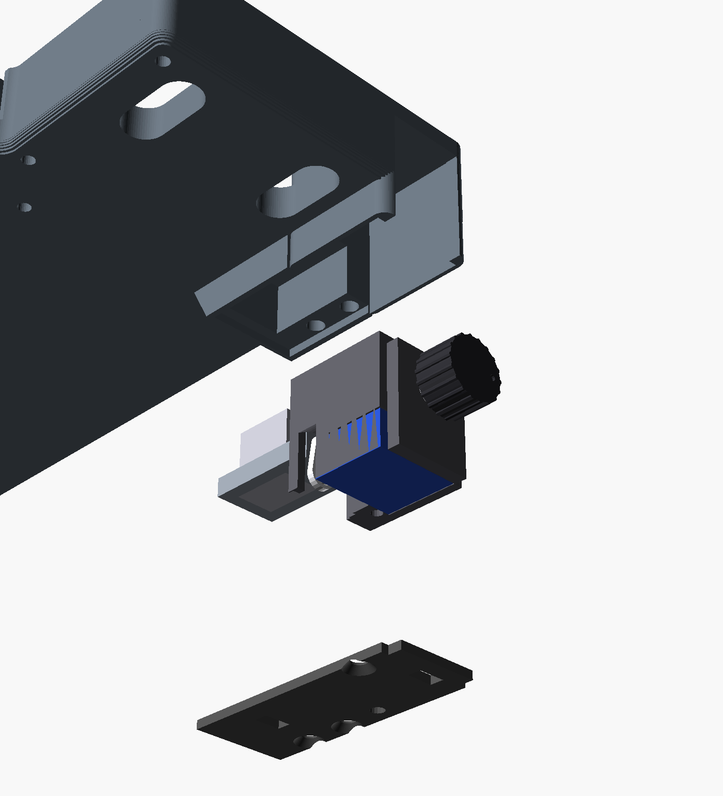
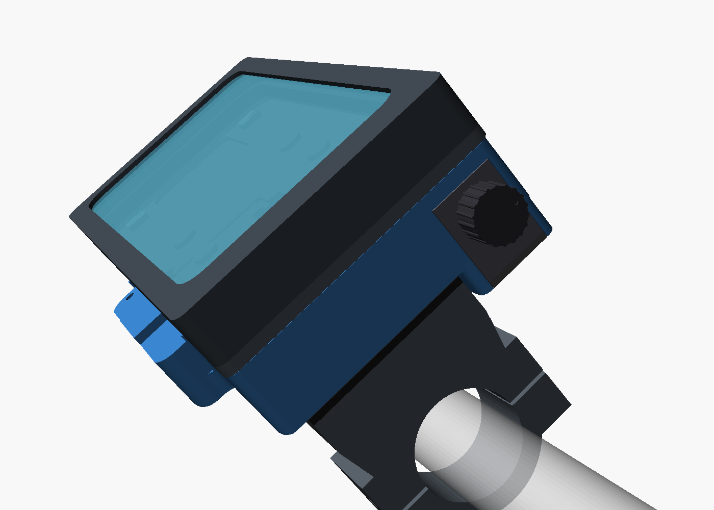

# Dial-code lock (demo)

A **demo** of an electronic lock for the dock: no key. You dial a code on a knob like a safe, and **press the knob to lock**. It comes in its own lock cartridge, so it fits the same lock bay as the store-bought cam lock and the printed lock (`lock_type = "keypad"`). The dock, the lock cover, the steel bolt and the strike are unchanged.

> **This is a concept, not a finished lock.** It needs the bike's 5 V to open, the knob and the electronics are not sealed against rain, and the code can be found by someone patient. Use it to try the idea, and keep the store lock for everyday use.

## Using it

- **To unlock:** turn the knob like a safe dial, counting the clicks:
  1. turn **right** (clockwise) the first number of clicks;
  2. turn **left** the second number;
  3. turn **right** the third number;
  4. stop. After 1.5 s the code is checked, and if it's right the servo drops the bolt. Slide the case off.
- **To lock:** dock the case and **press the knob**. The servo raises the bolt into the case.
- **A wrong code** makes it ignore the knob for 3 s, then 6, 12 and so on up to 60 s.
- **The code** is 3 numbers from 1 to 30 (set in the sketch), so about 27,000 combinations.
- **No power, no change:** with the ignition off, the servo holds where it is. A locked case stays locked; to open it you need the bike's power on.

## How it works

Inside the cartridge:
- **Knob:** an EC11 rotary encoder with a built-in push switch, behind the cartridge's face plate. A printed knob goes on its shaft.
- **Brain:** an ATtiny85 on a small piece of perfboard above the servo. It reads the clicks and runs the servo. The code is in [`keypad_lock/keypad_lock.ino`](keypad_lock/keypad_lock.ino).
- **Servo:** a 3.7 g class micro servo lies on the lock cover, with its shaft pointing back into the pod.
  - Its horn is the crank: an M2 screw at 7 mm radius sits in a horizontal slot in the **lifter**.
  - The lifter carries the same steel bolt on the same arm as the store lock's yoke.
  - A quarter turn of the servo moves the bolt 7 mm, exactly as the store lock's crank does.
- **Locked, the pin is straight up** (top dead centre). Pushing the bolt down presses straight along the horn, so it can't turn the servo back.

## Parts

STLs are in [`keypad_lock/`](keypad_lock/). Print them in PETG or ASA.

| Part | File | Qty | How to print |
|---|---|---|---|
| Cartridge | `kp_cartridge.stl` | 1 | Standing on its bottom face, as it sits in the dock. No supports. It replaces `lock_cartridge` |
| Lifter | `kp_lifter.stl` | 1 | Standing on its bottom face, 100 % infill. It replaces `lock_yoke` |
| Horn | `kp_horn.stl` | 1 | Flat, 100 % infill. Or cut the servo's own single-arm horn so its pin hole is 7 mm from the centre |
| Knob | `kp_knob.stl` | 1 | Top face down |

**Bought parts (demo, India, est.):**

| Item | Where | Price |
|---|---|---|
| 3.7 g micro servo, about 20 × 8.5 × 17.5 mm body. **Cut off its mounting tabs**: the cartridge holds it. Check the size first (`kp_srv_*` in `keypad_lock.scad`) | Robu, Amazon.in | ₹200–300 (est.) |
| EC11 rotary encoder **with push switch**, 20 detents, 6 mm D shaft, M7 bushing | Robu, Lamington Road | ₹30–60 (est.) |
| ATtiny85 (DIP-8) and an 8-pin socket | Robu, Lamington Road | ₹100–160 (est.) |
| Perfboard scrap, 100 nF and 100 µF capacitors, M2 × 6 screw (crank pin), 2-core thin cable about 30 cm | Lamington Road | ₹30–60 (est.) |
| A programmer: a USBasp, or an Arduino Uno/Nano you have, used as "Arduino as ISP" | Robu | ₹0–250 |
| **Total** | | **≈ ₹360–830**, against ₹270 for the store lock |

It also uses the steel bolt, the bearing block, the standard `lock_cover` and its 3 screws, as the store lock does.

## Wiring

| ATtiny85 pin | Goes to |
|---|---|
| 5 (PB0) | servo signal (orange) |
| 2 (PB3) | encoder A |
| 3 (PB4) | encoder B |
| 7 (PB2) | encoder push switch (its other leg to GND) |
| 8 (VCC) | 5 V (also the servo's red wire) |
| 4 (GND) | GND (also the encoder's C pin, the switch and the servo's brown wire) |

- Put **100 nF** across VCC and GND at the chip, and **100 µF** across the servo's 5 V and GND.
- **5 V feed:**
  - take it from the dock board **after the fuse F1 and before the MOSFET switch**, so it is on whenever the ignition is on, docked or not;
  - run a thin 2-core cable from the board before potting, out under the dock base, and up through the **cable hole in the lock cover**;
  - the hole is under the cartridge's cable channel; with the other locks it is just one more drain.
- The servo draws up to about 0.5 A while it moves, for under a second. The bike's USB supply handles that, but check yours gives at least 1 A.

## Programming and setting up

1. In the Arduino IDE, install **ATTinyCore**. Choose "ATtiny25/45/85 (No bootloader)", ATtiny85, 8 MHz internal.
2. Connect the programmer. Run **Burn Bootloader** once, to set the 8 MHz fuses.
3. In `keypad_lock.ino`, set your `CODE`. Upload.
4. **Calibrate the servo before fitting the horn.**
   - Power it and press the knob: the servo goes to `SERVO_LOCKED_US`. Fit the horn with its pin **straight up**.
   - Dial the code: it should turn a quarter turn, pin toward the rider side.
   - Adjust `SERVO_UNLOCKED_US` until the bolt sits fully down, without the servo straining at the end.
5. If turning right counts as left, set `ENCODER_REVERSED = true`.

## Assembly

On the bench first, then into the dock:
1. Fit the encoder through the face plate from inside, its lug in the small slot, and tighten its nut on the outside. Fit the knob.
2. Solder the board, wire it to the encoder and the servo, and lay it in the cavity above the servo.
3. Press the bolt into the lifter with retaining compound. Put the lifter in its pocket at the back of the cartridge from below.
4. Fit the horn and its M2 pin. Slide the servo in from below, its shaft toward the lifter, with the pin in the lifter's slot. Feed the 5 V cable down the channel.
5. Push the cartridge up into the bay from below, with the bolt going through the guide in the pod's roof. Pass the cable through the cover's hole and screw on the cover.
6. **Test before docking the phone:** dial the code (the bolt drops), press (the bolt rises), and try a wrong code.

## Checked in CAD

Run with `lock_type="keypad"`, on both the one-piece and the modular dock:

| Check | Result |
|---|---|
| Lifter, horn, pin, servo, encoder, knob and board vs the cartridge, at 0, 50 and 100 % of the turn (`PART="kp_check_cart"`) | No overlap |
| The same parts and the bolt vs the dock (`kp_check_dock`) | No overlap |
| Horn pin in the lifter's slot, 5 points of the turn (`kp_check_pin`) | No overlap |
| Moving parts and servo vs the lock cover (`kp_check_cover`) | Touching only: the servo sits on the cover |
| Cartridge vs the dock, in place and on its way in (3, 15, 32 mm); pulled out 0.5 mm | No overlap; **blocked** (56 mm³) |
| Locked bolt vs the case pulled up 0.5 mm | **Blocks removal** (30.4 mm³) |
| Clamps and bar at 0, 40 and 70° tilt, with the knob | Touching only / no overlap |
| All printed parts | Watertight single bodies |

**Not checked:** the servo's real size (they vary: measure yours), its torque against the bolt's friction, the code on real hardware, and anything about rain.
