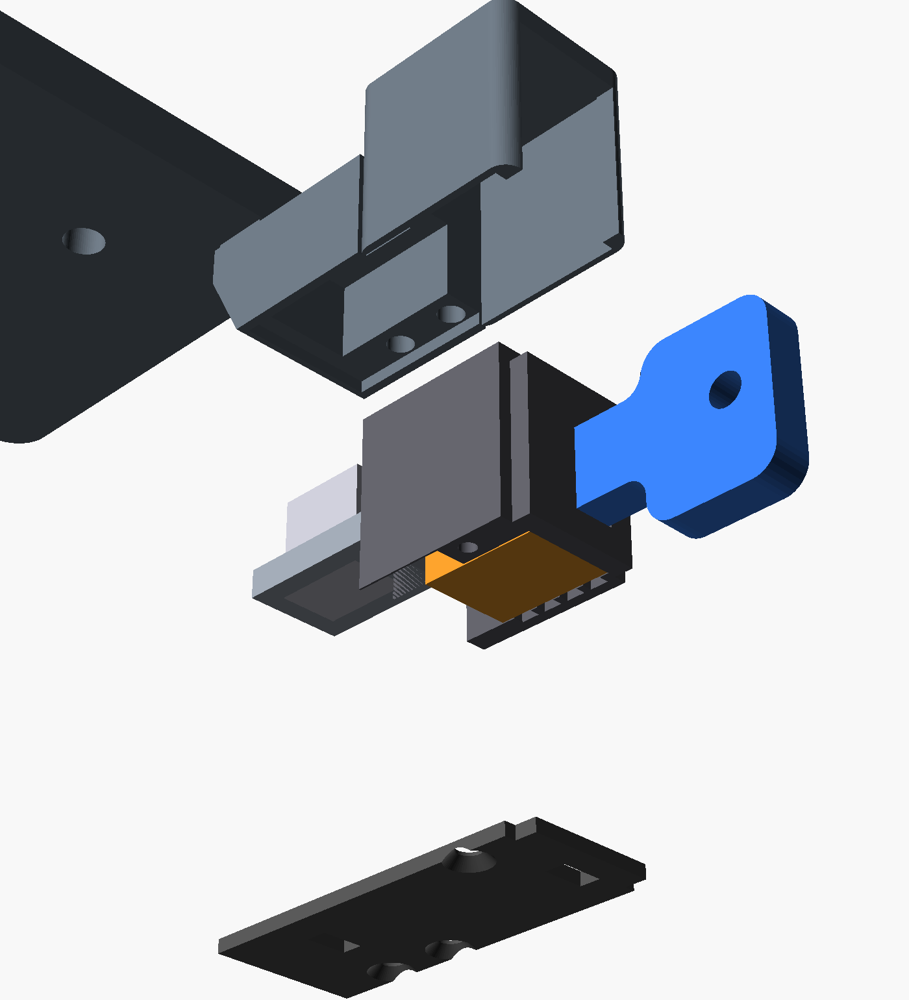

# Printed lock and key (optional)

A lock designed for 3D printing, as an alternative to the store-bought 16 mm cam lock. It is **not** a copy of a store lock: it is a **push-key lock**. A chunky printed key, a solid 6 × 10 mm bar, slides straight into a slot in the side of the dock, with no turning. It drives the same steel bolt and strike as the store lock, so the parts that take the load are unchanged.

| | Store-bought cam lock (default) | Printed lock |
|---|---|---|
| Security | Better: metal wafers, hardened body | **Casual-theft deterrent only.** It can be forced or drilled |
| Key | Comes with 2 metal keys; you turn it | Your own code; a chunky 6 × 10 mm printed key you push in. Print spares any time |
| Work | Drill the lock's cam for the crank pin | No drilling: print, add 4 small springs, assemble |
| Cartridge (the dock is the same) | `lock_cartridge` | `printed_lock/plock_cartridge` |
| Parts cost | About ₹270 for the lock | About ₹160–430 (4 springs; the printing is small) |

Use it if you can't find a suitable quarter-turn lock, want your own key code, or want a lock you can rebuild. For the best theft protection, use a good store-bought lock.


**It fits the same dock as the store lock.** The dock's lock pod is a plain bay, and each lock comes in its own printed cartridge that slides up into it from below. This lock's cartridge has the key slot in its face plate, the shuttle's channel and the groove for the wafer tabs. The dock, the lock cover, the steel bolt and the strike don't change, so you can switch between the two locks by printing the other cartridge.



## Using it

- **To unlock:** push the key fully into the slot in the side wall, then push it in a further 7 mm, until the key's head is almost against the wall. The bolt drops, and you can slide the case off. The key stays in while unlocked; it can't be pulled out yet.
- **To lock:** with the case docked, pull the key back out to its first stop. The bolt rises into the case's strike. Now the key comes out.
- **The key comes out only when locked,** like the store lock's "key removable only when locked". So you can't walk away and leave it unlocked by mistake.

## How it works

Four moving parts inside the cartridge, plus the steel bolt:

- **Shuttle (orange):** a printed block that slides 7 mm along a channel in the cartridge, behind the keyhole slot. The key pushes it in, and pulls it back out. Fully in, it stops against the back wall of the dock's bay.
- **Wafers (yellow):** 4 flat plates in slots in the shuttle. A small spring pushes each one down, so its window rests on the key's top edge, and the depth of the key's cut sets the wafer's height. Each wafer has a **tab** on its side that runs in a **groove** in the cartridge's wall.
- **Lifter (grey):** carries the steel bolt; it replaces the store lock's yoke. A pin on it runs in a **slanted track** on the shuttle's side. Shuttle in: the pin is pulled down the slope, and the bolt drops. Shuttle out: the bolt rises.
- **Key (blue):** a solid 6 × 10 mm bar with 4 cuts on its top edge. Its shoulder pushes the shuttle in; its cuts, held by the wafers, pull it back out.


*Cut through wafer 2, seen from the keyhole side, with the key in and the lock locked:*
- *the dock: grey-blue, the thin walls around the outside;*
- *the cartridge: dark grey, inside the dock;*
- *the shuttle: orange, with the lifter's track cut into its left side;*
- *the wafer: yellow, sitting on the key (blue). Its tab, on the right, is in its pocket;*
- *the spring: grey, above the wafer.*

**What stops the shuttle moving:**
- **The groove only lets a tab through at exactly the right height.** With the right key, all 4 wafers sit at that height, and the shuttle slides.
- **With no key,** the springs drop the wafers 1.3 mm. Their tabs hit the groove's lower edge, so the shuttle can't move.
- **With a wrong key,** any cut one step (1 mm) off leaves that tab 0.75 mm or more across the groove's edge, so it still blocks.
- **The key comes out only when locked:** at the locked position each tab sits in a **pocket** where it can move up and down as the key's cuts slide past. Anywhere else the groove holds the wafers still, so the key can't be pulled out.
- **The bolt can't be pushed down to open it:** when locked, the lifter's pin sits on a flat part of the track. A push on the bolt presses straight down on that flat, with no sideways push on the shuttle.

## Design choices, and what they're based on

- **Push, not turn:**
  - A turning key twists a thin printed blade, which is where printed keys break. A push key is loaded only along its length.
- **A chunky key, because it is plastic, not metal:**
  - The blade is a solid **6 × 10 mm bar** (a metal key is about 2 mm thick). Against bending, that makes it about 4 times stronger sideways, and 3.5 times stronger up and down, than the 3.5 × 7 mm card of the first version.
  - Where the blade meets the bow there are **3 mm rounded fillets**. A sharp inside corner is where a printed key snaps, so the key has none there.
  - Printed flat, the layers run along the whole key, so a sideways or an up-and-down push bends it along its layers, not across them.
  - Only the part between the bow and the side wall is ever unsupported: 11 mm when locked, 4 mm when pushed in. Inside the lock, the shuttle's keyway holds the blade along its whole length.
  - The width is the most the cartridge allows (the shuttle, the wafer tabs and the groove all have to fit in the pod).
  - No round plug in a round body, so there are no tight rotating fits to print.
- **Bigger, more forgiving sizes:** 6 × 10 mm key, 2.4 mm wafers, **1 mm code steps** and 0.25 mm clearances. The old printed lock had 1.3 mm wafers, 0.5 mm steps and 2 mm springs. A printer that is a tenth of a millimetre out still works, and a one-step wrong cut still blocks.
- **Print orientation:** everything that sets the code is printed flat (the key and the wafers), where FDM is most accurate. The shuttle and lifter print standing on their flat bottoms, with no supports.
- **Metal springs:** a university project that tried to print a complete lock found printed springs gave almost no force ([UW–Madison, Functional Lock and Key](https://additive-mfg.me.wisc.edu/?p=2515)). So the 4 wafer springs are bought; everything else is printed.
- **General ideas only:** the wafer-and-groove principle is the same as in store wafer and sidebar locks. No third-party lock designs or files are used.
- **Same bolt and strike:** the lock only lifts and lowers the steel bolt. The case's pull goes into the bolt and the steel bearing block exactly as with the store lock.

## Parts

STLs are in [`printed_lock/`](printed_lock/), already in print orientation. **Print the wafers and key with your own code (see below).** The ones here use the example code `[2, 0, 1, 2]`, which everyone who downloads them shares.

| Part | File | Qty | How to print |
|---|---|---|---|
| Cartridge | `plock_cartridge.stl` | 1 | Standing on its bottom face, as it sits in the dock, 100 % infill. No supports. It replaces `lock_cartridge`; the dock is the standard `dock_base` (or `modular/receiver`) |
| Shuttle | `plock_shuttle.stl` | 1 | Standing on its bottom face, 100 % infill. No supports |
| Wafers 1–4 | `plock_wafer_1.stl` … `plock_wafer_4.stl` (or `plock_wafers.stl`, all 4) | 1 each | Flat. **They differ:** keep them in order, front (keyhole end) to back |
| Key | `plock_key.stl` | 1+ | Flat, 100 % infill. PETG, or PC / PA if you have it. Print spares |
| Lifter | `plock_lifter.stl` | 1 | Standing on its bottom face, 100 % infill, PA12 or PETG. It replaces `lock_yoke` |

Print all of them at 0.2 mm layers or finer, with elephant's-foot compensation on.

**Hardware:**
- 4 compression springs: **3 mm outside diameter, 0.3 mm wire, about 8 mm long, 9 coils or fewer**, stainless steel. They are squeezed to 3.5 mm at most, and a 9-coil spring of 0.3 mm wire is 2.7 mm when fully closed. If a spring binds, snip a coil off.
- The steel bolt, the bearing block, the standard `lock_cover` and its 3 screws, as for the store lock.
- **Not needed:** the cam lock, the crank pin, the drill.

## Choose your key code

In `printed_lock.scad`, set `lock_code`: one digit per wafer, 0, 1 or 2, front to back.
- **Avoid all-equal codes** like `[1, 1, 1, 1]`.
- **Combinations:** 4 wafers with 3 depths give 81 codes.
- **Keep it private:** don't publish your own code or the STLs made with it.

Then export the parts:

```sh
openscad -D 'lock_type="printed"' -D 'PART="plock_wafers"' -o plock_wafers.stl phone_dock_v0.5.scad
openscad -D 'lock_type="printed"' -D 'PART="plock_key"'    -o plock_key.stl    phone_dock_v0.5.scad
# also: plock_shuttle, plock_lifter (these don't depend on the code), and the cartridge:
openscad -D 'lock_type="printed"' -D 'PART="lock_cartridge"' -o plock_cartridge.stl phone_dock_v0.5.scad
```

To see the printed lock in the full assembly, set `lock_type = "printed"`.

## Fit test (do this first)

Print the cartridge, the shuttle, the wafers and the key; the dock can come later.
1. **Wafers in the shuttle:** each wafer should slide up and down freely in its slot. If they stick, lightly sand their faces.
2. **The key:**
   - With the wafers in (no springs yet), push the key fully in.
   - Each wafer's tab should sit at the same height, level with the others: lay a straight edge along the tabs.
   - If they are all a little high or low together, the key is printing slightly over- or under-size. Adjust your printer's flow.
3. **In the cartridge:** put the shuttle in from below, with the key in. It should slide with light pressure (on the bench it can go further back, out of the cartridge's open back end; in the dock, the bay's back wall stops it at 7 mm). If it rubs at the groove, raise `plk_gclear` by 0.05 and reprint the cartridge (a small print), or ease the groove with a fine file.

## Assembly

The lock goes in from underneath the pod, with the lock cover off.
1. **Lifter and bolt:** press the bolt into the lifter with retaining compound, as with the store lock's yoke. Push it up into the pod from below, with the bolt through the guide in the roof, and hold it up (locked).
2. **Wafers and springs:**
   - Drop a spring into each pocket above the wafer slots in the shuttle.
   - Slide the wafers into their slots from the open side, in order, front to back, tabs outward.
   - Push the key through the cartridge's slot and fully into the shuttle: it holds all the wafers level.
3. **Shuttle into the cartridge:** with the key in, push the shuttle up into its channel in the cartridge from below, at the locked position (its front face against the face plate). Its tabs go up the slots below the pockets.
4. **Cartridge into the dock:** push the cartridge, with the shuttle and key in it, up into the bay from below. The open slot in the top of the shuttle's track drops over the lifter's pin.
5. Screw on the lock cover: 2 screws into the dock and 1 into the cartridge. It holds the cartridge and the shuttle in.
6. **Test:**
   - Push the key in: the bolt drops. Pull it back: the bolt rises, and the key comes out.
   - With the key in and pushed in, try to pull it out: it must not come out until the shuttle is back.
   - With the key out, push on the shuttle through the slot with a small screwdriver: it must not move.

## Checked in CAD

These checks are built in as `PART="plock_check_*"` (run with `lock_type="printed"`). They were run on both the modular dock and the one-piece base, with the cartridge in.

| Check | Result |
|---|---|
| Cartridge vs the dock, in place and on its way in (lowered 3–32 mm) | No overlap: it goes up into the bay from below |
| Cartridge pulled 0.5 mm out through the side wall | **Blocked** (13 mm³): inside the wall it is wider than the notch |
| Cartridge vs the lock cover | Touching only: it sits on the cover |
| Shuttle, wafers, key and lifter vs the dock and the cartridge, at 0, 25, 50, 75 and 100 % of the travel (`plock_check_pod`) | No overlap |
| The same parts vs the lock cover (`plock_check_cover`) | Touching only: the shuttle sits on the cover |
| Wafers in the shuttle (dropped, level, lifted); key in the shuttle; key in the wafers (`plock_check_parts`) | Touching only |
| Lifter pin in the shuttle's track at 6 points of the travel (`plock_check_pin`) | No overlap |
| **No key**, shuttle pushed 0.5 mm (`plock_check_nokey`) | **Blocked** (1.26 mm³) |
| **Wrong key**, every wafer one step off, pushed 0.5 mm (`plock_check_wrongkey`) | **Blocked** (0.90 mm³) |
| **Key pulled out while unlocked** (`plock_check_keyout`) | **Blocked** (5.67 mm³): the key comes out only when locked |
| **Bolt pushed down while locked** (`plock_check_backdrive`) | **Blocked** (0.63 mm³): the pin sits on the flat |
| Case sliding on at 0, 30 and 60 mm; locked bolt vs the case pulled up 0.5 mm; clamps and bar at 40° | Touching only; the bolt still blocks removal (30.4 mm³); no overlap |
| All parts | Watertight single bodies |

**CAD checks are not a physical test.** Print it, try it, and keep the store-bought lock as the option if the printed one doesn't work reliably on your printer.

## Limits and care

- **Security:** it stops someone walking off with the phone, not someone with a screwdriver or a drill. Keep the case on a tether until you trust it.
- **Weather:**
  - Rain can get in at the keyhole, so use stainless springs.
  - The lock cover has a drain under the shuttle and another under the bolt.
  - A rubber plug or flap over the slot helps.
- **Heat:** PETG and ASA are fine in the sun. Avoid PLA.
- **Wear:** the key's cuts and the wafers rub on each other. Print a spare key now, and reprint the wafers if the lock gets sloppy.
