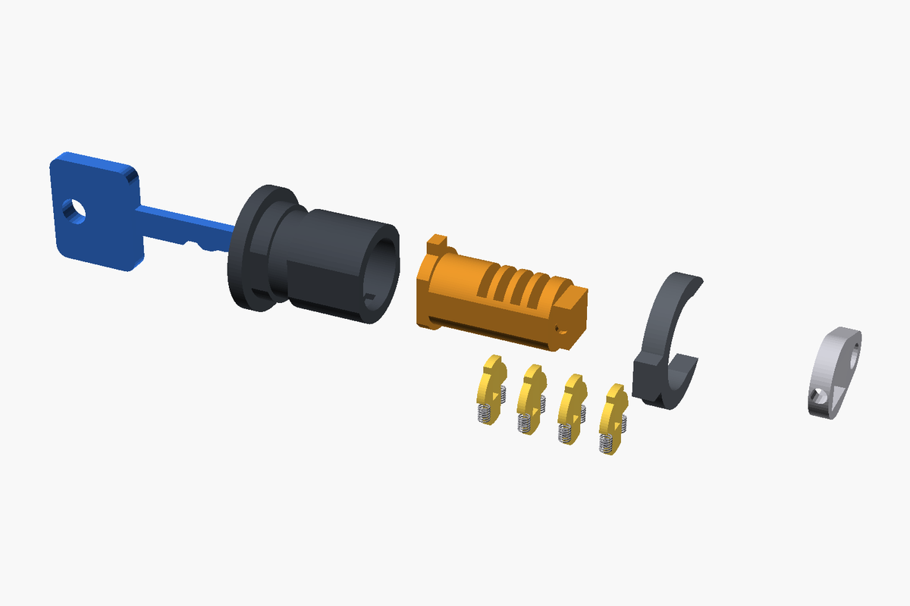
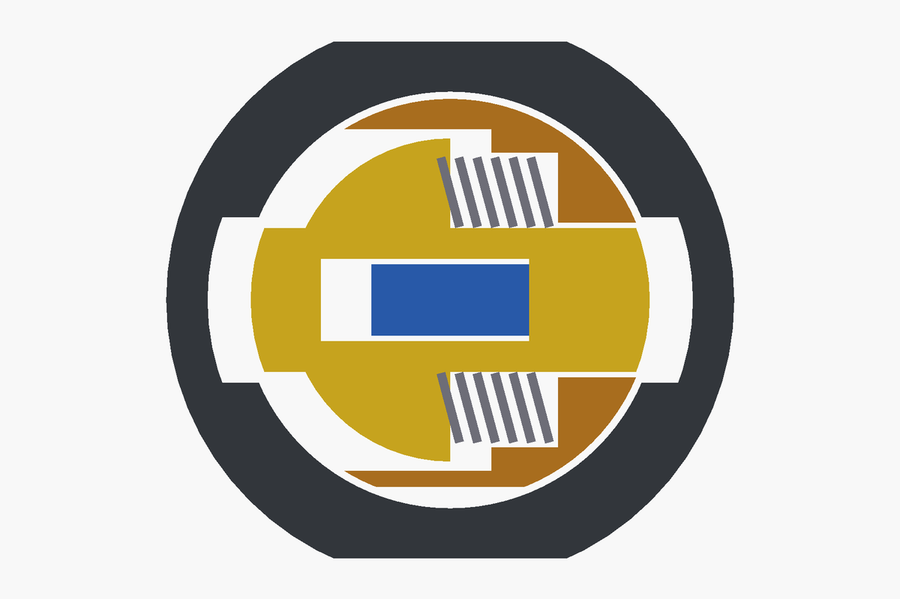

# Printed lock and key (optional)

A 3D-printable alternative to the store-bought 16 mm cam lock. It fits the **same dock**, so nothing else needs reprinting.

| | Store-bought cam lock (default) | Printed lock |
|---|---|---|
| Security | Better: metal wafers, hardened body | **Casual-theft deterrent only.** It can be forced or drilled |
| Key | Comes with 2 keys | Your own code; print spare keys any time |
| Work | Drill the lock's cam for the crank pin | No drilling; print, add 8 small springs, assemble |
| Parts cost | About ₹270 for the lock | About ₹250–450 (springs kit, a grub screw; the printing is tiny) |

Use it if you can't find a suitable quarter-turn lock, want your own key code, or want a lock you can rebuild. For the best theft protection, use a good store-bought lock.



## How it works

It is a **wafer lock**, the same mechanism as most store-bought cam locks.



*Cut through the second wafer, with the key in:*
- **body:** dark grey, D-shaped, with a channel at each side;
- **plug:** orange;
- **wafer:** yellow;
- **key:** blue, sitting in the wafer's window;
- **springs:** grey, pushing on the wafer's shoulders.

**Without the key:**
- Two small springs push each of the 4 flat wafers 0.9 mm out of the plug into a channel in the body. The plug can't turn.

**With the right key:**
- Each wafer's window rests on its cut of the key, which holds the wafer exactly flush with the plug.
- The plug and key then turn a quarter turn. The plug's printed crank drives the same yoke and steel bolt as before.

**With a wrong key:** any cut one step (0.5 mm) off leaves that wafer poking 0.5 mm out on one side or the other, so the plug stays locked.

**The key comes out only when locked:** the body has channels only at the locked position, so at any other position the wafers can't move to let the key out. This matches the store lock's "key removable only when locked".

**Limits:** a quarter-turn stop on the plug's head limits the turn to exactly 90°, from unlocked (crank pin toward the rider) to locked (pin straight up, over top dead centre).

## Design choices, and what they're based on

- **Wafers, not pin tumblers:**
  - Every part that sets the code (the wafers and the key) is **flat**, so it prints flat in the XY plane, where FDM is most accurate.
  - Pin tumblers need tiny printed cylinders, which print poorly.
  - Disc-detainer locks are spring-free but need precise angular cuts and a complex key.
- **Metal springs:** a university project that set out to print a complete lock found its printed springs gave almost no force, and fell back to metal ones ([UW–Madison, Functional Lock and Key](https://additive-mfg.me.wisc.edu/?p=2515)). So the wafers use 8 small metal springs, and everything else is printed.
- **Printing rules:**
  - Print every lock part at a fixed **0.15 mm** layer height, including the first layer, with elephant's-foot compensation on.
  - This follows an open-source collection of printed locks ([twanvl/locks](https://github.com/twanvl/locks)). That collection has no license, so none of its files or geometry are used here, only the general advice.
- **Tolerances:**
  - **Clearance values:** 0.2 mm radial clearance for turning parts (`plk_clear`), and 0.15 mm around each wafer in its slot (`plk_wclear`).
  - **Depth step:** cuts are 0.5 mm apart (`plk_step`). That is far bigger than the clearances, so an error of a tenth of a millimetre still opens with the right key, while a one-step error still locks.
  - **Test first:** printer fits vary, so print the fit test below before the final parts.
- **Same envelope as the store lock:** the body is the 16 mm D-shape (15.8 mm, 14.4 mm across the flats). The crank has the steel crank's outline and 7 mm pin radius. The checks below confirm it fits the existing dock.
- **Clip instead of a nut:** the body is held by a printed C-clip that snaps into a groove right behind the panel, like many store cam locks' retaining clips.
  - It goes into the pod's nut cavity from underneath.
  - A nut would have to slide over the body's rear end, which is too wide for a printable thread.

## Parts

STLs are in [`printed_lock/`](printed_lock/), already in print orientation. **Print them with your own code (see below).** The ones here use the example code `[2, 0, 1, 2]`, which everyone who downloads them shares.

| Part | File | Qty | How to print |
|---|---|---|---|
| Body | `plock_body.stl` | 1 | Flange down. 100 % infill (it's small), PETG or ASA |
| Plug | `plock_plug.stl` | 1 | Lying on its flat side, so the wafer slots print as accurate vertical walls. No supports |
| Wafers 1–4 | `plock_wafer_1.stl` … `plock_wafer_4.stl` (or `plock_wafers.stl`, all 4 in order) | 1 each | Flat. **They differ:** keep them in order, front (keyhole end) to back |
| Key | `plock_key.stl` | 1+ | Flat. 100 % infill. PETG, or PC / PA if you have it. Print spares |
| Clip | `plock_clip.stl` | 1 | Flat. PETG (it needs to flex a little to snap on) |
| Crank | `plock_crank.stl` | 1 | Flat, 100 % infill |

**Hardware:**
- 8 compression springs: 2 mm outside diameter, 0.2–0.3 mm wire, about 5 mm long. They are sold as mini compression-spring assortments ([example kit with 2 mm × 0.3 mm springs](https://www.cart2india.com/compression/unifizz-30-pcs-compression-springs-assortment-kitstainless-steel-springs-wire-diameter-0012od-008free-length-039-small-spring-assortment-for-home-repairs-machinery-construction-industrial/00000000004390075286)). At full compression each spring is 2.0 mm long, so with 0.3 mm wire it must have 6 coils or fewer. If a spring binds, snip a coil off.
- 1 M3 grub screw (set screw), 4–5 mm long. It holds the crank on the plug.
- 1 M3 heat-set insert, 3 mm long (in the crank, for the crank pin).
- The crank pin, as for the store lock: an M3 shoulder screw with a 4 mm shoulder, or an M3 screw with a 4 mm-OD spacer.

## Choose your key code

In `printed_lock.scad`, set `lock_code`: one digit per wafer, 0, 1 or 2, front to back.
- **Avoid all-equal codes** like `[1, 1, 1, 1]`.
- **Combinations:** 4 wafers with 3 depths give 81 codes.
- **Keep it private:** don't publish your own code or the STLs made with it.

Then export the parts:

```sh
openscad -D 'PART="plock_wafers"' -o plock_wafers.stl phone_dock_v0.5.scad
openscad -D 'PART="plock_key"'    -o plock_key.stl    phone_dock_v0.5.scad
# also: plock_body, plock_plug, plock_clip, plock_crank (these don't depend on the code)
```

To see the printed lock in the full assembly, set `lock_type = "printed"`.

## Fit test (do this first)

1. Print the body, plug, wafers and key.
2. **Plug in the body (no wafers):** push the plug into the body; it should turn freely. If it's tight, raise `plk_clear` by 0.05.
3. **Wafers in the plug:** each wafer should slide freely in its slot with a light push. If they stick, raise `plk_wclear` by 0.05, or lightly sand the wafers' edges.
4. **The key:**
   - With the wafers fitted (no springs yet), push the key in.
   - Every wafer should sit flush with the plug's surface: run a fingernail over them.
   - If they all stand proud the same way, the key is printing slightly over-size (or under-size). Adjust your printer's flow, or the key's dimensions.

## Assembly

1. **Wafers and springs:**
   - Put the plug on the bench. Drop 2 springs into each wafer's pockets.
   - Fit the wafers in order, front (keyhole end) to back, shoulders onto the springs.
   - Push the key fully in: it holds all the wafers flush.
2. **Plug into the body:** with the key in, slide the plug into the body from the front. Turn it to the locked position, with the plug head's lug at the end of its slot.
3. **Body into the dock:**
   - Push the body into the lock pod's D-shaped hole from outside.
   - From underneath (lock cover off), push the C-clip up into the groove right behind the panel, open side first, until it snaps on. Its tab points down.
   - To remove the lock later, pull the clip down by its tab.
4. **Crank:**
   - Press the M3 heat-set insert into the crank.
   - Slide the crank onto the plug's square drive, with its pin boss pointing up (locked).
   - Tighten the grub screw into the dimple on the drive.
   - Fit the crank pin through the yoke slot into the insert, as for the store lock.
5. **Test:**
   - Turn to unlocked (the bolt drops) and back to locked (the bolt rises).
   - Pull the key out: it should come out **only** when locked.
   - With the key out, the plug must not turn.
6. Refit the lock cover.

## Checked in CAD

These checks are built in as `PART="plock_check_*"` and were run on the default settings:

| Check | Result |
|---|---|
| Body and clip vs the dock (`plock_check_pod`) | No overlap: fits the unchanged dock |
| Crank and pin vs the dock and yoke, locked, half-way and unlocked (`plock_check_crank`) | No overlap |
| Right key, plug turned 0°, 45° and 90° (`plock_check_turn`) | No overlap: it turns |
| Wafers sliding in the plug: sprung out, flush, lifted (`plock_check_wafers`) | No overlap |
| Key vs plug (`plock_check_key`) | Touching only |
| **No key**, plug turned 8° (`plock_check_nokey`) | **Blocked** (1.7 mm³ overlap) |
| **Wrong key**, every wafer one step off, turned 8° (`plock_check_wrongkey`) | **Blocked** (0.6 mm³ overlap) |
| Wafers at the unlocked position, trying to move to let the key out | **Blocked**: the key comes out only when locked |
| Lock, key and flange vs the case and shoe, docked and while sliding on and off | No overlap |
| All parts | Watertight single bodies |

**CAD checks are not a physical test.** Print it, try it, and leave the store-bought lock as the option if the printed one doesn't work reliably on your printer.

## Limits and care

- **Security:** it stops someone walking off with the phone, not someone with a screwdriver or a drill. Keep the case on a tether until you trust it.
- **Weather:**
  - The keyhole lets water into the plug, so the springs should be stainless.
  - The pod's cover has a drain slot.
  - A rubber keyhole cover helps.
- **Heat:** PETG and ASA are fine in the sun. Avoid PLA.
- **Wear:** the key and wafers rub on each other. Print a spare key now, and re-print the wafers if the lock gets sloppy. A worn key is easy to replace; that is the advantage of a printed lock.
