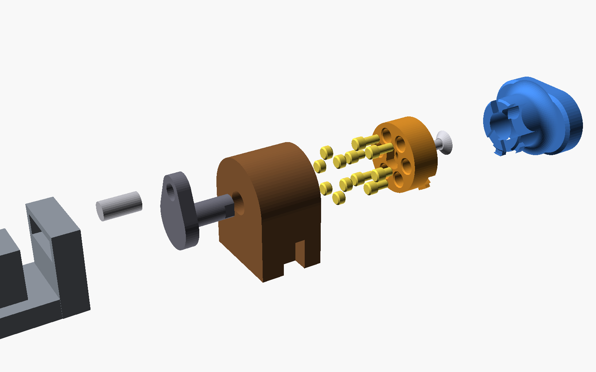
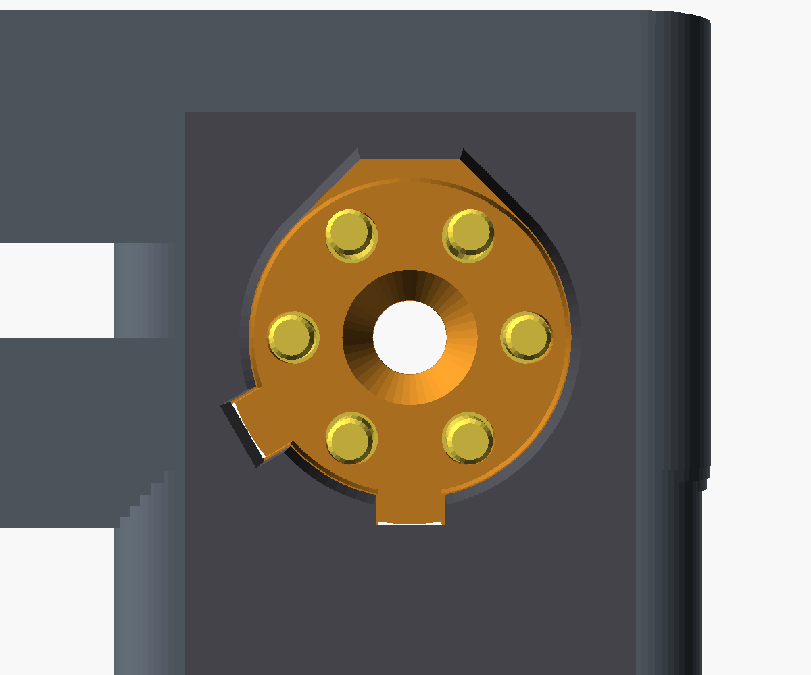
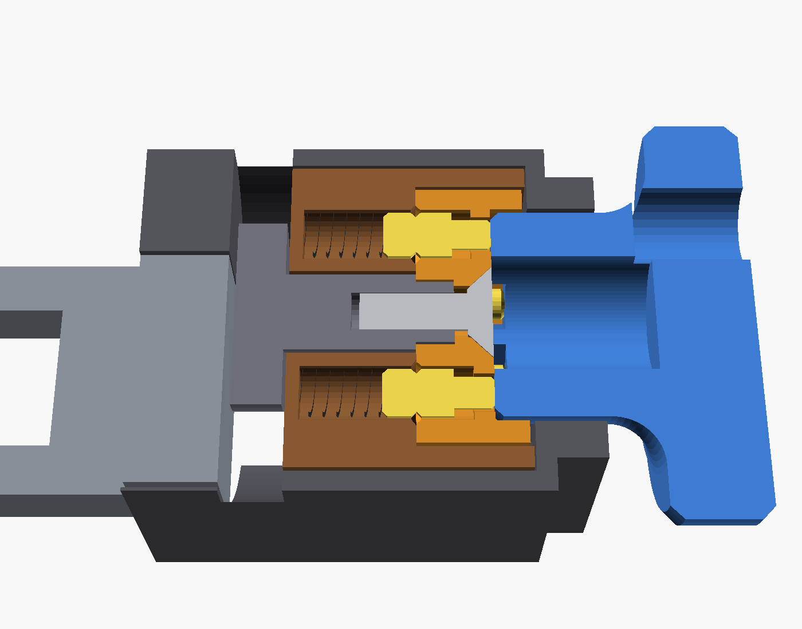
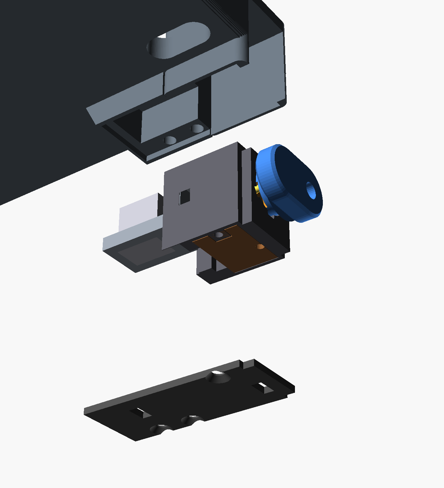

# Tubular key lock (optional, printed)

A pin-tumbler lock with a **round, hollow key**, like the ones on vending machines and bike locks, designed for 3D printing. You push the key in and turn it a quarter turn. It comes in its own lock cartridge (`lock_type = "tubular"`), so it fits the same lock bay as the store-bought cam lock, the printed push-key lock and the dial lock. It drives the store lock's own yoke (`lock_yoke`) and the same steel bolt, so the dock, the lock cover, the bolt and the strike are unchanged.

> **Checked in CAD, not yet printed or tested.** It is a deterrent: tubular locks can be picked by someone who knows how, and a printed lock can be forced. For the best security, use the store lock.



| | Store cam lock (default) | Printed push-key lock | **Tubular key lock** |
|---|---|---|---|
| Key | 2 metal keys, turn | chunky 6 × 10 mm bar, push | **13.5 mm printed tube, push and turn a quarter turn** |
| Codes | the lock's own | 81 (4 wafers × 3 depths) | **729 (6 pins × 3 depths)** |
| Printed parts | cartridge, yoke | cartridge, shuttle, 4 wafers, key, lifter | **cartridge, housing, plug, crank, key, 12 pins**, and the standard yoke |
| Hardware | the lock, a crank-pin screw | 4 springs | **6 springs, a 4 × 8 mm steel pin, an M3 × 8 countersunk screw** |
| Work | drill the lock's cam | no drilling | **no drilling** |

## Using it

Stand at the right-hand side of the bike, facing the keyhole.
- **To unlock:** push the key in with its two tabs at the bottom (the keyhole has two notches there, at 6 and 8 o'clock; the key fits only one way round), all the way, until it stops. Turn it **a quarter turn anticlockwise**. The bolt drops; slide the case off.
- **To lock:** with the case docked, turn the key back **clockwise** a quarter turn. The bolt rises into the case's strike. Now pull the key out.
- **The key comes out only when locked.** Turned, its tabs are behind the cartridge's face, so you can't walk away and leave it unlocked by mistake.



## How it works



- **The key** is a printed tube with **6 notches** in its end, each 0, 1 or 2 mm deep (your code), and two small **tabs** on its side.
- **The plug** (orange) turns inside the **housing** (brown). It has 6 holes on a circle, one per notch. In each sits a **key pin** (yellow): a short pin with a thin tip that sticks out of the plug's front face.
- Behind each hole, in the housing, is a **driver** (another short pin) and a **spring**.
- **With no key**, the springs push every driver half into the plug's holes. A driver straddling the gap between plug and housing stops the plug turning, like a pin through a hinge.
- **With the right key**, pushed in until its end rests on the plug's front face, each notch pushes its key pin back by just the right amount. Every key pin's back end, and every driver's front end, meets exactly at the gap between the plug and the housing (the **shear line**). Nothing crosses the gap, so the plug turns.
- **A wrong cut** (one step, 1 mm, off) leaves that pin or its driver 1 mm across the gap, so the plug still can't turn.
- **The crank:** a printed crank on the back of the plug turns with it. Its steel pin sits in the yoke's sideways slot, exactly as the store lock's crank does: a quarter turn pulls the yoke and the steel bolt 7 mm down.
- **Pushing the bolt down can't open it:** locked, the crank pin is at top dead centre (straight up), so a push on the bolt presses straight down on the crank, with no turning force.
- **Stops:** a lug on the plug runs in a 90° pocket in the housing. The key's twist at each end of the turn goes into the housing, not into the crank's shaft.

## Design choices, and what they're based on

- **Why a tube:** the push-key lock avoided turning because twisting a thin flat printed blade snaps it. A tube is the strongest shape against twisting: even a hard 0.5 N·m twist on the bow stresses this tube's walls to only about 1 MPa, against PETG's 20 MPa or more between layers. The key sticks out only 3 mm beyond the lock face before the bow, with a 3 mm fillet where it meets the bow.
- **Two tabs take the twist:** the key turns the plug through two 2.4 × 1.8 mm tabs. At that hard 0.5 N·m twist they carry about 8 MPa; turning the lock normally needs less than a tenth of that (the springs' drag and the yoke's weight). The plug's stops then take the twist into the housing.
- **Both tabs stay low:** the top of the keyhole is pointed, so it prints without sagging (the cartridge prints standing, with the keyhole lying on its side). A pointed top is wider than a tab, so a tab there could slip out. The tabs sit at 6 and 8 o'clock, and the quarter turn takes them to 3 and 5 o'clock: always in the keyhole's round lower half. Being one pin gap apart, they match the notches only the right way round.
- **Print orientation sets the accuracy:**
  - The key prints standing on its bow with the cut end at the top, so the notch depths are exact layer heights (1 mm = 5 layers at 0.2 mm).
  - The housing, the plug and the pins print standing on end, so all their holes and circles come out round. Round parts printed lying down sag at the top; that is why the housing is a separate part instead of a hole in the cartridge (which prints standing up, with the lock's axis lying down).
- **1 mm steps, 3 depths:** forgiving to print, and one step wrong still blocks by 1 mm. More depths would need longer springs: a key with the wrong cut pushes a pin up to 2 mm further back, and the spring must still have room. With 3 depths, a spring is never squeezed below 2.9 mm (an 8-coil spring of 0.3 mm wire closes solid at 2.4 mm). There is no more room: the lock fills the bay from the face plate to the yoke.
- **Metal springs:** printed springs give almost no force, so the 6 springs are bought, as for the push-key lock.
- **Steel crank pin:** a 4 × 8 mm steel dowel pin, pressed into the printed crank. The housing's back face sits 0.2 mm in front of it, so it can't work loose forward; backwards, it stays in the crank even if it slides to the bay's back wall.
- **General ideas only:** the pin-tumbler and tubular-key principles are those of ordinary store locks. No third-party lock designs or files are used.

## Parts

STLs are in [`tubular_lock/`](tubular_lock/), already in print orientation. **Print the key and the key pins with your own code (see below).** The ones here use the example code `[1, 0, 2, 2, 0, 1]`, which everyone who downloads them shares.

| Part | File | Qty | How to print |
|---|---|---|---|
| Cartridge | `tl_cartridge.stl` | 1 | Standing on its bottom face, as it sits in the dock. It replaces `lock_cartridge`; the dock is the standard `dock_base` (or `modular/receiver`) |
| Housing | `tl_housing.stl` | 1 | Standing on its back face, 100 % infill |
| Plug | `tl_plug.stl` | 1 | Standing on its back face, 100 % infill, 0.12–0.15 mm layers |
| Crank | `tl_crank.stl` | 1 | Flat, shaft up, 100 % infill, PETG or PA12 |
| Key | `tl_key.stl` | 1+ | On its bow, cut end up, 100 % infill, 0.2 mm layers (or 0.1 mm), PETG or PC/PA. Print a spare |
| Pins | `tl_pins.stl` | 1 set | Standing, 0.1–0.12 mm layers. Top row: key pins 1–6, left to right (they differ). Bottom row: 6 drivers (all the same) |
| Yoke | `lock_yoke.stl` (the store lock's) | 1 | As for the store lock |

All in PETG (or ASA). Elephant's-foot compensation on.

**Hardware:**
- 6 compression springs: **3 mm outside diameter, 0.3 mm wire, about 8 mm long, 8 coils or fewer**, stainless steel.
- 1 steel dowel pin **4 × 8 mm** (or 8 mm cut from 4 mm silver-steel rod), the crank pin.
- 1 **M3 × 8 countersunk screw** (ISO 10642, 6 mm head): holds the crank to the plug.
- The steel bolt, the bearing block, the standard `lock_cover` and its 3 screws, as for the store lock.
- A little grease (holds the pins in place while you assemble; use a light one).
- **Not needed:** the cam lock, the crank template, the drill.

## Choose your key code

In `tubular_lock.scad`, set `tl_code`: one digit per pin, 0, 1 or 2, pin 1 first.
- **Which pin is which:** looking at the keyhole, with its two notches at 6 and 8 o'clock, pin 1 is at 5 o'clock, then anticlockwise: pin 2 at 3, pin 3 at 1, pin 4 at 11, pin 5 at 9 and pin 6 at 7 o'clock.
- **Avoid** all-equal codes and codes with only one non-zero digit.
- **Combinations:** 6 pins with 3 depths give 729 codes.
- **Keep it private:** don't publish your own code or the STLs made with it.

Then export the key and the pins (the other parts don't depend on the code):

```sh
openscad -D 'lock_type="tubular"' -D 'PART="tl_key"'  -o tl_key.stl  phone_dock_v0.5.scad
openscad -D 'lock_type="tubular"' -D 'PART="tl_pins"' -o tl_pins.stl phone_dock_v0.5.scad
# and the rest: tl_housing, tl_plug, tl_crank, and the cartridge:
openscad -D 'lock_type="tubular"' -D 'PART="lock_cartridge"' -o tl_cartridge.stl phone_dock_v0.5.scad
```

A key pin for a digit d is 4.6 + d mm long (2.2 mm body, 2.4 + d mm tip). To see the lock in the full assembly, set `lock_type = "tubular"`.

## Fit test (do this first)

Print the housing, the plug, the pins and the key.
1. **Plug in the housing:** with no pins in, the plug should turn freely in the housing's bore and drop out under its own weight. If it rubs, sand the plug lightly; if your printer's holes come out small, raise `tl_bore_r` by 0.05 and reprint the housing.
2. **Pins:** each pin should slide freely in its hole in the plug and the housing. If a hole is tight, run a **3.5 mm drill** through it by hand (the thin front holes in the plug: 2.5 mm).
3. **The key:** it should slide into the plug's front and sit flat on the plug's face, with the tabs in their slots.
4. **The code:** put the key pins in the plug from behind, tip first, with the key in. Lay a straight edge across the plug's back face: every key pin's end should be flush with it. If they all stand a little proud or sunk together, your printer is printing the key or the pins slightly long or short; adjust its flow or Z steps.

## Assembly

On the bench first, then into the dock.
1. **Crank:** press the 4 mm steel pin into the crank's hole, flush with its front face (the side with the shaft), with a drop of retaining compound.
2. **Drivers and springs:** stand the housing on its back face. Drop a spring into each of the 6 chambers, then a driver on top, with a dab of grease.
3. **Key pins:** put the key in the plug. Turn the plug over (key underneath) and drop each key pin into its hole, tip first. They are different lengths (4.6, 5.6 or 6.6 mm): with the key in, each one sits **flush with the plug's back face** only in its own hole. Seen from the back the order is mirrored, so check each one with a straight edge rather than counting. A dab of grease holds them.
4. **Plug into the housing:** with the key still in, push the plug into the housing's bore, its lug in the lug pocket and its holes over the drivers. Press the springs down until the plug sits on the bottom of the bore.
5. **Crank:** from the back, push the crank's shaft through the housing into the plug's socket. Hold the housing as it sits in the dock (square end down) with the plug's tab slots at the bottom: the crank pin must point straight up. Drive the M3 × 8 countersunk screw in from the front, through the plug's face (take the key out for this; the drivers now hold the plug still). Now the unit holds together.
6. **Into the cartridge:** push the unit up into the cartridge from below: the housing into its pocket, the crank into the slot behind it.
7. **Yoke and bolt:** slide the yoke onto the crank pin from the cartridge's open back, and press the steel bolt into the yoke with retaining compound, as for the store lock.
8. **Into the dock:** push the cartridge up into the bay from below, the bolt through the guide in the pod's roof.
9. Screw on `lock_cover`: 2 screws into the dock and 1 into the boss in the cartridge. The cover holds the housing up too.
10. **Test:** key in, turn anticlockwise: the bolt drops. Turn back: the bolt rises, and the key comes out. With the key out, try to turn the plug with a small screwdriver in a tab slot: it must not turn. Try to pull the key out while unlocked: it must not come out.



## Checked in CAD

These checks are built in as `PART="tl_check_*"` (run with `lock_type="tubular"`). They were run on both the one-piece base and the modular dock.

| Check | Result |
|---|---|
| Housing, plug, pins, crank, steel pin, screw, yoke and key vs the cartridge, at 0, 25, 50, 75 and 100 % of the turn (`tl_check_cart`) | No overlap |
| The same, plus the bolt, vs the dock (`tl_check_dock`) | No overlap |
| The same vs the lock cover (`tl_check_cover`) | No overlap (the housing sits on it) |
| The parts against each other, at 5 points of the turn (`tl_check_parts`) | Touching only |
| The key's bow vs the case shell, back cover and shoe, locked and unlocked (`tl_check_case`) | No overlap |
| **Right key**, plug turned 3° and 45° (`tl_check_rightkey`) | Touching only: it turns |
| **No key**, plug turned 3° (`tl_check_nokey`) | **Blocked** (0.49 mm³) |
| **Wrong key**: each pin one step off on its own, and all of them (`tl_check_wrongkey`, `tl_wrong_i = 0..5`) | **Blocked**, every one (0.06 mm³ for a single pin at 3°) |
| **Key pulled out while unlocked** (`tl_check_keyout`) | **Blocked** (2.05 mm³): the tabs hit the cartridge |
| **Key put in the wrong way round**, turned 60°, 120°, 180°, 240° or 300°, half in (`tl_check_keyangle`) | **Blocked** at each angle (2.9–5.7 mm³) |
| **Plug turned 3° past either end** (`tl_check_stops`) | **Blocked** (0.19 mm³): the lug hits its pocket's end |
| **Bolt pushed down while locked** (`tl_check_backdrive`) | **Blocked** (1.86 mm³): the yoke sits on the crank pin at top dead centre |
| Housing pushed back 0.3 mm into the cartridge | **Blocked** (16.4 mm³): its back corners sit on the cartridge (the key's push goes into the dock) |
| All parts | Watertight single bodies (the pins file: 12 separate pins) |

**CAD checks are not a physical test.** Print it, try it, and keep the store-bought lock as the option if the printed one doesn't work reliably on your printer.

## Limits and care

- **Security:** it stops someone walking off with the phone, not someone with tools. Tubular locks can be picked by someone who knows how. Keep the case on a tether until you trust it.
- **Weather:** rain can get in at the keyhole. A drain runs from the bottom of the housing's bore through the lock cover. Use stainless springs, and a rubber plug over the keyhole helps.
- **Heat:** PETG and ASA are fine in the sun. Avoid PLA.
- **Wear:** the key's notches and the pin tips rub. Print a spare key now, and reprint the key pins if the lock gets sloppy.
